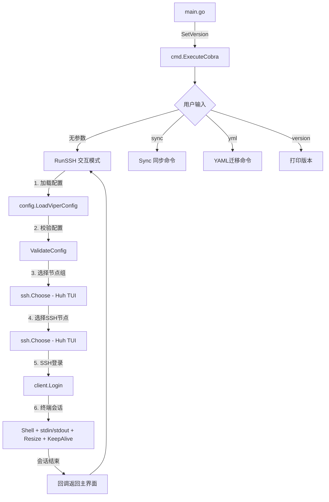
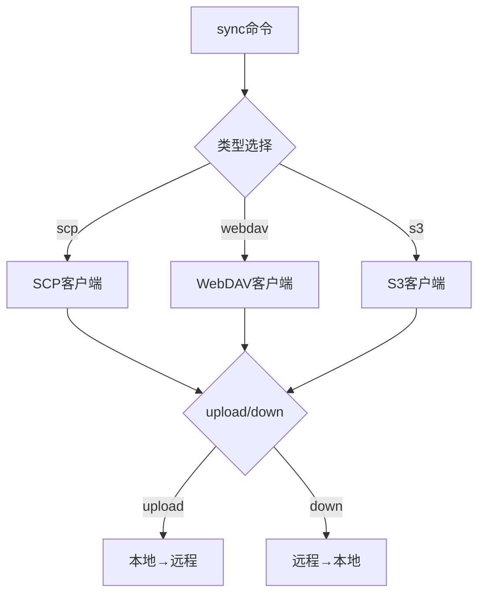
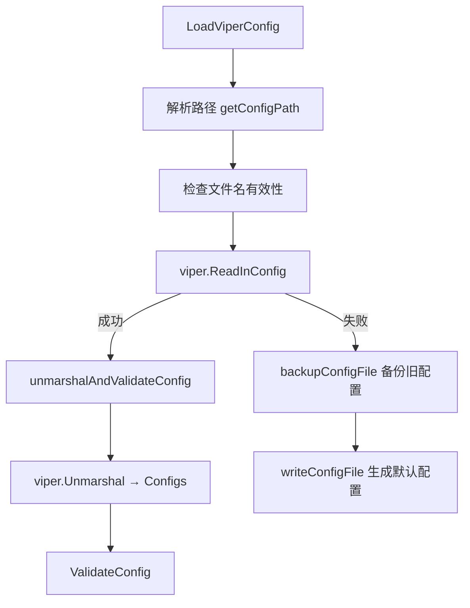

# mysshw — Project Analysis & AI Agent Guide

## 1. Project Overview

**mysshw** 是一个免费、开源的 SSH 命令行客户端工具，使用 Go 语言编写（Go 1.23+）。它是原 `sshw` 项目的现代化重写，将 YAML 配置升级为 TOML 格式，并引入了更清晰的包架构和更丰富的功能。

- **作者**: DenysGeng (cnphp@hotmail.com)
- **许可证**: MIT
- **仓库**: https://github.com/cnphpbb/mysshw
- **支持平台**: Linux, macOS, Windows

---

## 2. Tech Stack

| 类别 | 技术 | 用途 |
|------|------|------|
| 语言 | Go 1.23+ | 主开发语言 |
| 构建 | Mage (`github.com/magefile/mage`) | Go 风格的构建系统 |
| CLI框架 | Cobra (`github.com/spf13/cobra`) | 命令注册与参数解析 |
| 配置 | Viper (`github.com/spf13/viper`) + GuanceCloud TOML | 配置文件加载与解析 |
| TUI组件 | Charm Huh (`github.com/charmbracelet/huh`) | 交互式选择菜单 |
| 终端样式 | Lip Gloss (`github.com/charmbracelet/lipgloss`) | 彩色终端输出 |
| SSH协议 | `golang.org/x/crypto/ssh` | SSH 2.0 客户端实现 |
| S3 | MinIO (`github.com/minio/minio-go/v7`) | S3 配置同步 |
| WebDAV | `github.com/studio-b12/gowebdav` | WebDAV 配置同步 |
| 测试 | Testify (`github.com/stretchr/testify`) | 单元测试断言 |

---

## 3. Project Structure

```
mysshw/
├── main.go                    # 入口：设置版本信息，调用 cobra
├── mage.go                    # Mage 构建入口
├── magefile.go                # 构建/打包/测试/清理 任务
├── go.mod / go.sum            # Go 模块依赖
├── AGENTS.md                  # AI 代理指南（本文件）
├── readme.md / readme.zh.md   # 中英文文档
├── TODO.md                    # 项目待办列表
├── LICENSE                    # MIT 许可证
├── docker-compose.yml         # Docker 编译环境
├── .gitignore                 # Git 忽略规则
│
├── cmd/                       # CLI 命令层（Cobra）
│   ├── cobra_cmd.go           # 根命令：flag注册、子命令注册
│   ├── runssh_cmd.go          # 主交互循环：读取配置 → 选择节点 → SSH登录
│   ├── sync_cobra.go          # sync 命令：SCP/WebDAV/S3 上传下载
│   ├── version_cobra.go       # version 命令：打印版本信息
│   ├── yml_cmd.go             # yml 命令：sshw YAML → mysshw TOML 迁移
│   ├── init_cmd.go            # init 命令：首次运行向导
│   ├── list_cmd.go            # list 子命令：AI 友好的节点列表
│   ├── exec_cmd.go            # exec 子命令：非交互 SSH 命令执行
│   ├── copy_cmd.go            # copy 子命令：SCP 文件传输
│   ├── tunnel_cmd.go          # tunnel 子命令：本地/反向/SOCKS5 端口转发
│   ├── hostkey_cmd.go         # hostkey 子命令：known_hosts 管理
│   ├── completions_cmd.go     # completions 子命令：动态输出 CLI Schema (JSON)
│   ├── ping_cmd.go            # ping 子命令：TCP 连通性检测
│   ├── info_cmd.go            # info 子命令：远程系统信息收集
│   ├── mcp_cmd.go             # mcp 子命令：MCP server (stdio)
│   ├── output.go              # -o plain|json 全局输出器
│   ├── errors.go              # BSD sysexits 退出码 + ExitError
│   ├── helpers.go             # 共享 helpers (duration 解析等)
│   └── messages.go            # 全局字符串常量
│
├── config/                    # 配置管理层
│   ├── config.go              # LoadViperConfig / LoadConfig 主入口
│   ├── model_config.go        # 数据结构定义 + 默认TOML配置模板
│   ├── utils.go               # 路径解析（家目录、跨平台兼容）
│   ├── validated_config.go    # 配置校验（同步配置、节点、SSH参数）
│   ├── backup_config.go       # 配置文件自动备份与恢复
│   └── config_test.go         # 配置路径测试
│
├── ssh/                       # SSH 客户端层
│   ├── client.go              # SSH连接、Terminal会话、窗口自适应、KeepAlive
│   ├── cmd.go                 # 交互式节点选择（Huh TUI）
│   ├── messages.go            # SSH 相关字符串常量
│   └── client_test.go         # 路径展开测试
│
├── auth/                      # 认证方式层
│   └── auth.go                # 密码/密钥/密钥+口令/SSH Agent 认证
│
├── scp/                       # SCP 文件传输协议
│   ├── scp.go                 # 客户端工厂函数
│   ├── client.go              # 核心传输逻辑（上传/下载/超时）
│   ├── configured.go          # Builder 模式配置器
│   ├── protocol.go            # SCP 协议响应解析（OK/Warning/Error）
│   └── utils.go               # CopyN 辅助函数
│
├── s3/                        # S3 配置同步
│   └── client.go              # MinIO 客户端：上传/下载/列出/删除
│
├── webdav/                    # WebDAV 配置同步
│   └── client.go              # WebDAV 客户端：上传/下载/列出/删除
│
├── example/
│   └── mysshw.toml            # 示例配置文件
│
└── dist/                      # 构建输出目录（gitignored）
```

---

## 4. Architecture & Data Flow

### 4.1 主流程



### 4.2 同步功能流程



### 4.3 配置加载流程



---

## 5. 核心数据结构

| 结构体 | 文件 | 说明 |
|--------|------|------|
| `Configs` | `model_config.go` | 顶层配置：`cfg_dir` + `SyncInfo` + `[]Nodes` |
| `SyncInfo` | `model_config.go` | 同步配置：`type`, `remote_uri`, `remote_path`, 各协议子配置 |
| `SCPConfig` / `S3Config` / `WebDAVConfig` | `model_config.go` | 各协议的认证参数 |
| `Nodes` | `model_config.go` | 节点组：`groups` + `[]*SSHNode` |
| `SSHNode` | `model_config.go` | SSH节点：`name`, `alias`, `host`, `user`, `port`, `password`, `keypath`, `passphrase` |

**包间依赖关系**：

```
main → cmd → config, ssh
         cmd → config, ssh, scp, s3, webdav, auth
         ssh → config (huh, lipgloss)
         scp → auth (crypto/ssh)
         s3 → config (minio)
         webdav → config (gowebdav)
```

---

## 6. 关键路径分析

### 6.1 SSH 连接 (`ssh/client.go`)
- **认证顺序**: 密钥优先 → 密码 → 交互式键盘认证
- **密码为空时**: 提示用户手动输入
- **连接失败回退**: 若"无支持的认证方式"，提示输入密码重试
- **终端特性**: Raw模式、窗口大小自适应（每秒检测）、KeepAlive（10秒间隔）
- **会话退出**: 会话结束后回调 → 返回主界面（无限循环）

### 6.2 交互式选择 (`ssh/cmd.go`)
- 使用 `charmbracelet/huh` 实现两级菜单（组 → 节点）
- 支持返回上级（"返回上级"虚拟节点）
- Lip Gloss 着色：别名黄色、主机蓝色、父节点灰色

### 6.3 配置同步 (`cmd/sync_cobra.go`)
- 三协议统一接口：`upload` / `down` 操作
- SCP 通过 SSH 通道传输
- WebDAV/S3 通过对应 SDK

### 6.4 YAML 迁移 (`cmd/yml_cmd.go`)
- 解析 `sshw` 的 YAML 格式
- 转换为 TOML 追加到当前配置文件
- 支持字段：name, alias, host, user, port, password, keypath, passphrase

### 6.5 跨平台兼容
- 路径处理统一将 `\` 替换为 `/`
- `~` 和 `$HOME` 路径展开
- Windows 终端 Raw 模式特殊处理（stdout fd 替代 stdin fd）
- Windows 退出不支持 Ctrl+D，改用 Ctrl+C

---

## 7. 构建与发布

### 7.1 Mage 任务

| 命令 | 说明 |
|------|------|
| `mage build` | 当前平台开发构建 |
| `mage pack` | 全平台交叉编译 + tar.gz/zip 打包 + checksum |
| `mage test` | 运行测试 + 覆盖率报告 |
| `mage clean` | 清理 dist/ |
| `mage version` | 打印版本信息 |
| `mage help` | 帮助信息 |

### 7.2 版本号
- 自动生成：`v{YY.MM.DD}` 格式（如 `v25.06.12`）
- 通过 `-ldflags` 注入：`Version`, `Build`(branch+commit), `BuildTime`
- 交叉编译目标：darwin/amd64, darwin/arm64, freebsd/amd64, freebsd/arm64, linux/amd64, linux/arm64, windows/amd64, windows/arm64

### 7.3 Docker 构建
```bash
docker compose -p base -f ./docker-compose.yml up -d
docker exec -it build_go bash
cd /app
mage build
```

---

## 8. TODO / 未完成功能

| 优先级 | 功能 | 涉及包 |
|--------|------|--------|
| 低 | 主界面支持主题 | ssh/cmd.go |
| 低 | 配置文件加密 | config/ |
| 低 | config 子命令 (节点 CRUD) | 新文件 cmd/config_cmd.go |
| 低 | export/import (配置可移植性) | 新文件 cmd/import_cmd.go |
| 中 | exec --follow (流式输出) | cmd/exec_cmd.go |

## 8.1 已完成 ✅ MCP Server (Phase 1+2+3)

| 状态 | 任务 | 涉及文件 |
|------|------|---------|
| ✅ | `mcp` 子命令: stdio transport, 启动 MCP server | `cmd/mcp_cmd.go` |
| ✅ | `ssh_list_nodes` tool: 列出节点 (走 mysshw list -o json) | `cmd/mcp_cmd.go` |
| ✅ | `ssh_exec` tool: 执行命令 (走 mysshw exec -o json, 支持 alias 匹配) | `cmd/mcp_cmd.go` |
| ✅ | `ssh_copy` tool: SCP 传输 (走 mysshw copy -o json) | `cmd/mcp_cmd.go` |
| ✅ | `ssh_hostkey_list/show/remove/update/audit` tool: known_hosts 管理 | `cmd/mcp_cmd.go` |
| ✅ | `ssh_completions` tool: 动态 CLI schema 查询 | `cmd/mcp_cmd.go` |
| ✅ | 工具 schema 静态注册, 不暴露 password/passphrase/env 变量名 | `cmd/mcp_cmd.go` |
| ✅ | ExitError → MCP isError + 退出码透传 | `cmd/mcp_cmd.go::runSubcommandCaptured` |
| ✅ | 30+ 个单元测试 (tool schema + handler + alias/dry-run/error/state 隔离) | `cmd/mcp_cmd_test.go` |
| ✅ | 集成验证: JSON-RPC over stdio 端到端 (initialize / tools/list / tools/call) | 手工测试 |

## 8.2 已完成 ✅ ping 子命令

| 状态 | 任务 | 涉及文件 |
|------|------|---------|
| ✅ | `ping` 子命令: TCP 端口连通性检测 (不需 ICMP/root) | `cmd/ping_cmd.go` |
| ✅ | 单节点 / 批量 / 直接 host 三种入口 | `cmd/ping_cmd.go` |
| ✅ | JSON 输出: reachable/latency_ms/attempts/error | `cmd/ping_cmd.go` |
| ✅ | --node/--alias/--host 互斥 (MarkFlagsMutuallyExclusive) | `cmd/ping_cmd.go` |
| ✅ | 单元测试: 本地连接/超时/无效域名/count/JSON shape | `cmd/ping_cmd_test.go` |

## 8.3 已完成 ✅ info 子命令

| 状态 | 任务 | 涉及文件 |
|------|------|---------|
| ✅ | `info` 子命令: 远程节点系统信息收集 | `cmd/info_cmd.go` |
| ✅ | 字段: hostname/os/kernel/arch/cpu/memory/disk/uptime | `cmd/info_cmd.go` |
| ✅ | 跨平台: Linux (/proc) + macOS (sysctl) | `cmd/info_cmd.go` |
| ✅ | 并发采集 (10 条命令并行, semaphore 控制) | `cmd/info_cmd.go` |
| ✅ | 单元测试: humanDuration/humanBytes/parseBootTimeEpoch/JSON shape | `cmd/info_cmd_test.go` |

---

## 9. 开发指南（AI 代理注意事项）

### 9.1 添加新命令
1. 在 `cmd/` 下创建文件，使用 `cobra.Command`
2. 在 `cmd/cobra_cmd.go` 的 `init()` 中用 `rootCmd.AddCommand()` 注册
3. 如需新配置字段，更新 `config/model_config.go` 的结构体

### 9.2 添加新的同步协议
1. 在根目录创建新包（如 `webdav/`, `s3/`）
2. 实现基于 `config.SyncInfo` 的客户端
3. 在 `config/validated_config.go` 添加类型校验
4. 在 `cmd/sync_cobra.go` 添加 case 分支

### 9.3 AI Agent 集成

mysshw 提供 **2 种 AI Agent 集成模式**，详见 `examples/`：

| 文档 | 模式 | 推荐度 |
|------|------|--------|
| `examples/mcp-integration.md` | MCP (stdio transport), 9 个工具 | **首选** |
| `examples/ai-agent.md` | CLI subprocess + `-o json` | 备选 |

**修改 AI 集成文档时**:
- MCP 工具定义变更 → 同步更新 `cmd/mcp_cmd.go` 描述 + `examples/mcp-integration.md`
- 子命令新增/改名 → 同时更新 `ai-agent.md` 中的 Python SDK 示例
- 退出码语义变更 → 同时更新 `mcp-integration.md` § 3.2 和 `ai-agent.md` § 2.1

### 9.4 配置变更
- 所有配置结构体在 `config/model_config.go`
- 默认配置模板也在同一文件 `DefaultTomlConfig` 常量
- 校验逻辑在 `config/validated_config.go`

### 9.4 跨平台注意事项
- 使用 `runtime.GOOS` 判断平台
- 统一路径分隔符为正斜杠 `/`
- 使用 `filepath.Join` 处理最终路径拼接
- Windows 终端特殊处理：stdout fd 用于 `term.GetSize`

### 9.5 测试
- 使用 `testify/assert` 写测试
- 测试文件与被测文件同包
- 命令：`mage test` 或 `go test -v ./...`

### 9.6 代码风格
- 注释：中文注释为主（因为作者是中文母语者）
- 错误处理：`fmt.Errorf("mysshw:: %v", err)` 格式
- 导出函数有英文注释，内部函数有中英文混合注释

### 9.7 Git Commit 规范

#### 提交频率
- AI 代理应当在完成一个**独立、可工作的功能点或修复**后进行提交，而非等待所有任务完成
- 避免堆积大量未提交的更改，每个提交应聚焦单一职责
- 不要擅自执行 `git commit`，除非用户明确要求

#### Commit Message 格式
- 使用中文编写（与项目注释语言保持一致）
- 建议使用如下类别前缀：

| 前缀 | 说明 | 示例 |
|------|------|------|
| `feat:` | 新功能 | `feat: 添加 WebDAV 配置同步支持` |
| `fix:` | 修复 Bug | `fix: 修复 Windows 平台路径解析错误` |
| `refactor:` | 代码重构 | `refactor: 重构 SSH 认证逻辑` |
| `docs:` | 文档变更 | `docs: 更新 README 使用说明` |
| `style:` | 代码格式/样式 | `style: 调整 import 顺序` |
| `test:` | 测试相关 | `test: 添加路径展开单元测试` |
| `chore:` | 构建/工具/依赖 | `chore: 升级 minio-go 依赖版本` |

#### 示例
```
feat: 新增 S3 配置文件同步功能

- 支持 MinIO / RustFS / 云平台 S3
- 实现上传、下载、列出、删除操作
- 配置校验支持 S3 类型参数检查
```

#### 禁止行为
- 禁止提交未完成的、会导致编译失败的代码
- 禁止提交包含敏感信息（密码、密钥、token 等）的文件
- 禁止提交 IDE/编辑器配置文件（`.idea/`, `*.swp`, `.vscode/` 等）
- 禁止提交大型二进制文件到仓库中

#### Tag 与 Changelog 流程

每次发布新 tag 时 **必须** 生成对应的 `changelog.${tag}.md` 文档并提交：

1. **生成时机**：`git tag -a ${tag}` 之后立即生成，**先 commit changelog 再 push tag**
2. **文件名**：严格使用 `changelog.${tag}.md` 格式（如 `changelog.v26.06.13.2.md`）
3. **内容来源**：`git log ${prev_tag}..${new_tag} --oneline` 列出所有提交
4. **格式建议**：
   ```markdown
   # Changelog ${tag} (YYYY-MM-DD)

   > 简述本次发布的核心变化（1-2 句）

   ## ✨ 新功能
   - feat: ... (#PR)

   ## 🐛 修复
   - fix: ...

   ## 🔧 重构 / 🧪 测试 / 📝 文档 / 🏠 构建
   - ...

   ## 📊 统计
   - N 个 commit, +X / -Y 行
   - 新增 N 个测试用例
   ```
5. **commit 规范**：
   ```
   docs: 添加 ${tag} changelog
   ```
6. **推送顺序**：先 `git push origin gh-dev`，再 `git push origin ${tag}`
7. **changelog 文件永久入库**，作为发布历史档案（不放入 `.gitignore`）

反面例子：直接 `git tag && git push --tags`，不写 changelog — **禁止**。

#### 分支与 Tag 分类

**只有 `main` 分支上的 tag 才是「版本发布」**。其他分支的 tag 允许但**不是**版本发布。

| 分支 | 允许打 tag? | 视为版本发布? | 必须 changelog? | 格式要求 |
|------|:-----------:|:--------------:|:---------------:|---------|
| `main` | ✅ | ✅ 是 | ✅ 必须 | 语义化版本 (e.g. `v26.06.13.2`) |
| `gh-dev` / 其他 | ✅ | ❌ 否 | ❌ 不需要 | 自由 (e.g. `snapshot-2026-06-13`, `rc-1`, `feature-x-v0.1`) |

**非 main 分支 tag 的用途示例**：
- 标记开发进度：`gh-dev` 上 `git tag snapshot-2026-06-13` 用于回溯
- 预发布：`feature-x` 上 `git tag rc-1` 给测试团队用
- 内部里程碑：`git tag milestone-M3` 标记阶段完成

**禁止**：
- ❌ 在 `gh-dev` 等非主分支打 `vX.Y.Z` 格式的 tag — 会误导用户以为是正式发布
- ❌ 把非主分支 tag 推到公开远端并写 changelog — 浪费审计精力
- ❌ 删除 main 分支的 tag 后重新打（应使用新版本号）

**反面例子**：
- `git checkout gh-dev && git tag v26.07.0 && git push --tags` — 错误，v 格式是 main 专用
- 正确做法：合并到 main → 在 main 上打 `v26.07.0` → 写 changelog
