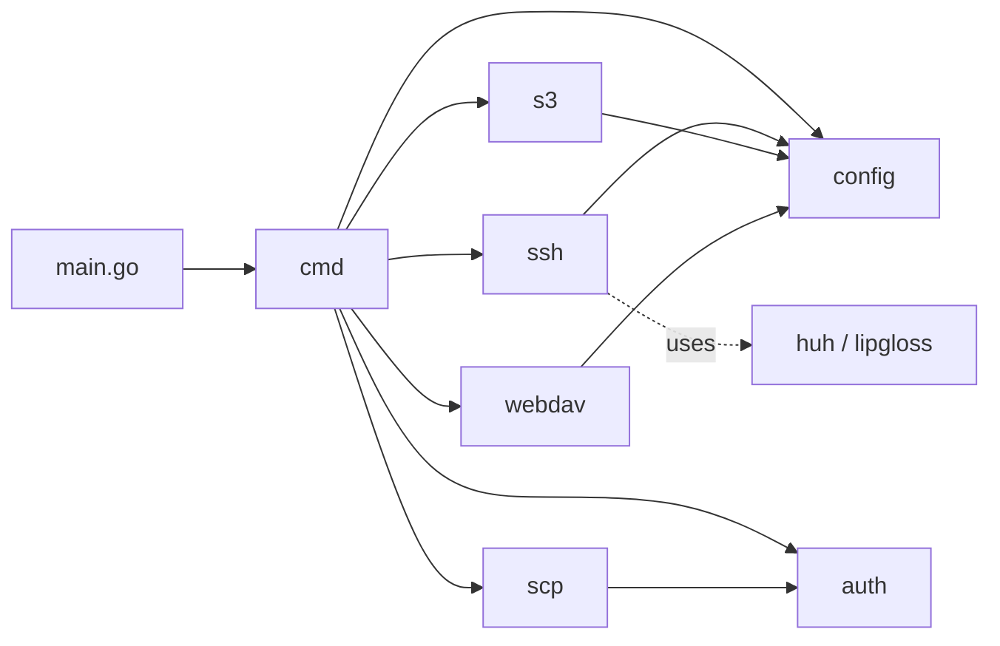
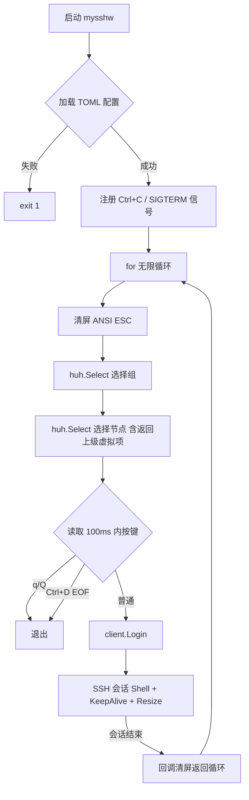
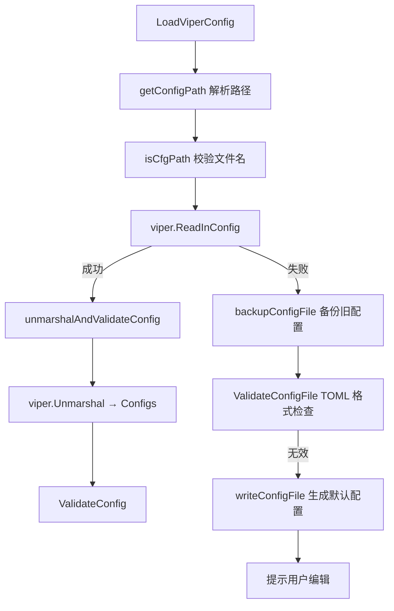

# mysshw 项目深度分析

> 本文档基于源码逐文件阅读后整理，涵盖架构、实现、问题与改进建议。
> 分析日期：2025-06-13  |  当前版本：v25.06.13

---

## 1. 项目定位

mysshw 是一个用 Go 编写的命令行 SSH 客户端与节点配置管理工具，是原 `sshw`（YAML 配置）的现代化重写版。

| 维度 | 内容 |
|------|------|
| 语言 | Go 1.23+（toolchain `go1.24.1`） |
| 配置格式 | TOML（取代旧 YAML） |
| 协议支持 | SSH 主交互 + 三种远程同步协议（SCP / WebDAV / S3） |
| 目标平台 | Linux / macOS / Windows（`CGO_ENABLED=0`，纯静态） |
| 许可证 | MIT |
| 仓库 | `github.com/cnphpbb/mysshw` |
| 版本号 | `v{YY.MM.DD}`，由构建日期自动生成 |

---

## 2. 整体架构

### 2.1 包结构与依赖



| 包 | 职责 |
|----|------|
| `cmd` | Cobra 命令层（root / sync / version / yml） |
| `config` | 配置加载、解析、校验、备份、路径处理 |
| `ssh` | SSH 客户端（连接、PTY、KeepAlive、Resize）+ huh 交互菜单 |
| `auth` | 认证工厂（密码 / 私钥 / 带口令私钥 / SSH Agent） |
| `scp` | 基于 SSH 的 SCP 协议客户端（Builder 模式） |
| `s3` | MinIO SDK 封装的 S3 客户端 |
| `webdav` | `gowebdav` 封装的 WebDAV 客户端 |

### 2.2 命令清单

| 命令 | 入口文件 | 功能 |
|------|---------|------|
| `mysshw`（无子命令） | `cmd/runssh_cmd.go` | 加载配置 → huh 二级菜单 → SSH 登录 → 回调回到主菜单 |
| `mysshw sync -u` | `cmd/sync_cobra.go` | 配置上传（按 `[sync].type` 选择协议） |
| `mysshw sync -z` | 同上 | 配置下载 |
| `mysshw yml -f` | `cmd/yml_cmd.go` | 把原 `sshw` 的 YAML 转 TOML 并追加到主配置 |
| `mysshw version` | `cmd/version_cobra.go` | 打印版本信息 |

### 2.3 主交互流程（`RunSSH`）



亮点：**会话结束 → 回调 → 回到主菜单**。避免每次连接都要重新启动进程，是项目核心 UX。

---

## 3. 关键实现细节

### 3.1 SSH 客户端（`ssh/client.go`）

**认证链构造（`genSSHConfig`）**：

```
1. 优先读取 node.KeyPath → expandHomeDir 解析 ~/、$HOME/
   - 无 passphrase: ssh.ParsePrivateKey
   - 有 passphrase: ssh.ParsePrivateKeyWithPassphrase
2. 若 KeyPath 为空：默认尝试 ~/.ssh/id_rsa
3. 追加 ssh.Password(node.Password)
   - 若 Password 为空：提示用户手动输入（明文 stdin）
4. 追加 ssh.KeyboardInteractive 回调用 term.ReadPassword 安全输入
```

**会话特性**：

| 特性 | 实现 |
|------|------|
| Raw 模式 | `term.MakeRaw(fd)` / `term.Restore` defer |
| 窗口自适应 | 1 秒间隔检测 `term.GetSize`，变化时调 `session.WindowChange` |
| KeepAlive | 10 秒间隔 `client.SendRequest("keepalive@openssh.com", false, nil)` |
| 跨平台 | Windows 用 `os.Stdout.Fd()` 替代 `os.Stdin.Fd()`（Windows 下 Stdout 才是 console） |
| 主机指纹 | `InsecureIgnoreHostKey()`（⚠️ 见问题清单） |
| 密码套件 | 13 种 AES/CTR/ChaCha20/3DES 兜底，兼容老服务器 |

**连接失败的密码重试**：`Login` 内检测到 `no supported methods remain` 且错误信息不含 `password` 时，调用 `term.ReadPassword` 安全输入密码重连一次。

### 3.2 huh 交互菜单（`ssh/cmd.go`）

- 二级菜单：组选择 → 节点选择
- "返回上级"虚拟节点：递归调用 `Choose(trees)`，无限回到组选择
- Lip Gloss 着色：别名黄色 `#DBAB79`、user@host 蓝色 `#71BEF2`、父节点灰色斜体 `#585858`

### 3.3 配置管理（`config/`）

#### 路径解析策略（`utils.go::getConfigPath`）

```
~/xxx     → $HOME/xxx
/xxx      → /xxx
D:/xxx    → D:/xxx       (Windows 绝对路径)
相对路径  → cwd/xxx
反斜杠    → 全部转正斜杠
```

#### 文件名校验（`config.go`）

要求文件名包含 `mysshw` 前缀，否则拒绝。

#### 备份策略（`backup_config.go`）

- 触发条件：`viper.ReadInConfig()` 失败时
- 文件名格式：`<原文件>.YYYYMMDD_HHMMSS.bak`
- 内容：`os.ReadFile` 原内容
- 之后写入 `DefaultTomlConfig` 默认配置

⚠️ 若原配置不存在（首次启动），`os.ReadFile` 失败但错误被静默吞掉。

#### TOML 校验（`validated_config.go`）

| 校验项 | 规则 |
|--------|------|
| 同步类型 | 必须是 `scp` / `webdav` / `s3` 之一 |
| 节点组 | 必须有 `groups` 字段，且至少一个 SSH 节点 |
| SSH 节点 | `name` + `host` 必填，`port` 在 1–65535 |
| 密钥路径 | 文件必须存在（同时校验 `~` 展开） |

### 3.4 三种同步协议对比

| 协议 | 客户端 SDK | 关键操作 |
|------|-----------|---------|
| SCP | 自实现（`scp/client.go` 解析 SCP 协议） | `C0644 <size> <name>\n<data>\x00` 协议层 |
| WebDAV | `studio-b12/gowebdav` | `client.Write` / `client.Read` |
| S3 | `minio/minio-go/v7` | `FPutObject` / `FGetObject`，自动检查/创建 bucket |

三种客户端的 `UploadFile/DownloadFile` 接口对齐，由 `cmd/sync_cobra.go` 的 switch 分发。

### 3.5 YAML 迁移（`cmd/yml_cmd.go`）

- 解析 sshw 的 `[]YMLServerGroup` → 生成 `[[nodes]]` + `[[nodes.ssh]]` TOML 段
- 转义规则：`\` → `\\`，`'` → `\'`
- 追加到现有配置（不覆盖）

### 3.6 构建系统（`magefile.go`）

| mage 目标 | 说明 |
|-----------|------|
| `mage Build` | 当前平台构建（`CGO_ENABLED=0`），不打包 |
| `mage Pack` | 8 平台交叉编译 + 打包（Windows→zip，其他→tar.gz）+ sha1 checksum |
| `mage Test` | `go test -v -coverprofile` + 覆盖率报告 HTML |
| `mage Clean` | 清理 `dist/` 和 `.cover.html` |
| `mage Version` | 打印构建元信息 |
| `mage Help` | 帮助 |

**ldflags 注入**：

```
-X "main.Version=v25.06.13"
-X "main.Build=<branch>-<short-hash>"
-X "main.BuildTime=2025-06-13 12:34:56"
-s -w -extldflags "-static"
```

**版本号生成**（`versionStr`）：`v` + `now.Format("06.01.02")` = `vYY.MM.DD`。

---

## 4. 依赖全景（`go.mod`）

| 库 | 版本 | 用途 |
|----|------|------|
| `github.com/spf13/cobra` | v1.9.1 | CLI 框架 |
| `github.com/spf13/viper` | v1.20.1 | TOML/配置加载 |
| `github.com/GuanceCloud/toml` | v1.2.5 | TOML 编解码（替代 yaml） |
| `github.com/charmbracelet/huh` | v0.7.0 | TUI 交互菜单（替代已停维护的 promptui） |
| `github.com/charmbracelet/lipgloss` | v1.1.0 | 终端样式 |
| `github.com/magefile/mage` | v1.15.0 | 构建系统 |
| `github.com/minio/minio-go/v7` | v7.0.95 | S3 SDK |
| `github.com/studio-b12/gowebdav` | v0.11.0 | WebDAV SDK |
| `golang.org/x/crypto/ssh` | v0.39.0 | SSH 协议 |
| `golang.org/x/term` | v0.32.0 | 终端 Raw 模式 + 密码读取 |
| `gopkg.in/yaml.v3` | v3.0.1 | YAML 迁移 |
| `github.com/stretchr/testify` | v1.10.0 | 单元测试 |

---

## 5. 关键路径分析

### 5.1 SSH 连接（`ssh/client.go`）

- **认证顺序**：密钥优先 → 密码 → 交互式键盘认证
- **密码为空时**：提示用户手动输入
- **连接失败回退**：若"无支持的认证方式"，提示输入密码重试
- **终端特性**：Raw 模式、窗口大小自适应（每秒检测）、KeepAlive（10 秒间隔）
- **会话退出**：会话结束后回调 → 返回主界面（无限循环）

### 5.2 配置加载（`config/config.go`）



---

## 6. 已发现的问题与改进建议

### 6.1 严重 Bug

#### 🔴 `scp/client.go::CopyFromRemotePassThru` 双重发送导致 panic

```go
defer func() {
    if err != nil {
        errCh <- err    // 错误时发一次
    }
    errCh <- err        // 无论是否错误再发一次  ← BUG
    wg.Done()
}()
```

`CopyFromRemote` 走的就是这个函数，下载配置时会偶发 `send on closed channel` panic。

**修复**：去掉第一个 `if err != nil { errCh <- err }`，只保留 `errCh <- err` 一次。

#### 🔴 `ssh/client.go::Login` 多处错误路径未调用回调

`term.MakeRaw`（280 行）、`term.GetSize`（292 行）、`session.RequestPty`（303 行）、`session.StdinPipe`（311 行）、`session.Shell`（317 行）的错误返回都没调 `sessionEndCallback`，导致 `RunSSH` 的 `for` 循环卡住，用户只能 Ctrl+C 强杀。

**修复**：每个错误分支前加 `if sessionEndCallback != nil { sessionEndCallback() }` 并 return。

### 6.2 中等问题

#### 🟡 ~~`InsecureIgnoreHostKey()` 全部使用~~（已修复）

~~所有 SSH 连接都跳过主机指纹校验，存在中间人攻击风险。~~

**修复说明**：新增 `ssh/hostkey.go`，实现 Trust On First Use (TOFU) 策略：
- 指纹存储：`~/.ssh/known_hosts`（与 OpenSSH 共享同一份指纹库）
- 首次连接：显示 SHA256 指纹 → 提示用户确认 → 信任后追加写入
- 后续连接：严格校验，不匹配直接拒绝连接（防中间人）
- 并发安全：`sync.Mutex` 保护 known_hosts 写入
- 错误信息包含期望/实际指纹，便于诊断

**灵活配置**（v2 增强）：
- **per-node 控制**：`SSHNode.StrictHostKeyChecking *bool` 字段
  - `nil` / `true` = 启用严格校验（默认）
  - `false` = 跳过校验（测试环境）
  - 跳过时会输出 `WARNING: host key verification disabled` 警告
- **全局自定义路径**：`Configs.KnownHostsPath string` 字段
  - 留空 = 使用默认 `~/.ssh/known_hosts`
  - 支持 `~` 和 `$HOME` 展开
  - 父目录不存在时自动创建（0700 权限）
  - 实现与 OpenSSH 指纹库隔离

**相关文件**：
- `ssh/hostkey.go`（新增，~170 行）
- `ssh/hostkey_test.go`（新增，9 个测试用例）
- `config/model_config.go`（新增 2 个字段 + 1 个方法）
- `config/model_config_test.go`（新增，1 个测试）
- `ssh/messages.go`（新增 5 个提示常量）
- `ssh/client.go`（per-node 策略选择）
- `example/mysshw.toml`（加示例注释）

**遗留改进**（未实施，留作后续）：
- 非交互场景（CI/脚本）下 TOFU 会失败，建议加 `MYSSHW_SKIP_HOST_KEY_CHECK` 环境变量

#### 🟡 密码明文存储 + 明文回显

- TOML 中 `password = "..."` 直接落盘（示例里还是 `$ZK7M@~1RY` 这种弱密码）
- `ssh/client.go::genSSHConfig` 当 `node.Password == ""` 时用 `fmt.Scanln` 明文读密码

**建议**：
- 默认改用环境变量引用（如 `${MYSSHW_PWD}`）
- 配置文件 `chmod 600`
- 删除示例中的真实密码格式
- 统一改用 `term.ReadPassword` 安全输入

#### 🟡 `magefile.go::tag()` 函数名与实现不符

注释说"returns the git tag"，实现是 `git branch --show-current`。所以 `Build` 字段实际是 `<branch>-<hash>`，不是 tag 版本号。

### 6.3 改进项

#### 🟢 未使用的导出函数

`s3/client.go` 的 `SyncConfig/GetConfig`、`webdav/client.go` 的 `SyncConfig/GetConfig` 都没有被引用，`cmd/sync_cobra.go` 走的是自己写的 `uploadConfig/downloadConfig`。

**建议**：二选一——要么删除未用代码，要么在 `sync` 命令里直接调用这两个函数。

#### 🟢 `filepath.IsAbs` 误用于 S3 / WebDAV 远程路径

`S3.NewClient` 和 `webdav.NewClient` 用 `filepath.IsAbs` 判断 `remote_path`，但 S3 key、WebDAV 路径里没有"绝对路径"概念——传 `mysshw/backup/` 更合理。

**建议**：删除该校验，或改用"不能以 `/` 开头"的简单规则。

#### 🟢 缺少集成测试

TODO.md 提到"集成测试"未完成，目前只有 `config/config_test.go` 和 `ssh/client_test.go` 的少量单测。SCP 协议层、S3 同步层、YML 迁移都缺测试覆盖。

#### 🟢 缺少 CI/CD

TODO.md 提到"自动化构建与测试流程"未完成。`.github/workflows/` 目录下没有任何 workflow。

#### 🟢 `context` 传播缺失

S3/WebDAV 客户端里 `context.Background()` 硬编码，没有从外层 `cmd` 传入 `context.Context`，无法超时控制或优雅取消。

---

## 7. TODO 状态总览

| 类别 | 完成度 | 备注 |
|------|--------|------|
| RunSSH 退出/搜索 | ✅ 100% | 仅"主题"未完成 |
| 配置管理 | ✅ 95% | 仅"配置文件加密"未完成 |
| 同步协议 | ✅ SCP/WebDAV/S3 全部完成 | Gist/API/RPC 作者主动放弃（安全顾虑） |
| UI huh 替换 promptui | ✅ 完成 | |
| 单元测试 | 🟡 部分 | 集成测试缺失 |
| Docker 镜像 | ❌ 未开始 | 仅提供 `docker-compose.yml`（开发容器） |
| CI/CD | ❌ 未开始 | |

---

## 8. 总结评价

### 做得好的部分

- ✅ **包职责清晰**：协议层（scp/s3/webdav）和业务层（cmd/ssh）解耦良好
- ✅ **跨平台**：路径处理、Raw 模式、SCP 打包都有 Windows 兼容逻辑
- ✅ **配置容错**：自动备份 + 自动生成默认配置，新手友好
- ✅ **会话可循环**：退出 SSH 返回主菜单的 UX 设计是亮点
- ✅ **Builder 模式**：SCP 客户端用 Configurer 模式，扩展性好

### 需要警惕的部分

- ⚠️ SCP 下载路径有 panic 风险（必须修）
- ⚠️ SSH 会话多个错误路径导致主循环死锁（必须修）
- ⚠️ 主机指纹校验缺失，密码明文存储

### 适用场景

- 自托管运维人员管理多台 Linux/macOS 服务器
- 需要在多个设备间同步 SSH 配置（WebDAV/S3 协议）
- 喜欢命令行交互式菜单而不愿用 `~/.ssh/config` 的用户

### 不适合的场景

- 高安全要求的生产环境（缺主机指纹校验）
- Windows Server 跳板机场景（buildTarget 已支持，但 Windows 兼容性"可能不佳"）

---

## 9. 待办优先级建议

| 优先级 | 任务 | 涉及文件 |
|--------|------|---------|
| P0 | 修复 `CopyFromRemotePassThru` 双重发送 panic | `scp/client.go` |
| P0 | 修复 `Login` 多个错误路径未调 callback | `ssh/client.go` |
| ~~P1~~ | ~~主机指纹校验（known_hosts）~~ | ✅ **已完成**（`ssh/hostkey.go`） |
| ~~P1~~ | ~~per-node `strict_host_key_checking` 配置~~ | ✅ **已完成**（`config/model_config.go`） |
| ~~P1~~ | ~~自定义 `known_hosts_path` 配置~~ | ✅ **已完成**（`config/model_config.go`） |
| P1 | 密码安全（环境变量 + term.ReadPassword） | `config/` + `ssh/client.go` |
| P2 | 集成测试覆盖 SCP/S3/WebDAV/YML | 各包 `_test.go` |
| P2 | GitHub Actions CI（build + test on 3 OS） | `.github/workflows/` |
| P3 | Docker 镜像 | `Dockerfile` + `docker-compose.yml` |
| P3 | 删除或合并 `SyncConfig/GetConfig` 未用代码 | `s3/`、`webdav/` |