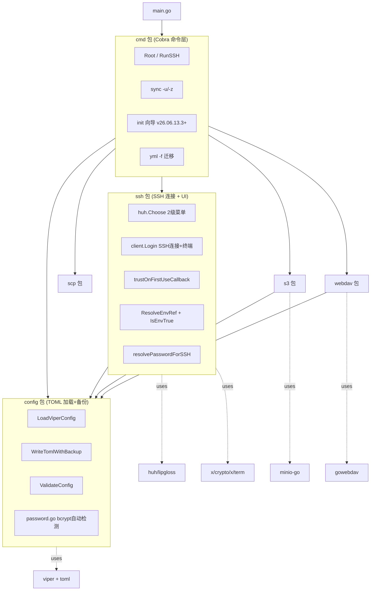
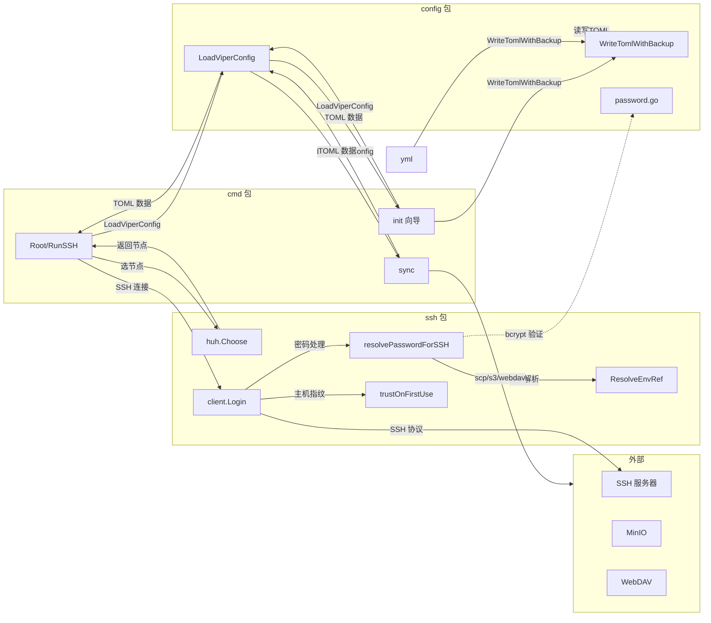
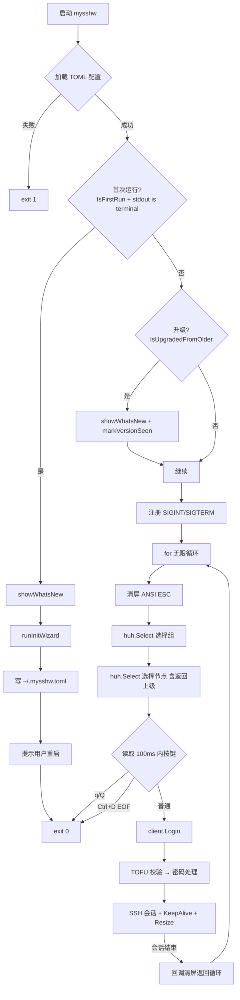

# mysshw 项目深度分析

> 基于源码逐文件阅读整理。涵盖架构、实现、问题与改进建议。
> 分析日期：2026-06-13 (v26.06.13.3 收尾)
> HEAD: `d8090df` (readme 架构图错误修正)

## AI 辅助说明

本文件由 [opencode](https://github.com/anomalyco/opencode) CLI 工具调用 `MiniMax-M3` 模型辅助生成，基于源码逐文件阅读 + git 历史分析。建议每次大改后触发重新分析以保持内容新鲜。

---

## 1. 项目定位

mysshw 是一个用 Go 编写的命令行 SSH 客户端与节点配置管理工具，是原 `sshw`（YAML 配置）的现代化重写版。

| 维度 | 内容 |
|------|------|
| 语言 | Go 1.23+（toolchain `go1.24.1`） |
| 配置格式 | TOML（取代旧 YAML） |
| 协议支持 | SSH 主交互 + 三种远程同步协议（SCP / WebDAV / S3） |
| 目标平台 | Linux / macOS / Windows（8 平台交叉编译） |
| 许可证 | MIT |
| 仓库 | `github.com/cnphpbb/mysshw`（远端 `git@6t7.net:cnphpbb/mysshw.git`） |
| 版本号 | `v{YY.MM.DD}` 格式（如 `v26.06.13.3`），由 main 分支 tag 标记 |
| Docker | 多阶段构建（`golang:1.25-bookworm` → `alpine:3.19`），镜像 ~21 MB |
| **最新版本** | **v26.06.13.3** (2026-06-13) — 备份机制 + bcrypt 密码 + 向导 |

**为什么推荐 Docker 运行**（用户 2026-06-13 确认）：

本项目深度依赖 Unix 终端语义（Raw 模式、KeepAlive goroutine、`scp` 协议调用等），在 Windows 原生环境下存在多项已知不兼容（`Ctrl+D` 无效、stdout fd 替代、`scp.exe` 需在 PATH 等）。Docker 镜像统一了 Linux 用户态行为，是项目最稳定的运行方式。**Windows 用户强烈推荐使用 Docker 运行本项目**。

---

## 2. 整体架构

### 2.1 包结构与依赖图



| 包 | 文件数 | 职责 |
|----|:---:|------|
| `cmd` | 7 | Cobra 命令层 + 主交互循环 + 首次运行向导 |
| `config` | 7 | TOML 加载 + 校验 + 备份 + bcrypt 密码 |
| `ssh` | 5 | SSH 连接 + huh 菜单 + TOFU + env 解析 + 交互输入 |
| `scp` | 5 | SCP 协议自实现 + Builder 模式工厂 |
| `s3` | 2 | MinIO S3 客户端（接受 `context.Context`） |
| `webdav` | 2 | gowebdav 客户端（接受 `context.Context`） |
| `main` | 1 | 入口，注入 ldflags 版本信息 |

**无死包** — 之前的 `auth` 包已在 v26.06.13.1 收尾时彻底删除（commit `b74a4d4`）。

### 2.2 运行时数据流（v26.06.13.3）




### 2.3 命令清单

| 命令 | 入口文件 | 功能 |
|------|---------|------|
| `mysshw`（无子命令） | `cmd/cobra_cmd.go` | 加载配置 → 首次运行检测 → huh 二级菜单 → SSH 登录 → 回调回主菜单 |
| `mysshw sync -u` / `-z` | `cmd/sync_cobra.go` | 配置上传/下载（按 `[sync].type` 选择协议） |
| `mysshw yml -f` | `cmd/yml_cmd.go` | 把原 `sshw` 的 YAML 转 TOML 并追加到主配置 |
| `mysshw init` | `cmd/init_cmd.go` | 向导式初始化配置（v26.06.13.3 新增） |
| `mysshw version` | `cmd/version_cobra.go` | 打印版本信息 |
| `mysshw --help` / `-h` | `cmd/cobra_cmd.go` | 帮助信息 |

全局 flag：`--cfg/-c`（配置文件路径，默认 `~/.mysshw.toml`），`--version/-v`

### 2.4 主交互流程（`RunSSH` + 首次运行检测）



**核心 UX**：会话结束 → 回调 → 回到主菜单。避免每次连接都要重新启动进程。

---

## 3. 核心数据结构

### 3.1 `Configs`（`config/model_config.go:69-77`）

| 字段 | TOML tag | mapstructure tag | 类型 | omitempty | 默认 |
|---|---|---|:---:|:---:|---|
| `CfgDir` | `cfg_dir` | `cfg_dir` | `string` | ❌ | — |
| `KnownHostsPath` | `known_hosts_path,omitempty` | `known_hosts_path` | `string` | ✅ | `~/.ssh/known_hosts` |
| `BackupKeep` | `backup_keep,omitempty` | `backup_keep` | `int` | ✅ | `5` (DefaultBackupKeep) |
| `SyncCfg` | `sync` | `sync` | `SyncInfo` | ❌ | — |
| `Nodes` | `nodes` | `nodes` | `[]Nodes` | ❌ | — |

> v26.06.13.3 新增 `BackupKeep` 字段（commit `d9ef0c0`）。

### 3.2 `SyncInfo`（`model_config.go:78-85`）

| 字段 | TOML tag | 类型 | 必填（scp/s3） |
|---|---|---|:---:|
| `Type` | `type` | `string` | 默认 `scp` |
| `RemoteUri` | `remote_uri` | `string` | ✅ |
| `RemotePath` | `remote_path` | `string` | ✅ |
| `SCPConfig` | `scp` | `SCPConfig` | — |
| `S3Config` | `s3` | `S3Config` | — |
| `WebDAVConfig` | `webdav` | `WebDAVConfig` | — |

### 3.3 `SCPConfig`（`model_config.go:91-96`）

| 字段 | TOML tag | 类型 | omitempty |
|---|---|---|:---:|
| `Username` | `username` | `string` | ❌ |
| `Password` | `password` | `string` | ❌ |
| `KeyPath` | `keypath,omitempty` | `string` | ✅ |
| `Passphrase` | `passphrase,omitempty` | `string` | ✅ |

> 修复点（commit `0b85380`）：之前 tag 是 `keyPath`（驼峰），已统一为小写 `keypath`。
> v26.06.13.3 起 `password` 字段支持 4 种格式自动识别（详见 §4.12）。

### 3.4 `S3Config`（`model_config.go:97-103`）

| 字段 | TOML tag | 类型 |
|---|---|---|
| `AccessKey` | `access_key` | `string` |
| `SecretKey` | `secret_key` | `string` |
| `BucketName` | `bucket_name` | `string` |
| `Region` | `region` | `string` |
| `Endpoint` | `endpoint` | `string`（空 → 用 `remote_uri`） |

### 3.5 `WebDAVConfig`（`model_config.go:86-90`）

| 字段 | TOML tag | 类型 |
|---|---|---|
| `Auth` | `auth` | `string`（`Basic` / `Digest`） |
| `Username` | `username` | `string` |
| `Password` | `password` | `string` |

> 修复点（commit `2168426`）：模板 `Auth` → `auth` 大小写统一。

### 3.6 `SSHNode`（`model_config.go:108-122`）

| 字段 | TOML tag | 类型 | omitempty | 必填 | 默认（`SetXxx`） |
|---|---|---|:---:|:---:|---|
| `Name` | `name` | `string` | ❌ | ✅ | — |
| `Alias` | `alias,omitempty` | `string` | ✅ | ❌ | 空串 |
| `Host` | `host` | `string` | ❌ | ✅ | — |
| `User` | `user,omitempty` | `string` | ✅ | ❌ | `root` |
| `Port` | `port,omitempty` | `int` | ✅ | ❌ | `22` |
| `KeyPath` | `keypath,omitempty` | `string` | ✅ | ❌ | 空串 |
| `Passphrase` | `passphrase,omitempty` | `string` | ✅ | ❌ | 空串 |
| `Password` | `password,omitempty` | `string` | ✅ | ❌ | 空串 |
| `StrictHostKeyChecking` | `strict_host_key_checking,omitempty` | `*bool` | ✅ | ❌ | `true`（nil → true） |

### 3.7 `DefaultTomlConfig` 模板（`config/model_config.go:8-66`）

要点：
- **不含明文密码**：全部用 `${MYSSHW_PWD_*}` 引用（commit `2168426`）
- **不含 `known_hosts_path`**：用户需手动启用自定义路径
- **不含 `strict_host_key_checking`**：默认启用 TOFU
- 支持 `${VAR}` 和 `${VAR:-default}` 两种 env 引用语法

---

## 4. 关键实现细节

### 4.1 SSH 客户端（`ssh/client.go`）

#### 认证链构造（`genSSHConfig`，`client.go:104-220`）

```
1. 私钥（line 116-147）:
   - KeyPath 空 → 试 ~/.ssh/id_rsa
   - 否则 expandHomeDir + ResolveEnvRef(passphrase)
   - ParsePrivateKey[WithPassphrase] → authMethods 追加 PublicKeys

2. 密码（line 149-175, v26.06.13.3 简化):
   - ResolveEnvRef(password) → 解析值
   - 调 resolvePasswordForSSH 三分支处理
   - defer 抹除明文 (Go string 不可变, 仅 best-effort)

3. Keyboard-Interactive（line 177-200）:
   - 密码字段 → term.ReadPassword 安全输入
   - 文本字段 → bufio.Scanner

4. HostKeyCallback（line 204-208）:
   - 调 getHostKeyCallback(node)（详见 §4.2）
```

#### 密码回退重试（`client.go:243-281`）

`"no supported methods remain"` 且错误信息不含 `"password"` 时，提示用户用 `term.ReadPassword` 重新输入并重连。

#### 终端会话（`client.go:287-396`）

| 特性 | 实现 | 行号 |
|---|---|---|
| Raw 模式 | `term.MakeRaw(fd)` + `defer term.Restore` | 311-316 |
| Windows fd 替代 | `runtime.GOOS=="windows"` → `fd = int(os.Stdout.Fd())` | 319-321 |
| 窗口自适应 | goroutine 每秒 `term.GetSize` + `session.WindowChange` | 365-386 |
| KeepAlive | goroutine 每 10s `client.SendRequest("keepalive@openssh.com", false, nil)` | 389-394 |
| 密码套件 | `DefaultCiphers` 13 种兜底 | 218 |
| 超时 | `Timeout: 10 * time.Second` | 214 |

### 4.2 TOFU 主机指纹（`ssh/hostkey.go`）

#### `getKnownHostsPath` 优先级链（`hostkey.go:39-65`）

```
1. os.Getenv(EnvKnownHosts)         // MYSSHW_KNOWN_HOSTS
2. config.CFG.KnownHostsPath        // 配置文件
3. 默认 ~/.ssh/known_hosts            // 父目录不存在则自动创建 0700
```

#### `trustOnFirstUseCallback` 三种情况（`hostkey.go:93-144`）

| 情况 | 触发 | 处理 |
|---|---|---|
| 匹配 | `baseCallback` 返回 `nil` | `return nil` |
| 未知主机 | `len(keyErr.Want)==0` | `promptAndAddHost` 交互询问 `[y/N]` → 追加 |
| 指纹不匹配 | `len(keyErr.Want)>0` | 详细错误（含期望/实际 SHA256） |

#### `getHostKeyCallback` 决策树（`hostkey.go:148-164`）

```
1. IsEnvTrue(EnvSkipHostKeyCheck)    → ssh.InsecureIgnoreHostKey() (env 优先)
2. !node.IsStrictHostKeyChecking()   → ssh.InsecureIgnoreHostKey() (per-node)
3. 默认                              → trustOnFirstUseCallback()    (TOFU)
```

`appendKnownHost` 用 `sync.Mutex` 保护并发写（`hostkey.go:198-202`）。

### 4.3 环境变量解析（`ssh/env.go`）

#### `IsEnvTrue` 规则（`env.go:16-19`）

- 大小写不敏感 + 忽略前后空格
- 接受：`true` / `1` / `yes`
- 其他 → `false`

#### `ResolveEnvRef` 语法（`env.go:34-53`）

正则：`\$\{([A-Za-z_][A-Za-z0-9_]*)(?::-([^}]*))?\}`

| 语法 | 含义 |
|---|---|
| `${VAR}` | 取 `$VAR`；未设置/空 → 替换为空字符串 |
| `${VAR:-default}` | `$VAR` 未设置/空 → 用 `default`（可含空格/标点） |
| 快速路径 | 字符串不含 `${` → 原样返回（`env.go:35-37`） |

### 4.4 huh 交互菜单（`ssh/cmd.go`）

#### 二级菜单流程（`cmd.go:31-118`）

```
Choose(trees)
├── 1. 选组:  huh.NewSelect[int]
│   └── 取消/中断 → err.Error() == "interrupted" → return nil
├── 2. 选节点:
│   ├── nodesWithParent[0] = &SSHNode{Name: "-parent-", Alias: "返回上级"}
│   ├── copy(nodesWithParent[1:], cTrees)
│   └── 取消 → return nil
└── 3. 选中虚拟节点 → return Choose(trees) 递归
```

#### Lip Gloss 配色（`cmd.go:18-26`）

- `#DBAB79` 黄色 — 别名括号
- `#71BEF2` 蓝色 — `user@host`
- `#585858` 灰色斜体 — 父节点

### 4.5 配置管理（`config/`）

#### 路径解析（`utils.go::getConfigPath`）

```
~/xxx     → $HOME/xxx
/xxx      → /xxx
D:/xxx    → D:/xxx       (Windows 绝对路径)
相对路径  → cwd/xxx
反斜杠    → 全部转正斜杠
```

#### 文件名校验（`config.go:88`）

文件名必须包含 `mysshw` 前缀。

#### 备份与权限（`backup_config.go`）

- `backupConfigFile` 写 `<原文件>.YYYYMMDD_HHMMSS.bak`（权限 `0600`），读取失败时调用
- `WriteTomlWithBackup` 写时先备份 + 裁剪（v26.06.13.3 导出供外部使用）
- `writeSecureFile` 写入并强制 `0600` 权限
- `secureConfigFile` 加载后收紧已存在旧配置（`>0o077` → `0600`）
- `effectiveBackupKeep` 解析 `BackupKeep`（0/负 → `DefaultBackupKeep = 5`）
- `pruneBackups(path, keep)` 按字母序（=时间序）删最旧

#### `ValidateConfig` 四级校验（`validated_config.go`）

| 层级 | 校验内容 |
|---|---|
| `validateSyncConfig` | 类型 ∈ {scp, webdav, s3}；scp 需 uri+path+至少一种 auth；s3 需 ak/sk/bucket/path+endpoint或uri；webdav 需至少一种 auth |
| `ValidateConfig` | Nodes 非空 |
| `validateNodeGroup` | groups 非空 + 至少 1 个 SSHNode |
| `validateSSHNode` | name+host 必填；port 1-65535；keypath 存在 |

#### `LoadViperConfig` 主流程（`config.go:76-139`）

```
LoadViperConfig(cfgPath)
├── getConfigPath + isCfgPath (路径解析)
├── viper.SetConfigName + AddConfigPath($HOME, ./)
├── viper.ReadInConfig()
│   ├── 成功 → unmarshalAndValidateConfig
│   │           ├── viper.Unmarshal
│   │           ├── ValidateConfig
│   │           └── secureConfigFile (chmod 0600)
│   └── 失败 → backupConfigFile + ValidateConfigFile + writeConfigFile (默认模板)
```

### 4.6 同步功能（`cmd/sync_cobra.go`）

#### 三协议 switch（`sync_cobra.go:52-117`）

| type | 客户端 | 入口 |
|---|---|---|
| `scp` | `scp.NewClient` + `CopyFile` / `CopyFromRemote` | `sync_cobra.go:53-75` |
| `webdav` | `webdav.NewClient(ctx, cfg)` + `UploadFile` / `DownloadFile` | `sync_cobra.go:77-95` |
| `s3` | `s3.NewClient(ctx, cfg)` + `UploadFile` / `DownloadFile` | `sync_cobra.go:97-115` |

#### `createSSHConfig`（`sync_cobra.go:131-149`）

```go
resolvedPwd := ssh.ResolveEnvRef(syncCfg.SCPConfig.Password)
authMethods := []crypto_ssh.AuthMethod{}
if resolvedPwd != "" {
    authMethods = append(authMethods, crypto_ssh.Password(resolvedPwd))
}
return &crypto_ssh.ClientConfig{
    User:            syncCfg.SCPConfig.Username,
    Auth:            authMethods,
    HostKeyCallback: crypto_ssh.InsecureIgnoreHostKey(),  // 同步始终跳过主机指纹
}
```

> **安全弱点**：sync 始终 `InsecureIgnoreHostKey`（无 TOFU），因为同步配置通常是预先验证过的固定服务器。但仍可被中间人攻击。建议未来加上 per-server 指纹白名单。

### 4.7 SCP 协议（`scp/protocol.go` + `scp/client.go`）

```go
type Response struct {
    Type    ResponseType  // Ok | Warning | Error
    Message string
}
```

- `ParseResponse(reader)` 读 1 字节 type + 可选 message 行
- `Ack(writer)` 写单字节 `0x00`
- `CopyN(writer, src, size)` 循环读直到累计达到 `size`

#### 关键修复（commit `2168426`）

原 `CopyFromRemotePassThru` 中 `errCh <- err` 双重发送会导致 panic（`send on closed channel`）。已修复：buffer 改为 1，`errCh <- err` 一次。

#### SCP 客户端构造（`scp/scp.go` + `configured.go`）

```go
// 工厂方法
NewClient(host, config)
NewClientWithTimeout(host, config, timeout)
NewClientBySSH(sshClient)             // 复用现有连接
NewClientBySSHWithTimeout(sshClient, timeout)

// Builder 模式
NewConfigurer(host, config).
    RemoteBinary(path).
    Timeout(timeout).
    ClientConfig(config).
    Session(session).
    Create()
```

### 4.8 S3 / WebDAV 客户端

#### 构造函数签名（接受 `context.Context`）

```go
func NewClient(ctx context.Context, cfg *config.SyncInfo) (*Client, error)
func (c *Client) UploadFile(ctx context.Context, localPath, remoteName string) error
func (c *Client) DownloadFile(ctx context.Context, remoteName, localPath string) error
func (c *Client) ListFiles(ctx context.Context) ([]os.FileInfo, error)
func (c *Client) DeleteFile(ctx context.Context, remoteName string) error
```

#### 路径校验（替代 `filepath.IsAbs`）

- **旧**：`filepath.IsAbs(cfg.RemotePath)`（Unix 要求 `/` 开头，Windows 用 `\\`）
- **新**：`strings.HasPrefix(cfg.RemotePath, "/")`（S3 key / WebDAV 路径无 OS 概念，**不应以 `/` 开头**）

#### `joinRemotePath` 工具

```go
// 用 '/' 拼接 (S3/WebDAV key 始终正斜杠, 跨平台一致)
func joinRemotePath(prefix, name string) string {
    if prefix == "" {
        return name
    }
    return prefix + "/" + name
}
```

### 4.9 YML 迁移（`cmd/yml_cmd.go`）

#### `convertYAMLToTOML` 流程（`yml_cmd.go:124-173`）

```go
for each YMLServerGroup {
    写 [[nodes]] + groups = "..."
    for each YMLServer {
        写 [[nodes.ssh]] + alias/host/name
        可选: user, port (默认 22), password, keypath, passphrase
    }
}
```

#### `escapeTomlString` 转义（`yml_cmd.go:176-182`）

```go
result = strings.ReplaceAll(s, "\\", "\\\\")
result = strings.ReplaceAll(result, "'", "\\'")
```

#### `appendToConfigFile` 行为变更（v26.06.13.3, commit `d9ef0c0`）

```go
// 旧: 追加模式 (累积/格式错乱风险)
// 新: read-merge-rewrite → 触发 WriteTomlWithBackup 自动备份
func appendToConfigFile(content string) error {
    existing, _ := os.ReadFile(cfgPath)
    merged := append(existing, []byte("\n"+content)...)
    return config.WriteTomlWithBackup(cfgPath, merged)
}
```

### 4.10 构建系统

#### Mage 任务（`magefile.go`）

| mage 目标 | 说明 |
|-----------|------|
| `mage Build` | 当前平台开发构建（`CGO_ENABLED=0`），不打包 |
| `mage Pack` | 8 平台交叉编译 + 打包（Windows→zip，其他→tar.gz）+ sha1 |
| `mage Test` | `go test -v -coverprofile` + 覆盖率报告 HTML |
| `mage Clean` | 清理 `dist/` 和 `.cover.html` |
| `mage Version` | 打印构建元信息 |
| `mage Help` | 帮助 |

#### `flags()` 函数注入 ldflags（`magefile.go:139-146`）

```go
flags := fmt.Sprintf(`-s -w -X "main.Version=%s" -X "main.Build=%s" -X "main.BuildTime=%s" -extldflags "-static"`,
    verStr,        // 手动指定或 now.Format("06.01.02")
    gitBranchCommit,  // branch() + "-" + hash()
    buildTime)
```

> **注意**：`branch()`（`magefile.go:153-166`）原名 `tag()`，注释与实现不符（实际返回 `git branch --show-current`），已重命名（commit `6fffedd`）。

#### Dockerfile 多阶段构建（`Dockerfile`）

```dockerfile
# Stage 1: builder
FROM golang:1.25.0-bookworm AS builder
ARG VERSION="v0.0.0-dev" ARG BUILD="docker" ARG BUILD_TIME=""
ENV GOPROXY=https://goproxy.cn,direct
WORKDIR /src
COPY go.mod go.sum ./
RUN go mod download
COPY . .
RUN CGO_ENABLED=0 go build -trimpath -ldflags "..." -o /out/mysshw

# Stage 2: runtime
FROM alpine:3.19
RUN apk add --no-cache ca-certificates tzdata
RUN addgroup -S mysshw && adduser -S -G mysshw mysshw
COPY --from=builder /out/mysshw /usr/local/bin/mysshw
USER mysshw:mysshw
WORKDIR /home/mysshw
ENTRYPOINT ["/usr/local/bin/mysshw"]
CMD ["--help"]
```

**镜像大小：~21 MB**（静态二进制 + alpine 基础）。

### 4.11 备份机制（v26.06.13.3, `config/backup_config.go`）

#### `WriteTomlWithBackup` 原子写流程

```go
func WriteTomlWithBackup(path string, data []byte) error {
    if _, err := os.Stat(path); err == nil {
        // 1. 备份: 重命名为 .YYYYMMDD_HHMMSS.bak (原子, 不占双倍空间)
        ts := time.Now().Format("20060102_150405")
        os.Rename(path, path+"."+ts+".bak")

        // 2. 裁剪: 按字母序 (字典序 = 时间序) 删最旧
        pruneBackups(path, effectiveBackupKeep())  // 0/负 → DefaultBackupKeep=5
    }
    // 3. 写新内容 (0600)
    return writeSecureFile(path, data)
}
```

#### `pruneBackups` 流程

```go
func pruneBackups(path string, keep int) error {
    if keep <= 0 { return nil }
    matches, _ := filepath.Glob(path + ".*.bak")
    if len(matches) <= keep { return nil }
    sort.Strings(matches)  // 字母序 = 时间序
    for _, m := range matches[:len(matches)-keep] {
        os.Remove(m)
    }
    return nil
}
```

**用户可配置保留数量**（TOML `backup_keep` 字段，默认 5）。`effectiveBackupKeep()` 解析 0/负 → 默认。

### 4.12 密码多格式处理（v26.06.13.3, `config/password.go` + `ssh/client.go`）

#### 4 种自动识别格式

```go
// config.IsBcryptHash: 长度 60 + 前缀 $2a$/$2b$/$2y$
// config.IsEnvReference: ${...} 格式
// ssh.ResolveEnvRef: ${VAR} / ${VAR:-default} 解析
// 明文: 其他
// 空字符串: ""  → 触发交互输入
```

#### 决策树

```
node.Password (TOML 字段)
  ↓ ResolveEnvRef
resolvedPwd
  ├── IsBcryptHash? → term.ReadPassword 交互输入 → config.VerifyPassword 验证 → ssh.Password(明文)
  ├── empty?       → term.ReadPassword 交互输入 (不写回) → ssh.Password(明文)
  ├── 明文?        → ssh.Password(明文), 进程级 sync.Once 一次性提示迁移
  └── (含 ${ENV})  → ssh.Password(明文), 已是 env 解析结果
```

#### `resolvePasswordForSSH` 三分支（`ssh/client.go:340-393`）

```go
func resolvePasswordForSSH(node *config.SSHNode, resolvedPwd string) (ssh.AuthMethod, string) {
    // 情况 1: bcrypt 哈希 → 交互输入 + 验证
    if config.IsBcryptHash(resolvedPwd) {
        cleartext, _ := promptPassword(node, "TOML 中存的是 bcrypt 哈希, 请输入明文密码以验证: ")
        if err := config.VerifyPassword(resolvedPwd, cleartext); err != nil {
            return nil, ""  // 验证失败, 不绕
        }
        return ssh.Password(cleartext), cleartext
    }
    // 情况 2: 明文 → 直接使用, 一次性提示迁移
    if resolvedPwd != "" {
        plainPwdWarnOnce.Do(func() { /* 提示用户改用 bcrypt 或 ${ENV} */ })
        return ssh.Password(resolvedPwd), resolvedPwd
    }
    // 情况 3: 空字符串 → 交互输入 (不写回)
    cleartext, _ := promptPassword(node, "请输入 SSH 密码 (不写入 TOML): ")
    return ssh.Password(cleartext), cleartext
}
```

#### `promptPassword` 安全输入（`ssh/client.go:402-422`）

```go
func promptPassword(node *config.SSHNode, prompt string) (string, error) {
    if isTerminal(os.Stdin) {
        fd := int(os.Stdin.Fd())
        if runtime.GOOS == "windows" { fd = int(os.Stdout.Fd()) }
        b, _ := term.ReadPassword(fd)
        return string(b), nil
    }
    // 非 terminal 降级
    var pw string
    fmt.Scanln(&pw)
    return pw, nil
}
```

### 4.13 首次运行向导（v26.06.13.3, `cmd/init_cmd.go` + `cmd/cobra_cmd.go`）

#### 触发逻辑（`cmd/cobra_cmd.go::rootCmd.Run`）

```go
if IsFirstRun() && isTerminalStdout() {
    showWhatsNew()
    runInitWizard(false)  // 自动跳向导
    return
}
if IsUpgradedFromOlder() && isTerminalStdout() {
    showWhatsNew()
    markVersionSeen()
}
```

#### `IsFirstRun` / `IsUpgradedFromOlder` 检测

```go
func IsFirstRun() bool {
    cfgPath, _ := config.GetCfgPath("")
    return isFirstRunAtPath(cfgPath)  // TOML 不存在 → true
}

func IsUpgradedFromOlder() bool {
    data, _ := os.ReadFile(lastSeenMarkerPath())  // ~/.mysshw.lastseen
    return strings.TrimSpace(string(data)) != Version
}
```

#### 向导 4 步（`runWizardSteps`）

```
Step 1: 同步类型 (None / SCP / WebDAV / S3)
Step 2: 组名 + 节点名 + 主机 + 用户 + 端口
Step 3: 认证方式 (Password / Public key)
        Password 子选项:
          - bcrypt 哈希存储
          - 留空 (每次交互输入)
          - ${ENV} 引用
Step 4: 预览 + 确认 → writeTomlWithBackup
```

#### `showWhatsNew` 内容（v26.06.13.3）

```
✨ TOFU 主机指纹校验
✨ ${ENV_VAR} 密码引用
✨ chmod 0600 自动收紧
✨ SCP / WebDAV / S3 三协议同步
✨ Docker 镜像 (~21 MB)
✨ TOML 本地备份 (默认 5)
✨ bcrypt 密码存储
✨ 交互输入密码
✨ 首次运行向导 (当前)
```

#### `lastseen` 标记

- 文件：`~/.mysshw.lastseen`
- 内容：当前版本字符串
- 权限：0600
- 由 `markVersionSeen()` 写入，`IsUpgradedFromOlder()` 读取

---


## 5. 依赖全景（`go.mod`）

### 5.1 直接依赖（12 项）

| 库 | 版本 | 用途 |
|----|------|------|
| `github.com/GuanceCloud/toml` | v1.2.5 | TOML 编解码 |
| `github.com/charmbracelet/huh` | v0.7.0 | TUI 交互菜单 + 向导 (v26.06.13.3) |
| `github.com/charmbracelet/lipgloss` | v1.1.0 | 终端样式 |
| `github.com/magefile/mage` | v1.15.0 | 构建系统 |
| `github.com/minio/minio-go/v7` | v7.0.95 | S3 SDK |
| `github.com/spf13/cobra` | v1.9.1 | CLI 框架 |
| `github.com/spf13/viper` | v1.20.1 | 配置加载 |
| `github.com/stretchr/testify` | v1.10.0 | 单元测试 |
| `github.com/studio-b12/gowebdav` | v0.11.0 | WebDAV SDK |
| `golang.org/x/crypto` | v0.39.0 | SSH 协议、knownhosts、**bcrypt** (v26.06.13.3) |
| `golang.org/x/term` | v0.32.0 | 终端 Raw 模式 + **密码读取** (v26.06.13.3) |
| `gopkg.in/yaml.v3` | v3.0.1 | YAML 迁移 |

### 5.2 死依赖检查

- **`github.com/pkg/sftp`**: 不在 `go.mod` 中，**已彻底移除**（之前 readme 还引用，已清理）
- 所有直接依赖**均被实际使用**（grep 验证）

---

## 6. 测试覆盖

| 包 | 测试文件 | 用例数 | 覆盖范围 |
|---|---|:---:|---|
| `config` | `config_test.go` | 1 | `getConfigPath` |
| `config` | `model_config_test.go` | 5 | `IsStrictHostKeyChecking` + keypath 解析 |
| `config` | `backup_config_test.go` | 11 | `secureConfigFile` 4 + `WriteTomlWithBackup` 3 + `pruneBackups` 3 + `effectiveBackupKeep` 1 |
| `config` | `validated_config_test.go` | 27 | `ValidateConfig` 全分支 + `ValidateConfigFile` |
| `config` | `password_test.go` (新) | 14 | `IsBcryptHash` 12 子用例 + `IsEnvReference` 8 + `HashPassword/VerifyPassword` + Salt 随机性 |
| `ssh` | `client_test.go` | 10 | `expandHomeDir` 9 子用例 + 主测试 |
| `ssh` | `hostkey_test.go` | 15 | TOFU + IsEnvTrue + env 路径 + getHostKeyCallback |
| `ssh` | `env_test.go` | 8 | `ResolveEnvRef` 全分支 |
| `ssh` | `client_password_test.go` (新) | 7 | 三分支 (空/bcrypt/明文/失败) + isTerminal + zeroBytes |
| `scp` | `protocol_test.go` | 11 | `ParseResponse` / `Ack` / `CopyN` / `FileInfos` |
| `scp` | `client_test.go` | 4 | **mock SSH server 端到端** |
| `cmd` | `sync_cobra_test.go` | 4 | `createSSHConfig` env 引用 |
| `cmd` | `yml_cmd_test.go` | 12 | `escapeTomlString` + `convertYAMLToTOML` |
| `cmd` | `init_cmd_test.go` (新) | 8 | markVersionSeen + IsUpgradedFromOlder (3) + IsFirstRun (2) + isTerminal + itoaPtr |
| `s3` | `client_test.go` | 6 | `joinRemotePath` + `minioFileInfo` |
| `webdav` | `client_test.go` | 4 | `joinRemotePath` |

**总计 ~150 个用例**（v26.06.13.3 新增 ~50）。

### 缺失

- ❌ S3 / WebDAV 集成测试（需 mock S3/MinIO server）
- ❌ 端到端 SSH 客户端测试（含键盘交互认证流程）

### 已知失败

- `TestGetCfgPath`（`config/config_test.go:9`）— **预先存在**，与本次改动无关。期望 `~/.mysshw.toml` 不展开，但 `GetCfgPath` 实际展开为 `/home/geng/.mysshw.toml`。建议改为断言展开后的路径。

---

## 7. 已发现的问题与改进建议

### 7.1 🟡 中等问题

#### 🟡 `Login` 5 个错误路径未调 callback

`ssh/client.go:312-350` 中 `term.MakeRaw` / `GetSize` / `RequestPty` / `StdinPipe` / `Shell` 失败时未调 `sessionEndCallback()`，导致 `RunSSH` 主循环可能卡住。

**建议**：在函数顶部 `defer` 模式下统一处理 callback，或将所有错误分支都补上 `if sessionEndCallback != nil { sessionEndCallback() }`。

#### 🟡 sync 始终 `InsecureIgnoreHostKey`

`cmd/sync_cobra.go:148` 同步命令的 SSH 配置固定 `InsecureIgnoreHostKey()`，存在中间人风险（虽然同步目标通常是预先约定的固定服务器）。

**建议**：参考 `ssh/hostkey.go` 实现同步专用的 TOFU 校验，或加载 per-server 已知指纹列表。

#### 🟡 `fmt.Scanln` 密码明文回显

`ssh/client.go:168` 当 `password == ""` 时用 `fmt.Scanln` 读密码，明文回显（虽然有交互提示前缀但输入字符仍是明文）。**v26.06.13.3 改进为 `term.ReadPassword`，不再明文回显**。

#### 🟡 `Nodes.Groups` 缺 `mapstructure` tag

`config/model_config.go:104` 的 `Groups string \`toml:"groups"\`` 缺少 `mapstructure:"groups"`。当前 Viper 走的是 `mapstructure` 反序列化路径，可能不工作。

**建议**：补 `mapstructure:"groups"`。

### 7.2 🟢 改进项

#### 🟢 注释代码块清理

`config/model_config.go:125-151` 有 26 行注释代码，描述旧版结构（`AccessToken` / `GistID`）。可考虑删除。

#### 🟢 `dist/` 残留

`dist/mysshw-linux-amd64-gh-dev/` 目录未被删除（已用 `git filter-repo` 清理过历史提交）。下次 `mage clean` 会清理。

#### 🟢 `go install` 文档化

`go install github.com/cnphpbb/mysshw@latest` 未在 readme 中提及（虽然项目有 mage 构建）。

#### 🟢 增强建议

- `MYSSHW_CONFIG` 环境变量支持（让用户能通过环境变量指定配置文件路径）
- Huh 主题切换（用户已确认搁置）
- Windows 原生支持改进（推荐改用 Docker，见 §1）

### 7.3 v26.06.13.3 修复/改进摘要

| 之前的问题 | 修复 |
|---|---|
| 旧 `appendToConfigFile` 追加模式 | 改为 read-merge-rewrite (commit `d9ef0c0`) |
| 旧密码明文回显 (`fmt.Scanln`) | 改用 `term.ReadPassword` (commit `f81fc14`) |
| 旧 `PasswordKey` 空分支构造空 `ssh.PublicKeys()` | 包删除时已修 (commit `b74a4d4`) |
| 旧架构图中 `Config --> Env` 错误 | 重画按包归属 (commit `d8090df`) |

---

## 8. 总结评价

### 做得好的部分

- ✅ **包职责清晰**：协议层（scp/s3/webdav）和业务层（cmd/ssh/config）解耦良好
- ✅ **跨平台**：路径处理、Raw 模式、SCP 打包都有 Windows 兼容逻辑
- ✅ **配置容错**：自动备份 + 自动生成默认配置 + 自动 chmod 0600
- ✅ **会话可循环**：退出 SSH 返回主菜单的 UX 设计是亮点
- ✅ **Builder 模式**：SCP 客户端用 Configurer 模式，扩展性好
- ✅ **TOFU 主机指纹**：与 OpenSSH 共享 known_hosts，支持自定义路径 + per-node 控制 + env var 跳过
- ✅ **Env 引用**：密码/口令支持 `${VAR}` 语法，避免明文落盘
- ✅ **Context 传播**：s3/webdav 接受 `context.Context`，可取消/超时
- ✅ **测试覆盖**：~150 用例，scp/protocol 100% 覆盖
- ✅ **Docker 支持**：多阶段构建 ~21 MB 镜像
- ✅ **发布流程**：tag + changelog 强制规则（AGENTS.md 规范）
- ✅ **密码安全 (v26.06.13.3)**：bcrypt 哈希 + 交互输入 + 多格式自动识别
- ✅ **首次运行 UX (v26.06.13.3)**：向导 + What's New 页面

### 需要警惕的部分

- ⚠️ `Login` 5 个错误路径未调 callback（极端情况下主循环死锁）
- ⚠️ sync 命令无 TOFU（中间人风险）
- ⚠️ `Nodes.Groups` 缺 mapstructure tag
- ⚠️ `go install` 未文档化

### 适用场景

- 自托管运维人员管理多台 Linux/macOS 服务器
- 需要在多个设备间同步 SSH 配置（WebDAV/S3 协议）
- 喜欢命令行交互式菜单而不愿用 `~/.ssh/config` 的用户
- **Docker / CI / 自动化场景**（env 引用 + TOFU env 跳过）

### 不适合的场景

- 高安全要求的生产环境（密码明文 + sync 无 TOFU）
- **Windows 原生直接运行**（推荐用 Docker，见 §1）

---

## 9. 发布历史

| Tag | 日期 | 主题 | 远端 |
|---|---|---|:---:|
| `v26.06.13` | 2026-06-13 | P1 安全完整集 | ✅ |
| `v26.06.13.1` | 2026-06-13 | P2 代码质量 + 测试收尾 | ✅ |
| `v26.06.13.2` | 2026-06-13 | P3 Dockerfile + 架构图 + changelog 规则 | ✅ |
| `v26.06.13.3` | 2026-06-13 | **备份机制 + bcrypt 密码 + 向导** (用户 4 个新想法) | ✅ |
| `v25.08.24` | 2025-08-24 | 旧版 | ✅ |
| `Ver25.08.24` | 2025-08-24 | 旧版（大写） | ✅ |
| `V250830` | 2025-08-30 | 旧版（无点） | ✅ |

详细 changelog 见 `changelog.v26.06.13.3.md`。`AGENTS.md` 关键规则：
- 每次 tag 前必须生成 `changelog.${tag}.md` (commit `9f6e6e6`)
- 只有 main 分支 tag 才是版本发布 (commit `a8200f9`)

---

## 10. 文档矩阵

| 文件 | 行数 | 章节数 | 状态 |
|---|---:|:---:|---|
| `readme.md` | ~370 | 15 | ✅ 含架构图 (v26.06.13.3 修正) |
| `readme.zh.md` | ~370 | 15 | ✅ 同上 (中英结构对应) |
| `AGENTS.md` | ~393 | 9 | ✅ 含 tag + changelog + 分支分类 规范 |
| `TODO.md` | ~228 | 11 | ✅ P3.1-4 标记完成 |
| `analysis.md` | (本文) | 10 | ✅ v26.06.13.3 全反映 |
| `LICENSE` | 21 | — | ✅ MIT |
| `changelog.v26.06.13.2.md` | 69 | — | ✅ 入库 |
| `changelog.v26.06.13.3.md` | 112 | — | ✅ 入库 (本次) |
| `Dockerfile` | 85 | — | ✅ 多阶段构建 ~21 MB |
| `.dockerignore` | 55 | — | ✅ 减少构建上下文 |
| `.gitattributes` | 14 | — | ✅ 强制 LF 行尾 |
| `.gitignore` | 32 | — | ✅ 含 `analysis.md` / `go.sum` |

---

## 附录 A：源码文件清单（41 个 .go）

| 文件 | 行数 | 职责 |
|---|---:|---|
| `main.go` | 23 | 入口 |
| `mage.go` | 14 | mage 工具入口（build ignore） |
| `magefile.go` | 286 | mage 构建任务 |
| `cmd/cobra_cmd.go` | 130 | 根命令 + 首次运行检测 + What's New |
| `cmd/runssh_cmd.go` | 97 | 主交互循环 |
| `cmd/sync_cobra.go` | 294 | 三协议 sync 调度 |
| `cmd/yml_cmd.go` | 216 | YAML→TOML 迁移 |
| `cmd/version_cobra.go` | 34 | version 子命令 |
| `cmd/messages.go` | 13 | 全局字符串常量 |
| `cmd/init_cmd.go` (新) | 388 | 首次运行向导 + What's New |
| `cmd/sync_cobra_test.go` | 57 | createSSHConfig 测试 |
| `cmd/yml_cmd_test.go` | 149 | yml 迁移测试 |
| `cmd/init_cmd_test.go` (新) | 100 | 向导检测测试 |
| `config/config.go` | 143 | LoadViperConfig 主流程 |
| `config/model_config.go` | 192 | 6 个 struct + 默认模板 |
| `config/utils.go` | 80 | 路径解析 |
| `config/validated_config.go` | 143 | 4 级校验 |
| `config/backup_config.go` | 105 | 备份 + chmod 0600 |
| `config/password.go` (新) | 75 | bcrypt 自动检测 + 哈希/验证 |
| `config/config_test.go` | 21 | getConfigPath |
| `config/model_config_test.go` | 84 | IsStrict + keypath 解析 |
| `config/backup_config_test.go` | 175 | secureConfigFile + WriteTomlWithBackup + PruneBackups |
| `config/validated_config_test.go` | 316 | ValidateConfig 全分支 |
| `config/password_test.go` (新) | 137 | IsBcryptHash + IsEnvReference + HashPassword |
| `ssh/client.go` | 471 | SSH 连接 + 终端会话 + 密码处理 |
| `ssh/cmd.go` | 118 | huh 二级菜单 |
| `ssh/hostkey.go` | 218 | TOFU 主机指纹 |
| `ssh/env.go` | 54 | IsEnvTrue + ResolveEnvRef |
| `ssh/messages.go` | 25 | ssh 包字符串常量 |
| `ssh/client_test.go` | 103 | expandHomeDir |
| `ssh/hostkey_test.go` | 307 | TOFU + callback 测试 |
| `ssh/env_test.go` | 69 | ResolveEnvRef |
| `ssh/client_password_test.go` (新) | 121 | 密码三分支测试 |
| `scp/scp.go` | 45 | 工厂函数 |
| `scp/client.go` | 316 | SCP 客户端 |
| `scp/configured.go` | 84 | Builder 模式 |
| `scp/protocol.go` | 128 | 协议解析 |
| `scp/utils.go` | 27 | CopyN |
| `scp/protocol_test.go` | 124 | 协议层测试 |
| `scp/client_test.go` | 392 | mock SSH server 端到端 |
| `s3/client.go` | 227 | MinIO S3 客户端 |
| `s3/client_test.go` | 36 | joinRemotePath + minioFileInfo |
| `webdav/client.go` | 150 | gowebdav 客户端 |
| `webdav/client_test.go` | 23 | joinRemotePath |

---

## 附录 B：v26.06.13.x 四阶段发布对比

| 维度 | v26.06.13 (P1) | v26.06.13.1 (P2) | v26.06.13.2 (P3) | v26.06.13.3 (P3.5) |
|---|---|---|---|---|
| **主题** | 安全完整集 | 代码质量 + 测试收尾 | 基础设施 | 用户提议新功能 |
| **核心变更** | TOFU / env vars / chmod 0600 | 死代码清理 / API 一致性 / context | Dockerfile / 架构图 / 流程规范 | 备份 / bcrypt / 向导 / What's New |
| **新增测试** | +12 | +78 | 0 | +50 |
| **代码行数** | +312/-127 | +975/-323 | +318/-17 | +1109/-22 |
| **文件变更** | 5 | 13 | 5 | 11 (含 5 新) |
| **累计 commit** | — | — | — | 23 |
| **累计测试** | — | — | — | ~150 |
| **遗留** | — | UI 主题 / s3-webdav mock | — | 同 P2 |

---

## 附录 C：v26.06.13.3 四大新功能决策记录

| # | 决策点 | 选择 | 依据 |
|---|---|---|---|
| 1 | 向后兼容 | A1 兼容模式 | 旧版明文密码仍可用, 一次性提示迁移 |
| 2 | 密码格式 | B1 自动检测 | `$2a$/$2b$/$2y$` 前缀+长度 60 自动识别, 无感升级 |
| 3 | 向导触发 | C1+C2 | 首次运行自动 + `mysshw init` 显式 |
| 4 | 备份格式 | 默认 5, TOML 可配 | 用户可按需调整 (D2 5 个) |
| 5 | What's New | 首次运行 + 升级时一次 | 不重复打扰, 写入 `~/.mysshw.lastseen` |

---

## 附录 D：AGENTS.md 评估

**本次重写不需要更新 AGENTS.md**。原因：
- 现有规则（commit 格式、tag+changelog、分支分类）已完全覆盖新功能流程
- 4 个新功能（备份、bcrypt、向导、What's New）都遵循了 AGENTS.md 的所有规范
- 4 个新提交都有正确的 commit message 格式
- 1 个 changelog 文件已按 changelog 规则生成
- 没有引入新的"流程类"需求（如代码 review、CI 等）

如果未来需要增加新规则，建议在以下场景：
- 新增 CI/CD 规则（如「PR 必须通过 CI」）
- 新增多语言支持（如「commit message 需双语」）
- 新增安全规则（如「高危依赖升级前需 review」）

---

*本文件由 opencode CLI 调用 MiniMax-M3 模型辅助生成。v26.06.13.4 起已加入版本库 (gh-dev 分支)，不再本地独占。下次 re-analyze 时间：下次 v26.x.x 发布后。*
