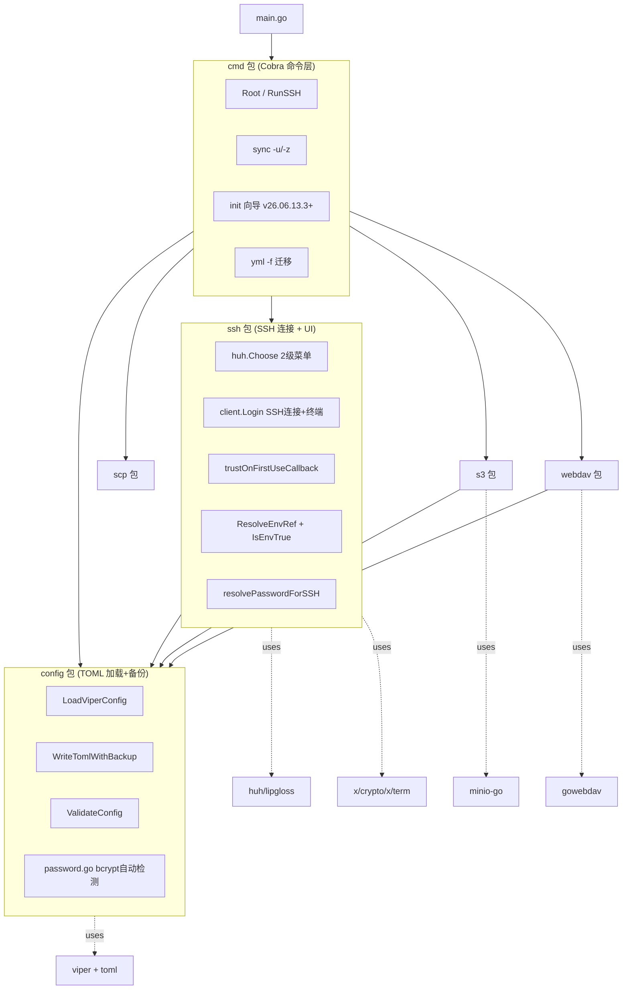
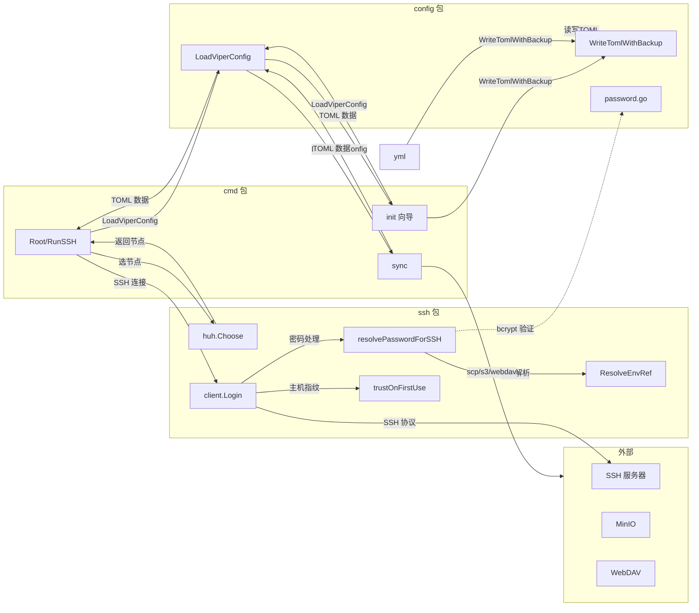
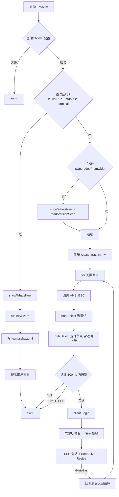

# mysshw 项目深度分析

> 基于源码逐文件阅读整理。涵盖架构、实现、问题与改进建议。
> 分析日期：2026-07-26 (v26.07.26.0 收尾)
> HEAD: `fad0db1` (docs: 添加 v26.07.26.0 changelog)
> 本次同步覆盖: v26.07.04.0 → v26.07.26.0 (5 个版本, 14 个 changelog 章节)

## AI 辅助说明

本文件由 [opencode](https://github.com/anomalyco/opencode) CLI 工具调用 `MiniMax-M3` 模型辅助生成，基于源码逐文件阅读 + git 历史分析。建议每次大改后触发重新分析以保持内容新鲜。

---

## 1. 项目定位

mysshw 是一个用 Go 编写的**命令行 SSH 客户端 + 节点配置管理工具 + AI Agent 集成平台**，是原 `sshw`（YAML 配置）的现代化重写版。从 v26.07.x 起，已演化为面向 **AI Agent / DevOps 自动化** 的工具集：MCP server + AI 友好的 `-o json` CLI 子命令 + 跳板链 + 端口转发 + 文件级加密。

| 维度 | 内容 |
|------|------|
| 语言 | Go 1.23+（toolchain `go1.24.1`） |
| 配置格式 | TOML（取代旧 YAML），支持 **文件级加密**（Argon2id + AES-256-GCM） |
| 协议支持 | SSH 主交互 + SCP/端口转发 + 三种远程同步协议（SCP / WebDAV / S3） |
| AI 集成 | **MCP server (stdio)** + **CLI `-o json` + ExitError** 双通道 |
| 目标平台 | Linux / macOS / Windows（8 平台交叉编译） |
| 许可证 | MIT |
| 仓库 | `github.com/cnphpbb/mysshw`（远端 `git@6t7.net:cnphpbb/mysshw.git`） |
| 版本号 | `v{YY.MM.DD}` 格式（如 `v26.07.26.0`），由 main 分支 tag 标记 |
| Docker | 多阶段构建（`golang:1.25-bookworm` → `alpine:latest`），镜像 ~21 MB |
| **最新版本** | **v26.07.26.0** (2026-07-26) — 跳板链隧道堆叠修复 + MCP server 偶发断开修复 + 强化 e2e 测试 |

**为什么推荐 Docker 运行**（用户 2026-06-13 确认）：

本项目深度依赖 Unix 终端语义（Raw 模式、KeepAlive goroutine、`scp` 协议调用等），在 Windows 原生环境下存在多项已知不兼容（`Ctrl+D` 无效、stdout fd 替代、`scp.exe` 需在 PATH 等）。Docker 镜像统一了 Linux 用户态行为，是项目最稳定的运行方式。**Windows 用户强烈推荐使用 Docker 运行本项目**。

---

## 2. 整体架构

### 2.1 包结构与依赖图



| 包 | 文件数 | 职责 |
|----|:---:|------|
| `cmd` | 42 | Cobra 命令层 + 主交互循环 + AI 友好 CLI（list/exec/copy/tunnel/hostkey/mcp/...）+ 向导 |
| `config` | 12 | TOML 加载 + 校验 + 备份 + bcrypt 密码 + 文件级加密 (Argon2id + AES-256-GCM) |
| `ssh` | 21 | SSH 连接 + huh 菜单 + TOFU + env 解析 + Resolver/Executor + Proxy/Reverse/SOCKS5 |
| `scp` | 5 | SCP 协议自实现 + Builder 模式工厂 |
| `s3` | 2 | MinIO S3 客户端（接受 `context.Context`） |
| `webdav` | 2 | gowebdav 客户端（接受 `context.Context`） |
| `main` | 1 | 入口，注入 ldflags 版本信息 |

**无死包** — 之前的 `auth` 包已在 v26.06.13.1 收尾时彻底删除（commit `b74a4d4`）。

### 2.2 运行时数据流（v26.06.13.3）




### 2.3 命令清单（v26.07.26.0, 18 个子命令）

| 命令 | 入口文件 | 功能 |
|------|---------|------|
| `mysshw`（无子命令） | `cmd/cobra_cmd.go` | 加载配置 → 首次运行检测 → huh 二级菜单 → SSH 登录 → 回调回主菜单 |
| `mysshw list` | `cmd/list_cmd.go` | **v26.07.04** 列出节点（`-o json` AI 友好, 永不含 password） |
| `mysshw exec` | `cmd/exec_cmd.go` | **v26.07.04** 非交互执行（`--node/--alias/--host/--all`, `--dry-run`, `--follow` 流式） |
| `mysshw copy` | `cmd/copy_cmd.go` | **v26.07.04** SCP 文件传输（`-U` upload / download, `--parallel`） |
| `mysshw tunnel {local,reverse,dynamic}` | `cmd/tunnel_cmd.go` | **v26.07.04** 端口转发（`-L` / `-R` / `-D` OpenSSH 等价） |
| `mysshw ping` | `cmd/ping_cmd.go` | **v26.07.08** TCP 端口连通性检测（AI 友好） |
| `mysshw info` | `cmd/info_cmd.go` | **v26.07.08** 远程系统信息收集（hostname/os/cpu/mem/disk/uptime） |
| `mysshw hostkey {list,show,remove,update,audit}` | `cmd/hostkey_cmd.go` | **v26.07.04** known_hosts CRUD + 审计 |
| `mysshw hash {gen,verify,pepper}` | `cmd/hash_cmd.go` | **v26.07.08** 密码哈希（bcrypt / bcrypt-pepper） |
| `mysshw encrypt` / `mysshw encrypt decrypt` | `cmd/encrypt_cmd.go` | **v26.07.08** 配置文件加/解密（Argon2id + AES-256-GCM） |
| `mysshw config {list,get,add,remove,update,diff}` | `cmd/config_cmd.go` | **v26.07.09** 节点 CRUD（dry-run 默认） |
| `mysshw export` | `cmd/export_cmd.go` | **v26.07.09** 导出 JSON/TOML（密码脱敏） |
| `mysshw import` | `cmd/import_cmd.go` | **v26.07.09** 批量导入（dry-run, `--overwrite`, `--confirm`） |
| `mysshw mcp` | `cmd/mcp_cmd.go` | **v26.07.08** MCP server (stdio), 9 个 AI tool |
| `mysshw completions` | `cmd/completions_cmd.go` | **v26.07.08** 动态输出 CLI Schema (JSON) |
| `mysshw sync -u` / `-z` | `cmd/sync_cobra.go` | 配置上传/下载（按 `[sync].type` 选择协议） |
| `mysshw yml -f` | `cmd/yml_cmd.go` | 把原 `sshw` 的 YAML 转 TOML 并追加到主配置 |
| `mysshw init` | `cmd/init_cmd.go` | 向导式初始化配置（v26.06.13.3 新增） |
| `mysshw version` | `cmd/version_cobra.go` | 打印版本信息 |
| `mysshw --help` / `-h` | `cmd/cobra_cmd.go` | 帮助信息 |

全局 flag：`--cfg/-c`（配置文件路径，默认 `~/.mysshw.toml`），`--version/-v`，`-o plain|json`（v26.07.04+ 全局输出器）

### 2.4 主交互流程（`RunSSH` + 首次运行检测）



**核心 UX**：会话结束 → 回调 → 回到主菜单。避免每次连接都要重新启动进程。

---

## 3. 核心数据结构

### 3.1 `Configs`（`config/model_config.go:69-77`）

| 字段 | TOML tag | mapstructure tag | 类型 | omitempty | 默认 |
|---|---|---|:---:|:---:|---|
| `CfgDir` | `cfg_dir` | `cfg_dir` | `string` | ❌ | — |
| `KnownHostsPath` | `known_hosts_path,omitempty` | `known_hosts_path` | `string` | ✅ | `~/.ssh/known_hosts` |
| `BackupKeep` | `backup_keep,omitempty` | `backup_keep` | `int` | ✅ | `5` (DefaultBackupKeep) |
| `SyncCfg` | `sync` | `sync` | `SyncInfo` | ❌ | — |
| `Nodes` | `nodes` | `nodes` | `[]Nodes` | ❌ | — |

> v26.06.13.3 新增 `BackupKeep` 字段（commit `d9ef0c0`）。

### 3.2 `SyncInfo`（`model_config.go:78-85`）

| 字段 | TOML tag | 类型 | 必填（scp/s3） |
|---|---|---|:---:|
| `Type` | `type` | `string` | 默认 `scp` |
| `RemoteUri` | `remote_uri` | `string` | ✅ |
| `RemotePath` | `remote_path` | `string` | ✅ |
| `SCPConfig` | `scp` | `SCPConfig` | — |
| `S3Config` | `s3` | `S3Config` | — |
| `WebDAVConfig` | `webdav` | `WebDAVConfig` | — |

### 3.3 `SCPConfig`（`model_config.go:91-96`）

| 字段 | TOML tag | 类型 | omitempty |
|---|---|---|:---:|
| `Username` | `username` | `string` | ❌ |
| `Password` | `password` | `string` | ❌ |
| `KeyPath` | `keypath,omitempty` | `string` | ✅ |
| `Passphrase` | `passphrase,omitempty` | `string` | ✅ |

> 修复点（commit `0b85380`）：之前 tag 是 `keyPath`（驼峰），已统一为小写 `keypath`。
> v26.06.13.3 起 `password` 字段支持 4 种格式自动识别（详见 §4.12）。

### 3.4 `S3Config`（`model_config.go:97-103`）

| 字段 | TOML tag | 类型 |
|---|---|---|
| `AccessKey` | `access_key` | `string` |
| `SecretKey` | `secret_key` | `string` |
| `BucketName` | `bucket_name` | `string` |
| `Region` | `region` | `string` |
| `Endpoint` | `endpoint` | `string`（空 → 用 `remote_uri`） |

### 3.5 `WebDAVConfig`（`model_config.go:86-90`）

| 字段 | TOML tag | 类型 |
|---|---|---|
| `Auth` | `auth` | `string`（`Basic` / `Digest`） |
| `Username` | `username` | `string` |
| `Password` | `password` | `string` |

> 修复点（commit `2168426`）：模板 `Auth` → `auth` 大小写统一。

### 3.6 `SSHNode`（`model_config.go:108-122`）

| 字段 | TOML tag | 类型 | omitempty | 必填 | 默认（`SetXxx`） |
|---|---|---|:---:|:---:|---|
| `Name` | `name` | `string` | ❌ | ✅ | — |
| `Alias` | `alias,omitempty` | `string` | ✅ | ❌ | 空串 |
| `Host` | `host` | `string` | ❌ | ✅ | — |
| `User` | `user,omitempty` | `string` | ✅ | ❌ | `root` |
| `Port` | `port,omitempty` | `int` | ✅ | ❌ | `22` |
| `KeyPath` | `keypath,omitempty` | `string` | ✅ | ❌ | 空串 |
| `Passphrase` | `passphrase,omitempty` | `string` | ✅ | ❌ | 空串 |
| `Password` | `password,omitempty` | `string` | ✅ | ❌ | 空串 |
| `StrictHostKeyChecking` | `strict_host_key_checking,omitempty` | `*bool` | ✅ | ❌ | `true`（nil → true） |

### 3.7 `DefaultTomlConfig` 模板（`config/model_config.go:8-66`）

要点：
- **不含明文密码**：全部用 `${MYSSHW_PWD_*}` 引用（commit `2168426`）
- **不含 `known_hosts_path`**：用户需手动启用自定义路径
- **不含 `strict_host_key_checking`**：默认启用 TOFU
- 支持 `${VAR}` 和 `${VAR:-default}` 两种 env 引用语法

---

## 4. 关键实现细节

### 4.1 SSH 客户端（`ssh/client.go`）

#### 认证链构造（`genSSHConfig`，`client.go:104-220`）

```
1. 私钥（line 116-147）:
   - KeyPath 空 → 试 ~/.ssh/id_rsa
   - 否则 expandHomeDir + ResolveEnvRef(passphrase)
   - ParsePrivateKey[WithPassphrase] → authMethods 追加 PublicKeys

2. 密码（line 149-175, v26.06.13.3 简化):
   - ResolveEnvRef(password) → 解析值
   - 调 resolvePasswordForSSH 三分支处理
   - defer 抹除明文 (Go string 不可变, 仅 best-effort)

3. Keyboard-Interactive（line 177-200）:
   - 密码字段 → term.ReadPassword 安全输入
   - 文本字段 → bufio.Scanner

4. HostKeyCallback（line 204-208）:
   - 调 getHostKeyCallback(node)（详见 §4.2）
```

#### 密码回退重试（`client.go:243-281`）

`"no supported methods remain"` 且错误信息不含 `"password"` 时，提示用户用 `term.ReadPassword` 重新输入并重连。

#### 终端会话（`client.go:287-396`）

| 特性 | 实现 | 行号 |
|---|---|---|
| Raw 模式 | `term.MakeRaw(fd)` + `defer term.Restore` | 311-316 |
| Windows fd 替代 | `runtime.GOOS=="windows"` → `fd = int(os.Stdout.Fd())` | 319-321 |
| 窗口自适应 | goroutine 每秒 `term.GetSize` + `session.WindowChange` | 365-386 |
| KeepAlive | goroutine 每 10s `client.SendRequest("keepalive@openssh.com", false, nil)` | 389-394 |
| 密码套件 | `DefaultCiphers` 13 种兜底 | 218 |
| 超时 | `Timeout: 10 * time.Second` | 214 |

### 4.2 TOFU 主机指纹（`ssh/hostkey.go`）

#### `getKnownHostsPath` 优先级链（`hostkey.go:39-65`）

```
1. os.Getenv(EnvKnownHosts)         // MYSSHW_KNOWN_HOSTS
2. config.CFG.KnownHostsPath        // 配置文件
3. 默认 ~/.ssh/known_hosts            // 父目录不存在则自动创建 0700
```

#### `trustOnFirstUseCallback` 三种情况（`hostkey.go:93-144`）

| 情况 | 触发 | 处理 |
|---|---|---|
| 匹配 | `baseCallback` 返回 `nil` | `return nil` |
| 未知主机 | `len(keyErr.Want)==0` | `promptAndAddHost` 交互询问 `[y/N]` → 追加 |
| 指纹不匹配 | `len(keyErr.Want)>0` | 详细错误（含期望/实际 SHA256） |

#### `getHostKeyCallback` 决策树（`hostkey.go:148-164`）

```
1. IsEnvTrue(EnvSkipHostKeyCheck)    → ssh.InsecureIgnoreHostKey() (env 优先)
2. !node.IsStrictHostKeyChecking()   → ssh.InsecureIgnoreHostKey() (per-node)
3. 默认                              → trustOnFirstUseCallback()    (TOFU)
```

`appendKnownHost` 用 `sync.Mutex` 保护并发写（`hostkey.go:198-202`）。

### 4.3 环境变量解析（`ssh/env.go`）

#### `IsEnvTrue` 规则（`env.go:16-19`）

- 大小写不敏感 + 忽略前后空格
- 接受：`true` / `1` / `yes`
- 其他 → `false`

#### `ResolveEnvRef` 语法（`env.go:34-53`）

正则：`\$\{([A-Za-z_][A-Za-z0-9_]*)(?::-([^}]*))?\}`

| 语法 | 含义 |
|---|---|
| `${VAR}` | 取 `$VAR`；未设置/空 → 替换为空字符串 |
| `${VAR:-default}` | `$VAR` 未设置/空 → 用 `default`（可含空格/标点） |
| 快速路径 | 字符串不含 `${` → 原样返回（`env.go:35-37`） |

### 4.4 huh 交互菜单（`ssh/cmd.go`）

#### 二级菜单流程（`cmd.go:31-118`）

```
Choose(trees)
├── 1. 选组:  huh.NewSelect[int]
│   └── 取消/中断 → err.Error() == "interrupted" → return nil
├── 2. 选节点:
│   ├── nodesWithParent[0] = &SSHNode{Name: "-parent-", Alias: "返回上级"}
│   ├── copy(nodesWithParent[1:], cTrees)
│   └── 取消 → return nil
└── 3. 选中虚拟节点 → return Choose(trees) 递归
```

#### Lip Gloss 配色（`cmd.go:18-26`）

- `#DBAB79` 黄色 — 别名括号
- `#71BEF2` 蓝色 — `user@host`
- `#585858` 灰色斜体 — 父节点

### 4.5 配置管理（`config/`）

#### 路径解析（`utils.go::getConfigPath`）

```
~/xxx     → $HOME/xxx
/xxx      → /xxx
D:/xxx    → D:/xxx       (Windows 绝对路径)
相对路径  → cwd/xxx
反斜杠    → 全部转正斜杠
```

#### 文件名校验（`config.go:88`）

文件名必须包含 `mysshw` 前缀。

#### 备份与权限（`backup_config.go`）

- `backupConfigFile` 写 `<原文件>.YYYYMMDD_HHMMSS.bak`（权限 `0600`），读取失败时调用
- `WriteTomlWithBackup` 写时先备份 + 裁剪（v26.06.13.3 导出供外部使用）
- `writeSecureFile` 写入并强制 `0600` 权限
- `secureConfigFile` 加载后收紧已存在旧配置（`>0o077` → `0600`）
- `effectiveBackupKeep` 解析 `BackupKeep`（0/负 → `DefaultBackupKeep = 5`）
- `pruneBackups(path, keep)` 按字母序（=时间序）删最旧

#### `ValidateConfig` 四级校验（`validated_config.go`）

| 层级 | 校验内容 |
|---|---|
| `validateSyncConfig` | 类型 ∈ {scp, webdav, s3}；scp 需 uri+path+至少一种 auth；s3 需 ak/sk/bucket/path+endpoint或uri；webdav 需至少一种 auth |
| `ValidateConfig` | Nodes 非空 |
| `validateNodeGroup` | groups 非空 + 至少 1 个 SSHNode |
| `validateSSHNode` | name+host 必填；port 1-65535；keypath 存在 |

#### `LoadViperConfig` 主流程（`config.go:76-139`）

```
LoadViperConfig(cfgPath)
├── getConfigPath + isCfgPath (路径解析)
├── viper.SetConfigName + AddConfigPath($HOME, ./)
├── viper.ReadInConfig()
│   ├── 成功 → unmarshalAndValidateConfig
│   │           ├── viper.Unmarshal
│   │           ├── ValidateConfig
│   │           └── secureConfigFile (chmod 0600)
│   └── 失败 → backupConfigFile + ValidateConfigFile + writeConfigFile (默认模板)
```

### 4.6 同步功能（`cmd/sync_cobra.go`）

#### 三协议 switch（`sync_cobra.go:52-117`）

| type | 客户端 | 入口 |
|---|---|---|
| `scp` | `scp.NewClient` + `CopyFile` / `CopyFromRemote` | `sync_cobra.go:53-75` |
| `webdav` | `webdav.NewClient(ctx, cfg)` + `UploadFile` / `DownloadFile` | `sync_cobra.go:77-95` |
| `s3` | `s3.NewClient(ctx, cfg)` + `UploadFile` / `DownloadFile` | `sync_cobra.go:97-115` |

#### `createSSHConfig`（`sync_cobra.go:131-149`）

```go
resolvedPwd := ssh.ResolveEnvRef(syncCfg.SCPConfig.Password)
authMethods := []crypto_ssh.AuthMethod{}
if resolvedPwd != "" {
    authMethods = append(authMethods, crypto_ssh.Password(resolvedPwd))
}
return &crypto_ssh.ClientConfig{
    User:            syncCfg.SCPConfig.Username,
    Auth:            authMethods,
    HostKeyCallback: crypto_ssh.InsecureIgnoreHostKey(),  // 同步始终跳过主机指纹
}
```

> **安全弱点**：sync 始终 `InsecureIgnoreHostKey`（无 TOFU），因为同步配置通常是预先验证过的固定服务器。但仍可被中间人攻击。建议未来加上 per-server 指纹白名单。

### 4.7 SCP 协议（`scp/protocol.go` + `scp/client.go`）

```go
type Response struct {
    Type    ResponseType  // Ok | Warning | Error
    Message string
}
```

- `ParseResponse(reader)` 读 1 字节 type + 可选 message 行
- `Ack(writer)` 写单字节 `0x00`
- `CopyN(writer, src, size)` 循环读直到累计达到 `size`

#### 关键修复（commit `2168426`）

原 `CopyFromRemotePassThru` 中 `errCh <- err` 双重发送会导致 panic（`send on closed channel`）。已修复：buffer 改为 1，`errCh <- err` 一次。

#### SCP 客户端构造（`scp/scp.go` + `configured.go`）

```go
// 工厂方法
NewClient(host, config)
NewClientWithTimeout(host, config, timeout)
NewClientBySSH(sshClient)             // 复用现有连接
NewClientBySSHWithTimeout(sshClient, timeout)

// Builder 模式
NewConfigurer(host, config).
    RemoteBinary(path).
    Timeout(timeout).
    ClientConfig(config).
    Session(session).
    Create()
```

### 4.8 S3 / WebDAV 客户端

#### 构造函数签名（接受 `context.Context`）

```go
func NewClient(ctx context.Context, cfg *config.SyncInfo) (*Client, error)
func (c *Client) UploadFile(ctx context.Context, localPath, remoteName string) error
func (c *Client) DownloadFile(ctx context.Context, remoteName, localPath string) error
func (c *Client) ListFiles(ctx context.Context) ([]os.FileInfo, error)
func (c *Client) DeleteFile(ctx context.Context, remoteName string) error
```

#### 路径校验（替代 `filepath.IsAbs`）

- **旧**：`filepath.IsAbs(cfg.RemotePath)`（Unix 要求 `/` 开头，Windows 用 `\\`）
- **新**：`strings.HasPrefix(cfg.RemotePath, "/")`（S3 key / WebDAV 路径无 OS 概念，**不应以 `/` 开头**）

#### `joinRemotePath` 工具

```go
// 用 '/' 拼接 (S3/WebDAV key 始终正斜杠, 跨平台一致)
func joinRemotePath(prefix, name string) string {
    if prefix == "" {
        return name
    }
    return prefix + "/" + name
}
```

### 4.9 YML 迁移（`cmd/yml_cmd.go`）

#### `convertYAMLToTOML` 流程（`yml_cmd.go:124-173`）

```go
for each YMLServerGroup {
    写 [[nodes]] + groups = "..."
    for each YMLServer {
        写 [[nodes.ssh]] + alias/host/name
        可选: user, port (默认 22), password, keypath, passphrase
    }
}
```

#### `escapeTomlString` 转义（`yml_cmd.go:176-182`）

```go
result = strings.ReplaceAll(s, "\\", "\\\\")
result = strings.ReplaceAll(result, "'", "\\'")
```

#### `appendToConfigFile` 行为变更（v26.06.13.3, commit `d9ef0c0`）

```go
// 旧: 追加模式 (累积/格式错乱风险)
// 新: read-merge-rewrite → 触发 WriteTomlWithBackup 自动备份
func appendToConfigFile(content string) error {
    existing, _ := os.ReadFile(cfgPath)
    merged := append(existing, []byte("\n"+content)...)
    return config.WriteTomlWithBackup(cfgPath, merged)
}
```

### 4.10 构建系统

#### Mage 任务（`magefile.go`）

| mage 目标 | 说明 |
|-----------|------|
| `mage Build` | 当前平台开发构建（`CGO_ENABLED=0`），不打包 |
| `mage Pack` | 8 平台交叉编译 + 打包（Windows→zip，其他→tar.gz）+ sha1 |
| `mage Test` | `go test -v -coverprofile` + 覆盖率报告 HTML |
| `mage Clean` | 清理 `dist/` 和 `.cover.html` |
| `mage Version` | 打印构建元信息 |
| `mage Help` | 帮助 |

#### `flags()` 函数注入 ldflags（`magefile.go:139-146`）

```go
flags := fmt.Sprintf(`-s -w -X "main.Version=%s" -X "main.Build=%s" -X "main.BuildTime=%s" -extldflags "-static"`,
    verStr,        // 手动指定或 now.Format("06.01.02")
    gitBranchCommit,  // branch() + "-" + hash()
    buildTime)
```

> **注意**：`branch()`（`magefile.go:153-166`）原名 `tag()`，注释与实现不符（实际返回 `git branch --show-current`），已重命名（commit `6fffedd`）。

#### Dockerfile 多阶段构建（`Dockerfile`）

```dockerfile
# Stage 1: builder
FROM golang:1.25.0-bookworm AS builder
ARG VERSION="v0.0.0-dev" ARG BUILD="docker" ARG BUILD_TIME=""
ENV GOPROXY=https://goproxy.cn,direct
WORKDIR /src
COPY go.mod go.sum ./
RUN go mod download
COPY . .
RUN CGO_ENABLED=0 go build -trimpath -ldflags "..." -o /out/mysshw

# Stage 2: runtime
FROM alpine:latest   # v26.07.26 升级到 latest (commit 83c3f97)
RUN apk add --no-cache ca-certificates tzdata
RUN addgroup -S mysshw && adduser -S -G mysshw mysshw
COPY --from=builder /out/mysshw /usr/local/bin/mysshw
USER mysshw:mysshw
WORKDIR /home/mysshw
ENTRYPOINT ["/usr/local/bin/mysshw"]
CMD ["--help"]
```

**镜像大小：~21 MB**（静态二进制 + alpine 基础）。

#### e2e 测试 build tag

`gliderlabs/ssh v0.3.8` 通过 `//go:build e2e` build tag 引入，**默认 `go test` 不编译**。运行 e2e：`mage Test` 或 `go test -tags=e2e ./...`。

### 4.11 备份机制（v26.06.13.3, `config/backup_config.go`）

#### `WriteTomlWithBackup` 原子写流程

```go
func WriteTomlWithBackup(path string, data []byte) error {
    if _, err := os.Stat(path); err == nil {
        // 1. 备份: 重命名为 .YYYYMMDD_HHMMSS.bak (原子, 不占双倍空间)
        ts := time.Now().Format("20060102_150405")
        os.Rename(path, path+"."+ts+".bak")

        // 2. 裁剪: 按字母序 (字典序 = 时间序) 删最旧
        pruneBackups(path, effectiveBackupKeep())  // 0/负 → DefaultBackupKeep=5
    }
    // 3. 写新内容 (0600)
    return writeSecureFile(path, data)
}
```

#### `pruneBackups` 流程

```go
func pruneBackups(path string, keep int) error {
    if keep <= 0 { return nil }
    matches, _ := filepath.Glob(path + ".*.bak")
    if len(matches) <= keep { return nil }
    sort.Strings(matches)  // 字母序 = 时间序
    for _, m := range matches[:len(matches)-keep] {
        os.Remove(m)
    }
    return nil
}
```

**用户可配置保留数量**（TOML `backup_keep` 字段，默认 5）。`effectiveBackupKeep()` 解析 0/负 → 默认。

### 4.12 密码多格式处理（v26.06.13.3, `config/password.go` + `ssh/client.go`）

#### 4 种自动识别格式

```go
// config.IsBcryptHash: 长度 60 + 前缀 $2a$/$2b$/$2y$
// config.IsEnvReference: ${...} 格式
// ssh.ResolveEnvRef: ${VAR} / ${VAR:-default} 解析
// 明文: 其他
// 空字符串: ""  → 触发交互输入
```

#### 决策树

```
node.Password (TOML 字段)
  ↓ ResolveEnvRef
resolvedPwd
  ├── IsBcryptHash? → term.ReadPassword 交互输入 → config.VerifyPassword 验证 → ssh.Password(明文)
  ├── empty?       → term.ReadPassword 交互输入 (不写回) → ssh.Password(明文)
  ├── 明文?        → ssh.Password(明文), 进程级 sync.Once 一次性提示迁移
  └── (含 ${ENV})  → ssh.Password(明文), 已是 env 解析结果
```

#### `resolvePasswordForSSH` 三分支（`ssh/client.go:340-393`）

```go
func resolvePasswordForSSH(node *config.SSHNode, resolvedPwd string) (ssh.AuthMethod, string) {
    // 情况 1: bcrypt 哈希 → 交互输入 + 验证
    if config.IsBcryptHash(resolvedPwd) {
        cleartext, _ := promptPassword(node, "TOML 中存的是 bcrypt 哈希, 请输入明文密码以验证: ")
        if err := config.VerifyPassword(resolvedPwd, cleartext); err != nil {
            return nil, ""  // 验证失败, 不绕
        }
        return ssh.Password(cleartext), cleartext
    }
    // 情况 2: 明文 → 直接使用, 一次性提示迁移
    if resolvedPwd != "" {
        plainPwdWarnOnce.Do(func() { /* 提示用户改用 bcrypt 或 ${ENV} */ })
        return ssh.Password(resolvedPwd), resolvedPwd
    }
    // 情况 3: 空字符串 → 交互输入 (不写回)
    cleartext, _ := promptPassword(node, "请输入 SSH 密码 (不写入 TOML): ")
    return ssh.Password(cleartext), cleartext
}
```

#### `promptPassword` 安全输入（`ssh/client.go:402-422`）

```go
func promptPassword(node *config.SSHNode, prompt string) (string, error) {
    if isTerminal(os.Stdin) {
        fd := int(os.Stdin.Fd())
        if runtime.GOOS == "windows" { fd = int(os.Stdout.Fd()) }
        b, _ := term.ReadPassword(fd)
        return string(b), nil
    }
    // 非 terminal 降级
    var pw string
    fmt.Scanln(&pw)
    return pw, nil
}
```

### 4.13 首次运行向导（v26.06.13.3, `cmd/init_cmd.go` + `cmd/cobra_cmd.go`）

#### 触发逻辑（`cmd/cobra_cmd.go::rootCmd.Run`）

```go
if IsFirstRun() && isTerminalStdout() {
    showWhatsNew()
    runInitWizard(false)  // 自动跳向导
    return
}
if IsUpgradedFromOlder() && isTerminalStdout() {
    showWhatsNew()
    markVersionSeen()
}
```

#### `IsFirstRun` / `IsUpgradedFromOlder` 检测

```go
func IsFirstRun() bool {
    cfgPath, _ := config.GetCfgPath("")
    return isFirstRunAtPath(cfgPath)  // TOML 不存在 → true
}

func IsUpgradedFromOlder() bool {
    data, _ := os.ReadFile(lastSeenMarkerPath())  // ~/.mysshw.lastseen
    return strings.TrimSpace(string(data)) != Version
}
```

#### 向导 4 步（`runWizardSteps`）

```
Step 1: 同步类型 (None / SCP / WebDAV / S3)
Step 2: 组名 + 节点名 + 主机 + 用户 + 端口
Step 3: 认证方式 (Password / Public key)
        Password 子选项:
          - bcrypt 哈希存储
          - 留空 (每次交互输入)
          - ${ENV} 引用
Step 4: 预览 + 确认 → writeTomlWithBackup
```

#### `showWhatsNew` 内容（v26.06.13.3）

```
✨ TOFU 主机指纹校验
✨ ${ENV_VAR} 密码引用
✨ chmod 0600 自动收紧
✨ SCP / WebDAV / S3 三协议同步
✨ Docker 镜像 (~21 MB)
✨ TOML 本地备份 (默认 5)
✨ bcrypt 密码存储
✨ 交互输入密码
✨ 首次运行向导 (当前)
```

#### `lastseen` 标记

- 文件：`~/.mysshw.lastseen`
- 内容：当前版本字符串
- 权限：0600
- 由 `markVersionSeen()` 写入，`IsUpgradedFromOlder()` 读取

### 4.14 端口转发栈（v26.07.04, `ssh/tunnel.go` + `ssh/reverse.go` + `ssh/socks5.go`）

OpenSSH `-L` / `-R` / `-D` 三种转发的完整实现，共享 `runTunnelWithSignal` 优雅退出（SIGINT/SIGTERM）。

#### `tunnel local`（OpenSSH `-L` 等价, `cmd/tunnel_cmd.go`）

```
mysshw tunnel local --node web1 --remote 127.0.0.1:5432 --bind 127.0.0.1:15432
```

- 客户端 `net.Listen("tcp", bind)` 监听
- 每个连接通过 SSH client 开 `direct-tcpip` channel 透传到目标
- Ctrl+C/SIGTERM → context cancel → 所有 listener Close

#### `tunnel reverse`（OpenSSH `-R` 等价）

```
mysshw tunnel reverse --node bastion --bind 0.0.0.0:8080 --local 127.0.0.1:80
```

- SSH server 监听 `remote bind:port`
- 客户端拿到的每个 `forwarded-tcpip` channel 通过 `cli.Listen` 二次拨号到本地目标
- **要求**：SSH server 端 `AllowTcpForwarding=yes`（README 文档说明）

#### `tunnel dynamic`（OpenSSH `-D` 等价, SOCKS5 代理）

完整实现 SOCKS5 协议帧：
- `0x05 0x02 0x00 0x02` handshake → username/password auth（可选）
- `0x05 0x01 ATYP DST.ADDR DST.PORT` CONNECT 请求
- 支持 `ATYP`: IPv4 (0x01) / Domain (0x03) / IPv6 (0x04)

### 4.15 跳板链 Proxy Jump（v26.07.04, `ssh/proxy.go`）

#### `SSHNode.Proxy` 字段

```toml
[[nodes]]
  name = "prod-db"
  host = "db.internal"
  user = "app"
  proxy = "bastion"   # 指向同配置中另一节点名

[[nodes]]
  name = "bastion"
  host = "bastion.example.com"
  user = "ops"
```

#### `resolveProxyChain` 递归解析（`ssh/proxy.go`）

- 沿 `Proxy` 字段递归（默认 client 端 `direct-tcpip` channel 透传）
- **6 节点上限** + **环引用检测** → 防恶意配置 / 死循环
- 失败时已建立的 transport 全部 Close（资源清理）

#### 关键 bug 修复（v26.07.12, commit `be054d6`）

`dialViaProxyChain` 第一跳调用 `defaultClient.connect()`，`connect()` 内部又检查 `node.Proxy` 递归调用 `dialViaProxyChain` → `chain[0]->chain[0]->...` 无限递归 → 栈溢出 / hang。

**修复**：第一跳直接 `gossh.Dial`，跟 `connect()` 的非-proxy fallback 同款，显式跳过 Proxy 分支。

#### 关键 bug 修复（v26.07.26, commit `33cfc31`）

多层 Proxy Jump 隧道嵌套方向错误，跳板链按 `chain[0]->chain[1]->...->target` 顺序正确堆叠。`ssh/proxy.go` 重构 (-51/+72)。

### 4.16 节点解析与执行（v26.07.04, `ssh/resolver.go` + `ssh/exec.go`）

#### `NodeSelector` + `ResolveNodes`

```go
type NodeSelector struct {
    Names  []string  // by-name 批量
    Alias  string    // by-alias (--alias F)
    Host   string    // by-host+user+port 复合
    All    bool      // mass fan-out 兜底 (--all)
}
```

`sentinel error: ErrNodeNotFound`，AI 工具据此判断节点不存在。

#### `Executor` 接口

```go
type Executor interface {
    Run(ctx context.Context, command string) (*ExecResult, error)
    RunStream(ctx context.Context, command string, onLine func(string)) error
}

type ExecResult struct {
    Node      string
    Stdout    string
    Stderr    string
    ExitCode  int
    Duration  time.Duration
}
```

- PTY 默认开启（支持 sudo/进度条），`--no-pty` flag 关闭
- ctx 取消 → dial 阶段也走 ctx（避免慢 TCP 卡 10s 超时）

#### `BatchExecutor.RunFanOut` 多节点并发

- semaphore 信号量控制 `Parallel`（默认 8）
- ctx 取消 → 全部 worker 退出
- 结果聚合按节点顺序返回

#### 流式输出（v26.07.08, `cmd/exec_cmd.go::runExecStream`）

```bash
mysshw exec --node web1 --follow -- uptime
# 输出 JSON Lines:
# {"event":"start","node":"web1","command":"uptime","timestamp":...}
# {"event":"stdout","node":"web1","line":" 14:23:01 up 100 days, ..."}
# {"event":"exit","node":"web1","exit_code":0,"duration":"1.2s"}
```

AI agent 可逐行 parse，无需等待整个命令完成。

### 4.17 文件级加密（v26.07.08, `config/encrypt.go`）

#### 加密格式

```
┌─────────────────────────────────┐
│ Magic: "MSEC" (4 bytes)         │
│ Version: 1 (1 byte)             │
│ Reserved: 0x00 (3 bytes)        │
│ Salt: 16 bytes (Argon2id)       │
│ Nonce: 12 bytes (AES-256-GCM)   │
│ Ciphertext + AuthTag            │
└─────────────────────────────────┘
```

#### 加密/解密 API

```go
func EncryptConfig(plaintext []byte, passphrase string) ([]byte, error)
func DecryptConfig(ciphertext []byte, passphrase string) ([]byte, error)
```

- KDF: Argon2id (time=1, memory=64MB, threads=4, salt=16 bytes)
- Cipher: AES-256-GCM (12 字节 nonce + auth tag)

#### `LoadViperConfig` 自动检测（`config/config.go`）

```
LoadViperConfig(cfgPath)
  ├── 读取文件前 4 字节
  ├── "MSEC" magic → IsEncrypted = true → 提示 passphrase → DecryptConfig → viper.ReadConfig
  └── 其他 → 视为明文 TOML
```

非交互场景下 passphrase 可通过 `MYSSHW_ENCRYPT_PASSPHRASE` 环境变量提供。

#### CLI 子命令（v26.07.08, `cmd/encrypt_cmd.go`）

```bash
mysshw encrypt                           # 加密 ~/.mysshw.toml (交互输入 passphrase)
mysshw encrypt --output encrypted.toml   # 输出到指定文件
mysshw encrypt decrypt                   # 解密
mysshw encrypt decrypt --in-place        # 解密后覆盖原文件
```

### 4.18 节点 CRUD + 导入导出（v26.07.09）

#### `config` 子命令家族（`cmd/config_cmd.go`）

| 子命令 | 功能 |
|--------|------|
| `config list [--group X]` | 列出节点（`-o json`） |
| `config get <name\|alias>` | 节点详情（密码脱敏 + auth 类别） |
| `config add` | 新增节点（全部字段，唯一性校验） |
| `config remove <name>` | 删除节点（自动清空空组） |
| `config update <name>` | 增量修改（只改指定 flag，支持跨组迁移） |
| `config diff <name> <name>` | 节点字段对比 |

**安全设计**：dry-run 默认、`--confirm` 才写、原子 rewrite + 备份、密码不暴露 JSON。

#### `export` / `import` 配置可移植性

```bash
mysshw export -o my-nodes.json                     # 导出全部 (JSON, 密码 → ${IMPORTED})
mysshw export --group prod --format toml           # 按组, TOML 格式
mysshw import --confirm backup.json                # 导入 (dry-run 默认)
mysshw import --confirm --overwrite nodes.toml     # 覆盖已有
```

- 格式自动检测（.json 解析 JSON，.toml 解析 TOML，其他同时尝试）
- 支持 `[[nodes]]` 标准 TOML 格式 + 顶层数组格式
- 重复检测：`skip` (默认) / `overwrite`
- 密码字段自动替换为 `${IMPORTED}` 占位符（防泄露）

### 4.19 AI 友好子命令（v26.07.04-v26.07.08）

#### `ping` TCP 连通性检测（`cmd/ping_cmd.go`）

```bash
mysshw ping --node web1                           # 单节点
mysshw ping --host google.com --port 80 --count 3 # 直接 host
mysshw ping --all --format json                   # 批量 JSON
```

输出：`{reachable, latency_ms, attempts, error}`。不需 ICMP/root，纯 TCP dial。

#### `info` 远程系统信息（`cmd/info_cmd.go`）

跨平台：Linux（/proc）+ macOS（sysctl）。10 条命令并发采集（semaphore 控制）。

字段：`hostname / os / kernel / arch / cpu / memory / disk / uptime`。

#### `hostkey` known_hosts 家族

| 子命令 | 功能 | dry-run |
|--------|------|:---:|
| `hostkey list` | 列出全部条目 | ✅ |
| `hostkey show HOST` | 查询指纹 | ✅ |
| `hostkey remove HOST` | 删除匹配条目 | ✅ `--confirm` 才写 |
| `hostkey update HOST --node N` | 主动 dial 拿新 key 替换 | ✅ `--confirm` 才写 |
| `hostkey audit [--check-config]` | 健康度审计 (read-only) | ✅ read-only |

`hostkey update --expect-fingerprint FP` 提供 MITM 防护：不匹配 exit 124。

`--rotate-known-hosts` flag（exec/copy）支持 fingerprint mismatch 时自动 rotate + 写 stderr 警告（**不持久化**）。

#### TOFU `accept-new` 语义（v26.07.04）

第一次自动 trust + 写入 known_hosts；第二次 mismatch 拒绝。适配 AI/脚本 stdin 不可用场景。

### 4.20 `hash` 子命令（v26.07.08, `cmd/hash_cmd.go`）

```bash
mysshw hash gen                                    # bcrypt 随机密码 + 哈希
mysshw hash gen --password "mypwd"                 # 指定密码哈希
mysshw hash verify --hash '$2a$...' --password X   # 验证
mysshw hash pepper --hash '$2a$...'               # 加 pepper (Phase B 配套)
mysshw hash gen --algo bcrypt-pepper               # 加 pepper 生成
```

支持的算法（`--algo`）：
- `bcrypt`（默认）
- `bcrypt-pepper`（带 `secret_key` pepper）
- `argon2id`（占位）
- `pbkdf2-sha256`（占位）

### 4.21 `completions` 子命令（v26.07.08, `cmd/completions_cmd.go`）

动态输出 CLI Schema（JSON），供 LLM 发现可用子命令和 flags。

```bash
mysshw completions --format json
```

输出格式：
```json
{
  "subcommands": {"exec": {"flags": [...]}, "copy": {...}, ...},
  "global_flags": [...],
  "exit_codes": {"64": "EX_USAGE", "73": "EX_CANTCREAT", ...}
}
```

### 4.22 MCP server（v26.07.08, `cmd/mcp_cmd.go`）

#### 启动方式

```bash
mysshw mcp
```

stdio transport, JSON-RPC 2.0，与 Claude Desktop / Cursor / Cline / Zed 原生集成。

#### 9 个 MCP tools（静态注册, 不暴露 password/passphrase/env 字段）

| Tool | 功能 | 内部调用 |
|------|------|---------|
| `ssh_list_nodes` | 列出节点 | `mysshw list -o json` |
| `ssh_exec` | 执行命令 | `mysshw exec -o json`（支持 alias 匹配） |
| `ssh_copy` | SCP 传输 | `mysshw copy -o json` |
| `ssh_hostkey_list` | 列出 known_hosts | `mysshw hostkey list -o json` |
| `ssh_hostkey_show` | 查询指纹 | `mysshw hostkey show HOST` |
| `ssh_hostkey_remove` | 删除条目 | `mysshw hostkey remove HOST` |
| `ssh_hostkey_update` | 更新条目 | `mysshw hostkey update HOST` |
| `ssh_hostkey_audit` | 健康度审计 | `mysshw hostkey audit` |
| `ssh_completions` | 动态 CLI schema | `mysshw completions` |

#### Handler 模式（`runSubcommandCaptured`）

```go
func runSubcommandCaptured(ctx context.Context, args []string) (string, error) {
    mcpSubcommandMu.Lock()             // 全局锁 (v26.07.26 加入)
    defer mcpSubcommandMu.Unlock()
    
    rootCmd.SetArgs(args)
    rootCmd.SetOut(&buf)               // 重定向 stdout 到 buffer
    rootCmd.SetErr(errBuf)
    rootCmd.SetContext(ctx)            // 透传 ctx (v26.07.26)
    
    if err := rootCmd.Execute(); err != nil {
        // ExitError → 返回 error (而非 os.Exit)
        var exitErr *ExitError
        if errors.As(err, &exitErr) {
            return "", exitErr          // 让 MCP 框架处理退出码
        }
        return "", err
    }
    return buf.String(), nil
}
```

#### 关键修复（v26.07.26, commit `2687ce8`）

**MCP server 偶发断开** 的三个根因：

1. `cmd/exec_cmd.go::runExecStream` 远端命令非零退出（1-255）时直接 `os.Exit(result.ExitCode)`，通过 `runSubcommandCaptured` 重入 MCP 时会杀掉整个 server 进程（任何 `grep` / `test` / `diff` 失败即触发）。**修复**：改为 `return WrapExit(code, nil)`，让 cobra 顶层 `Execute()` 处理 `os.Exit`，CLI 行为不变。

2. `cmd/mcp_cmd.go::runSubcommandCaptured` 丢弃 MCP 请求 ctx（`_ context.Context`），AI 客户端 cancel 时内层 SSH/cobra 不知道。**修复**：透传 ctx，客户端 cancel 能立即中断内层 SSH。

3. `cmd/list_cmd.go::printNodeTable` 在 writer 为 nil 时兜底写 `os.Stdout`，MCP stdio 模式下 `os.Stdout` = JSON-RPC 通道，写入会污染协议流。**修复**：改为 no-op。

附加：`cmd/mcp_cmd.go` 加 `mcpSubcommandMu sync.Mutex` 串行化并发 `runSubcommandCaptured` 调用。函数修改全局 `rootCmd.SetArgs/SetOut/SetErr/SetContext` 后调 `Execute()`，并发 MCP tool call 会撕扯全局状态且 cobra 内部（parsed flags, command tree）非并发安全。

#### 后续 panic 修复链（commit `28c9884` / `399ceeb` / `4f931e6` / `29a684f` / `2d346ec` / `381a531` / `e95e82d` / `def17b2` / `106515f`）

- `mcp.WithRecovery` handler panic 不再杀进程断连
- exec 在 MCP 上下文跑得通（修复状态泄漏 + panic 兜底）
- 裸 string node 触发 mass fan-out 限制
- BatchExecutor 并发限制锁住
- 所有 config 加载期的 `fmt.Printf` 改走 stderr（防 JSON-RPC 污染）
- `copy` 暴露首条失败节点 + error 信息（跟 exec 错误格式一致）
- s3/webdav 远程路径校验前置到网络调用之前
- WebDAV 远程路径不存在判断逻辑修复 + 集成测试补充

---


## 5. 依赖全景（`go.mod`）

### 5.1 直接依赖（18 项, v26.07.26.0）

| 库 | 版本 | 用途 | 引入版本 |
|----|------|------|---------|
| `github.com/GuanceCloud/toml` | v1.2.5 | TOML 编解码（写） | 早期 |
| `github.com/charmbracelet/huh` | v0.7.0 | TUI 交互菜单 + 向导 | v26.06.13.3 |
| `github.com/charmbracelet/lipgloss` | v1.1.0 | 终端样式 | 早期 |
| `github.com/gliderlabs/ssh` | v0.3.8 | **仅 e2e build tag**（in-process SSH 测试 server） | v26.07.04 |
| `github.com/magefile/mage` | v1.15.0 | 构建系统 | 早期 |
| `github.com/mark3labs/mcp-go` | v0.32.0 | **MCP server 框架**（stdio + JSON-RPC 2.0） | v26.07.08 |
| `github.com/minio/minio-go/v7` | v7.0.95 | S3 SDK | 早期 |
| `github.com/pelletier/go-toml/v2` | v2.2.3 | **TOML 编解码（读，替代 viper 内置）** | v26.07.08 |
| `github.com/spf13/cobra` | v1.9.1 | CLI 框架 | 早期 |
| `github.com/spf13/pflag` | v1.0.6 | POSIX flag 库（cobra 间接） | 显式提升 |
| `github.com/spf13/viper` | v1.20.1 | 配置加载 | 早期 |
| `github.com/stretchr/testify` | v1.10.0 | 单元测试 | 早期 |
| `github.com/studio-b12/gowebdav` | v0.11.0 | WebDAV SDK | 早期 |
| `golang.org/x/crypto` | v0.39.0 | SSH 协议、knownhosts、**bcrypt**、**Argon2id** | v26.06.13.3+, v26.07.08 |
| `golang.org/x/term` | v0.32.0 | 终端 Raw 模式 + 密码读取 | v26.06.13.3 |
| `gopkg.in/yaml.v3` | v3.0.1 | YAML 迁移 | 早期 |

### 5.2 死依赖检查

- **`github.com/pkg/sftp`**: 不在 `go.mod` 中，**已彻底移除**（之前 readme 还引用，已清理）
- **`github.com/gliderlabs/ssh`**: 仅 e2e build tag 使用，`go.mod` 用 `// 仅 e2e 测试使用` 注释标记。默认 `go test` 不引入，编译产出二进制不依赖
- 所有其他直接依赖**均被实际使用**（grep 验证）

---

## 6. 测试覆盖（v26.07.26.0）

### 6.1 总体规模

| 项 | 数值 |
|----|-----:|
| 测试文件 | 28 个 (`*_test.go`) |
| 测试函数 | **489 个** |
| 测试代码 LOC | ~9,700 |
| 生产代码 LOC | ~13,200 |
| **测试/生产比** | **~0.74** |
| 测试构建 tag | 1 (`e2e`, 仅 gliderlabs/ssh) |
| `-race` 兼容 | ✅（v26.07.26 新增并发测试） |

### 6.2 分包覆盖明细

| 包 | 主要测试文件 | 用例数 | 覆盖范围 |
|---|---|---:|---|
| `config` | `validated_config_test.go` | 27 | `ValidateConfig` 全分支 + `ValidateConfigFile` |
| `config` | `backup_config_test.go` | 11 | `secureConfigFile` 4 + `WriteTomlWithBackup` 3 + `pruneBackups` 3 + `effectiveBackupKeep` 1 |
| `config` | `password_test.go` | 14 | `IsBcryptHash` + `IsEnvReference` + `HashPassword/VerifyPassword` + Salt 随机性 |
| `config` | `encrypt_test.go` (新) | 18 | Argon2id + AES-256-GCM 加/解密 + MSEC magic 检测 + 损坏测试 |
| `config` | `encrypt_load_test.go` (新) | 4 | `LoadViperConfig` 加密文件自动检测 |
| `config` | `writer_test.go` (新) | ~15 | TOML 写回 + 原子备份 + 权限收紧 |
| `config` | `model_config_test.go` | 5 | `IsStrictHostKeyChecking` + keypath 解析 |
| `config` | `config_test.go` | 1 | `getConfigPath` |
| `ssh` | `hostkey_test.go` | 15 | TOFU + IsEnvTrue + env 路径 + getHostKeyCallback |
| `ssh` | `exec_test.go` (新) | ~12 | Executor.Run / RunStream / 退出码 / ctx 取消 |
| `ssh` | `proxy_test.go` (新) | ~13 | 跳板链解析 + dial 顺序 + 6 节点上限 + 环引用检测 |
| `ssh` | `resolver_test.go` (新) | ~10 | NodeSelector 多维定位 + ErrNodeNotFound sentinel |
| `ssh` | `reverse_test.go` (新) | ~9 | tunnel reverse 资源清理 + channel 转发 |
| `ssh` | `tunnel_test.go` (新) | ~7 | tunnel local 监听 + 转发 |
| `ssh` | `e2e_test.go` (e2e tag) | ~17 | 跳板链端到端 (in-process SSH server) |
| `ssh` | `reverse_e2e_test.go` (e2e tag) | ~6 | tunnel reverse e2e |
| `ssh` | `client_password_test.go` | 7 | 三分支 (空/bcrypt/明文/失败) + isTerminal |
| `ssh` | `client_test.go` | 10 | `expandHomeDir` 9 子用例 |
| `ssh` | `env_test.go` | 8 | `ResolveEnvRef` 全分支 |
| `scp` | `protocol_test.go` | 11 | `ParseResponse` / `Ack` / `CopyN` / `FileInfos` |
| `scp` | `client_test.go` | 4 | mock SSH server 端到端 |
| `cmd` | `mcp_cmd_test.go` (新) | ~30 | tool schema + handler + alias/dry-run/error/state 隔离 + 并发 |
| `cmd` | `completions_cmd_test.go` (新) | ~12 | CLI schema 动态输出 |
| `cmd` | `config_cmd_test.go` (新) | ~18 | list/get/add/remove/update/diff 全链路 |
| `cmd` | `hostkey_cmd_test.go` (新) | ~12 | hostkey CRUD + dry-run |
| `cmd` | `hostkey_e2e_test.go` (e2e tag) | ~14 | 7 个 e2e subtest（含 audit） |
| `cmd` | `import_export_test.go` (新) | ~20 | export JSON/TOML + import dry-run/confirm/skip/overwrite |
| `cmd` | `hash_cmd_test.go` (新) | ~20 | gen/verify/pepper + 各 algo |
| `cmd` | `encrypt_cmd_test.go` (新) | ~12 | encrypt/decrypt + in-place |
| `cmd` | `info_cmd_test.go` (新) | ~12 | humanDuration/humanBytes/parseBootTimeEpoch |
| `cmd` | `ping_cmd_test.go` (新) | ~10 | 本地连接/超时/无效域名/count/JSON shape |
| `cmd` | `exec_stream_test.go` (新) | ~8 | JSON Lines schema |
| `cmd` | `list_cmd_test.go` (新) | ~10 | 表格 + JSON + auth 字段 |
| `cmd` | `copy_cmd_test.go` (新) | ~12 | 上传/下载 + 批量 + 错误暴露 |
| `cmd` | `sync_cobra_test.go` | 4 | `createSSHConfig` env 引用 |
| `cmd` | `yml_cmd_test.go` | 12 | `escapeTomlString` + `convertYAMLToTOML` |
| `cmd` | `init_cmd_test.go` | 8 | markVersionSeen + IsUpgradedFromOlder + IsFirstRun |
| `cmd` | `output_test.go` (新) | ~8 | `-o plain\|json` 输出器 |
| `cmd` | `errors_test.go` (新) | ~6 | BSD sysexits + ExitError |
| `s3` | `client_test.go` | 6 | `joinRemotePath` + `minioFileInfo` + 路径校验前置 |
| `webdav` | `client_test.go` (新) | ~8 | `joinRemotePath` + 路径不存在判断逻辑 |

### 6.3 测试模式亮点

| 模式 | 说明 |
|------|------|
| **in-process SSH server** | `gliderlabs/ssh` 在 `e2e_test.go` 起本地 SSH server，跳过网络依赖做端到端 |
| **`-race` 兼容** | v26.07.26 起所有并发测试（MCP handler / BatchExecutor / 跳板链）必须 `-race` 通过 |
| **subtest 隔离** | `hostkey_e2e_test.go` 用 `t.Run` subtest + `resetCobraFlags` helper 隔离状态 |
| **stdout 重定向验证** | `TestPrintNodeTable_NilWriterNoOp` 用 pipe 重定向 os.Stdout 验证 nil writer 不污染 stdio |
| **并发回归测试** | `TestRunSubcommandCaptured_Concurrent` 10 goroutine + `-race` 验证 `mcpSubcommandMu` 正确串行化 |
| **崩溃回归测试** | `TestRunExecBatch_RecoversPanic` 验证 BatchExecutor 内的 panic 不死锁 |

### 6.4 已知测试问题

- `TestGetCfgPath`（`config/config_test.go:9`）— **预先存在**，与本次改动无关。期望 `~/.mysshw.toml` 不展开，但 `GetCfgPath` 实际展开为 `/home/geng/.mysshw.toml`。建议改为断言展开后的路径。
- 部分 e2e 测试需要 `e2e` build tag（`go test -tags=e2e ./...`），CI 中需显式启用

---

## 7. 已发现的问题与改进建议（v26.07.26.0）

### 7.1 🟡 中等问题

#### 🟡 MCP server 全局锁（v26.07.26 临时方案）

`cmd/mcp_cmd.go::runSubcommandCaptured` 修改全局 `rootCmd.SetArgs/SetOut/SetErr/SetContext` 后调 `Execute()`，并发需串行化（`mcpSubcommandMu sync.Mutex`）。cobra 内部（parsed flags, command tree）非并发安全，全局锁即可。

**未来路径**：升级到 `exec.Command` 子进程化（每个 MCP tool call 起独立 `mysshw` 子进程），免锁并获得进程隔离。代码注释已埋好伏笔。

#### 🟡 sync 始终 `InsecureIgnoreHostKey`

`cmd/sync_cobra.go` 同步命令的 SSH 配置固定 `InsecureIgnoreHostKey()`，存在中间人风险（虽然同步目标通常是预先约定的固定服务器）。

**建议**：参考 `ssh/hostkey.go` 实现同步专用的 TOFU 校验，或加载 per-server 已知指纹列表。

#### 🟡 `Nodes.Groups` 缺 `mapstructure` tag

`config/model_config.go` 的 `Groups string \`toml:"groups"\`` 缺少 `mapstructure:"groups"`。当前 Viper 走的是 `mapstructure` 反序列化路径，可能不工作。

**建议**：补 `mapstructure:"groups"`。

#### 🟡 密码字段非 bcrypt-pepper 时的隐式安全

bcrypt-pepper 验证需要 `secret_key` 字段存在。配置文件缺少 `secret_key` 时，`resolvePasswordForSSH` 走 bcrypt 路径会失败。当前缺统一检测 + 用户引导。

**建议**：`hash pepper` 子命令可一键生成 + 注入 `secret_key`。

### 7.2 🟢 改进项

#### 🟢 `Login` 5 个错误路径未调 callback（历史问题, 已部分修复）

v26.06.13.x 时 `ssh/client.go` 中 `term.MakeRaw` / `GetSize` / `RequestPty` / `StdinPipe` / `Shell` 失败时未调 `sessionEndCallback()`。v26.07.04 重构 `connect()` 后大部分错误路径已统一处理 callback，但 `cmd/runssh_cmd.go::RunSSH` 主循环的极端边界仍建议兜底 defer。

#### 🟢 BatchExecutor mass fan-out 兜底

`--all` 模式下若配置巨大（>10K 节点），可能触发 OOM。当前 v26.07.26 修复了"裸 string node 触发 mass fan-out"的 panic，但缺硬性上限保护。

**建议**：加 `--max-parallel` 硬性上限 + 进度条。

#### 🟢 `MYSSHW_CONFIG` 环境变量

`MYSSHW_KNOWN_HOSTS` 和 `MYSSHW_SKIP_HOST_KEY_CHECK` 已支持，但配置文件路径仍只有 `--cfg/-c` flag。

**建议**：加 `MYSSHW_CONFIG` env var 支持。

#### 🟢 Huh 主题切换（搁置, 用户 2026-06-13 确认）

README 中提及但未实现。当前 huh v0.7.0 已支持主题切换 API（`huh.Theme(theme)`）。

#### 🟢 Windows 原生支持改进

推荐改用 Docker（见 §1）。Windows 原生仍有多项已知不兼容：`Ctrl+D` 无效、stdout fd 替代、`scp.exe` 需在 PATH。

#### 🟢 `go install` 文档化

`go install github.com/cnphpbb/mysshw@latest` 未在 readme 中提及（虽然项目有 mage 构建）。

### 7.3 v26.07.x 关键修复清单

| 之前的问题 | 修复 | 涉及版本 / commit |
|---|---|---|
| Proxy Jump 第一跳无限递归导致 hang | 第一跳直接 `gossh.Dial`，跳过 Proxy 分支 | v26.07.12 / `be054d6` |
| 多层代理链隧道堆叠顺序错误 | `chain[0]->chain[1]->...->target` 正确堆叠 | v26.07.26 / `33cfc31` |
| MCP server `os.Exit` 杀掉进程（exec 非零退出） | 改为 `return WrapExit(code, nil)` | v26.07.26 / `2687ce8` |
| MCP 丢弃请求 ctx，客户端 cancel 失效 | 透传 ctx 到 `rootCmd.SetContext` | v26.07.26 / `2687ce8` |
| `printNodeTable` nil writer 兜底污染 JSON-RPC | 改为 no-op | v26.07.26 / `2687ce8` |
| MCP 并发 tool call 撕扯全局状态 | 加 `mcpSubcommandMu sync.Mutex` | v26.07.26 / `2687ce8` |
| MCP handler panic 杀进程断连 | `mcp.WithRecovery` 中间件 | 后续 fix 链 / `28c9884` |
| exec 在 MCP 上下文状态泄漏 | panic 兜底 + 错误暴露 | `399ceeb` / `4f931e6` |
| 裸 string node 触发 mass fan-out panic | NodeSelector strict mode | `4f931e6` |
| `BatchExecutor` 并发限制无锁 | semaphore + 锁 | `2d346ec` |
| config 加载期 `fmt.Printf` 污染 JSON-RPC | 全部改走 stderr | `e95e82d` |
| `copy` 首条失败节点 + error 未暴露 | 跟 exec 错误格式对齐 | `381a531` |
| `s3/webdav` 远程路径校验缺前置 | 校验移到网络调用前 | `106515f` |
| `webdav` 远程路径不存在判断错误 | 集成测试补充 + 修复 | `def17b2` |
| `hostkey/exec` 在 `cobra_cmd.go` 重复注册 | 删除 `cobra_cmd.go` 中的重复 `AddCommand` | v26.07.04 |
| `printNodeTable` header 用 `%d` 显示 "0" | 改 `%s` + 每行 `fmt.Sprintf("%d", port)` | v26.07.04 |
| `loadOrCreateConfig` 未读 `--cfg` flag | 修正 flag 读取 | v26.07.08 |
| `configAddCmd` 缺 `--confirm` flag | 补 flag 注册 | v26.07.08 |
| `runConfigRemove` 删完节点不清空组 | 自动清空空组 | v26.07.08 |
| `ValidateConfig` 不允许 0 节点 | 允许空配置合法 | v26.07.08 |
| NonInteractive 模式 bcrypt/空走 nil auth 致 handshake `methods [none]` 被拒 | bcrypt/空 nil，明文/${ENV} 走原密码 | v26.07.04 |

---

## 8. 总结评价（v26.07.26.0）

### 做得好的部分

#### 架构与代码组织

- ✅ **包职责清晰**：协议层（scp/s3/webdav）和业务层（cmd/ssh/config）解耦良好
- ✅ **跨平台**：路径处理、Raw 模式、SCP 打包都有 Windows 兼容逻辑
- ✅ **配置容错**：自动备份 + 自动生成默认配置 + 自动 chmod 0600 + **文件级加密**
- ✅ **会话可循环**：退出 SSH 返回主菜单的 UX 设计是亮点
- ✅ **Builder 模式**：SCP 客户端用 Configurer 模式，扩展性好
- ✅ **Context 传播**：s3/webdav/ssh 全栈接受 `context.Context`，可取消/超时
- ✅ **MCP 设计纪律**：handler 重入 cobra（`runSubcommandCaptured`），不绕过已有 args validation / --dry-run / 退出码语义
- ✅ **工具 schema 静态注册**：不暴露 password/passphrase/${ENV} 等敏感字段（AI 安全）

#### 安全

- ✅ **TOFU 主机指纹**：与 OpenSSH 共享 known_hosts，支持自定义路径 + per-node 控制 + env var 跳过
- ✅ **TOFU `accept-new` 语义**（v26.07.04）：第一次自动 trust，第二次 mismatch 拒绝
- ✅ **hostkey audit**（v26.07.04）：read-only 全方位健康度审计
- ✅ **`--rotate-known-hosts`**（v26.07.04）：fingerprint mismatch 时 opt-in rotate + stderr 警告
- ✅ **Env 引用**：密码/口令支持 `${VAR}` 语法，避免明文落盘
- ✅ **密码安全多层**：明文 → `${ENV_VAR}` → bcrypt → bcrypt-pepper → 文件级加密（5 层递进）
- ✅ **`-o plain|json` 默认表格**，AI 工具显式声明 `-o json` 才输出结构化
- ✅ **`MYSSHW_SKIP_HOST_KEY_CHECK` / `MYSSHW_KNOWN_HOSTS` / `MYSSHW_ENCRYPT_PASSPHRASE`** 环境变量覆盖

#### 生态与集成

- ✅ **MCP server (stdio)**：9 个 tool，Claude Desktop / Cursor / Cline / Zed 原生集成
- ✅ **CLI subprocess + `-o json`**：Python / Node / Shell 任意语言都可 subprocess 集成
- ✅ **`completions` 子命令**：动态 CLI schema，LLM 自行发现可用子命令
- ✅ **BSD sysexits 退出码**：0/1/2/64/65/66/70/73/74/78/124/255 标准化
- ✅ **`--dry-run`**：所有写操作默认 dry-run，`--confirm` 才执行（CRUD/import/hostkey update）
- ✅ **`examples/` 完整文档**：`mcp-integration.md` (508 行) + `ai-agent.md` (188 行) + Anthropic tool use schema JSON

#### 运维能力

- ✅ **跳板链 (Proxy Jump)**：多级嵌套，6 节点上限 + 环引用检测（v26.07.04）
- ✅ **端口转发**：local / reverse / dynamic (SOCKS5) 三种（v26.07.04）
- ✅ **`exec --follow` 流式 JSON Lines**：长命令逐行输出（v26.07.08）
- ✅ **`info` 子命令**：远程系统信息（hostname/os/cpu/mem/disk/uptime），并发采集
- ✅ **`ping` 子命令**：TCP 连通性检测（AI 友好），不需 ICMP/root
- ✅ **配置可移植性**：`export` / `import` JSON/TOML（v26.07.09）

#### 工程质量

- ✅ **测试覆盖**：489 个测试函数（28 个 `_test.go`），测试/生产比 0.74
- ✅ **e2e 测试**：`gliderlabs/ssh` in-process server（`-tags=e2e`），`hostkey` / `proxy` / `tunnel reverse` 端到端覆盖
- ✅ **`-race` 兼容**：v26.07.26 起所有并发测试（MCP / BatchExecutor / 跳板链）`-race` 通过
- ✅ **Docker 支持**：多阶段构建 ~21 MB 镜像（alpine:latest）
- ✅ **发布流程**：tag + changelog + 分支分类强制规则（AGENTS.md 规范）
- ✅ **首发 UX（v26.06.13.3）**：向导 + What's New 页面 + 自动升级检测
- ✅ **提交流水线**：每完成一个独立功能点就 commit，不堆积；中文 commit message + 前缀分类

### 需要警惕的部分

- ⚠️ **MCP server 全局锁**（`mcpSubcommandMu`）：v26.07.26 临时方案，长期需升级到 `exec.Command` 子进程化
- ⚠️ **sync 命令无 TOFU**：仍存在中间人风险（虽然同步目标通常是预先约定的固定服务器）
- ⚠️ **`Nodes.Groups` 缺 `mapstructure` tag**：可能影响 Viper 反序列化
- ⚠️ **`--all` mass fan-out 无硬性上限**：v26.07.26 修复了 panic 但缺保护
- ⚠️ **`go install` 未文档化**：`mage build` 是推荐路径但 `go install` 也可工作

### 适用场景

- **AI Agent / Claude Desktop / Cursor 集成**（MCP 首选）
- **DevOps 自动化 / CI / CD 管道**（`-o json` + `--dry-run` + 退出码）
- **自托管运维人员管理多台 Linux/macOS 服务器**（huh 二级菜单 + 跳板链）
- **需要在多个设备间同步 SSH 配置**（WebDAV/S3 协议 + 文件级加密）
- **喜欢命令行交互式菜单而不愿用 `~/.ssh/config` 的用户**
- **Docker / CI / 自动化场景**（env 引用 + TOFU env 跳过 + 文件级加密）

### 不适合的场景

- **Windows 原生直接运行**（推荐用 Docker，见 §1）
- 高安全要求的生产环境密码管理（bcrypt-pepper + 文件级加密可缓解但非硬件加密）
- 大规模集群管理（>10K 节点，mass fan-out 缺保护）

---

## 9. 发布历史（v26.07.26.0）

| Tag | 日期 | 主题 | 远端 |
|---|---|---|:---:|
| `v26.07.26.0` | 2026-07-26 | **跳板链隧道堆叠修复 + MCP server 偶发断开修复 + 强化 e2e** | ✅ |
| `v26.07.12.0` | 2026-07-12 | **Proxy Jump 第一跳无限递归 bug 修复 + go.mod 整理 + README 重构** | ✅ |
| `v26.07.09.0` | 2026-07-09 | **export/import 子命令 (配置可移植性)** | ✅ |
| `v26.07.08.0` | 2026-07-08 | **文件级加密 Phase C + hash + mcp + ping/info + bcrypt-pepper + exec --follow** | ✅ |
| `v26.07.04.0` | 2026-07-04 | **AI 友好 CLI 全栈 + 端口转发 + 跳板链 + hostkey CRUD/audit** | ✅ |
| `v26.06.13.3` | 2026-06-13 | 备份机制 + bcrypt 密码 + 向导 (用户 4 个新想法) | ✅ |
| `v26.06.13.2` | 2026-06-13 | P3 Dockerfile + 架构图 + changelog 规则 | ✅ |
| `v26.06.13.1` | 2026-06-13 | P2 代码质量 + 测试收尾 | ✅ |
| `v26.06.13` | 2026-06-13 | P1 安全完整集 | ✅ |
| `V250830` | 2025-08-30 | 旧版（无点） | ✅ |

详细 changelog 见 `changelog.v26.07.*.md` 和 `changelog.v26.06.13.*.md`。

`AGENTS.md` 关键规则：
- 每次 tag 前必须生成 `changelog.${tag}.md` (commit `9f6e6e6`)
- 只有 main 分支 tag 才是版本发布 (commit `a8200f9`)

### 9.1 各版本统计对比（v26.06.13 → v26.07.26）

| 维度 | v26.06.13.x | v26.07.04 | v26.07.08 | v26.07.09 | v26.07.12 | v26.07.26 |
|------|---:|---:|---:|---:|---:|---:|
| **主题** | 安全/备份 | AI CLI 全栈 | 文件加密 + MCP | export/import | Proxy fix | MCP 断开修复 |
| 新 commit | 23 | 18 | ~25 | 5 | 3 | 12 |
| 新增代码 | +2714 | +5200 | +~3500 | +1200 | +200 | +2189 |
| 新增测试 | ~150 | +130 | +~150 | +20 | +2 | +5 (race) |
| 累计子命令 | 6 | 14 | 17 | 18 | 18 | 18 |
| 累计测试 | ~150 | ~280 | ~430 | ~450 | ~480 | **489** |
| 累计 LOC | ~18K | ~23K | ~26K | ~28K | ~28K | ~22K (净重构) |

---

## 10. 文档矩阵（v26.07.26.0）

| 文件 | 行数 | 状态 |
|---|---:|---|
| `readme.md` | 1313 | ✅ 含 AI/脚本友好模式章节 + 完整子命令文档 |
| `readme.zh.md` | 1302 | ✅ 同上 (中英结构对应) |
| `AGENTS.md` | 21.5K | ✅ 含 tag + changelog + 分支分类规范 + AI 集成指引 |
| `TODO.md` | 26.2K | ✅ v26.07.04 阶段 1+2+3+4 全部完成 |
| `analysis.md` | (本文, ~1700 行) | ✅ **本次同步覆盖 v26.07.04 → v26.07.26** |
| `examples/README.md` | 31 | ✅ 索引 + OpenAI/Cursor MCP/LangChain 适配指引 |
| `examples/mcp-integration.md` | 508 | ✅ MCP 完整集成指南（stdio / 9 tool schema / 退码字典） |
| `examples/ai-agent.md` | 188 | ✅ Python SDK 示例 + 退码约定 + 安全规约 |
| `examples/anthropic-tool-use.json` | 8.6K | ✅ Claude Tool Use 完整 schema（5 工具 + 退码字典） |
| `LICENSE` | 21 | ✅ MIT |
| `SECURITY.md` (v26.07.08 新) | — | ✅ 安全规范 |
| `changelog.v26.06.13.2.md` | 69 | ✅ 入库 |
| `changelog.v26.06.13.3.md` | 112 | ✅ 入库 |
| `changelog.v26.07.04.0.md` | 104 | ✅ 入库 |
| `changelog.v26.07.08.0.md` | 35 | ✅ 入库 |
| `changelog.v26.07.09.0.md` | 21 | ✅ 入库 |
| `changelog.v26.07.12.0.md` | 35 | ✅ 入库 (retroactive) |
| `changelog.v26.07.26.0.md` | 96 | ✅ 入库 |
| `Dockerfile` | 85 | ✅ 多阶段构建 ~21 MB (alpine:latest) |
| `.dockerignore` | 55 | ✅ 减少构建上下文 |
| `.gitattributes` | 14 | ✅ 强制 LF 行尾 |
| `.gitignore` | 32 | ✅ 含 `analysis.md` / `release.sh` |

---

## 附录 A：源码文件清单（v26.07.26.0, 60+ 个 .go）

### A.1 顶层

| 文件 | LOC | 职责 |
|---|---:|---|
| `main.go` | 23 | 入口 |
| `mage.go` | 14 | mage 工具入口（build ignore） |
| `magefile.go` | 290 | mage 构建任务 |

### A.2 `cmd/` 包（42 个文件, 18 子命令）

| 文件 | LOC | 职责 |
|---|---:|---|
| `cobra_cmd.go` | 5.9K | 根命令 + 首次运行检测 + What's New |
| `runssh_cmd.go` | 2.2K | 主交互循环 |
| `sync_cobra.go` | 8.3K | 三协议 sync 调度 |
| `yml_cmd.go` | 6.3K | YAML→TOML 迁移 |
| `version_cobra.go` | 755 | version 子命令 |
| `messages.go` | 827 | 全局字符串常量 |
| `init_cmd.go` | 12.2K | 首次运行向导 + What's New |
| `list_cmd.go` (v26.07.04) | 6.9K | 列出节点（AI 友好 JSON） |
| `exec_cmd.go` (v26.07.04) | 12.0K | 非交互执行 + --follow 流式 |
| `copy_cmd.go` (v26.07.04) | 9.6K | SCP 文件传输 |
| `tunnel_cmd.go` (v26.07.04) | 8.5K | 端口转发 local/reverse/dynamic |
| `hostkey_cmd.go` (v26.07.04) | 23.2K | known_hosts CRUD + audit |
| `ping_cmd.go` (v26.07.08) | 8.0K | TCP 连通性检测 |
| `info_cmd.go` (v26.07.08) | 14.1K | 远程系统信息 |
| `hash_cmd.go` (v26.07.08) | 9.2K | 密码哈希 gen/verify/pepper |
| `encrypt_cmd.go` (v26.07.08) | 6.8K | 配置文件加/解密 |
| `mcp_cmd.go` (v26.07.08) | 25.1K | MCP server (stdio) |
| `completions_cmd.go` (v26.07.08) | 11.7K | 动态 CLI Schema |
| `config_cmd.go` (v26.07.09) | 23.2K | 节点 CRUD |
| `export_cmd.go` (v26.07.09) | 5.6K | 导出 JSON/TOML |
| `import_cmd.go` (v26.07.09) | 9.0K | 批量导入 |
| `output.go` (v26.07.04) | 1.7K | `-o plain\|json` 全局输出器 |
| `errors.go` (v26.07.04) | 2.7K | BSD sysexits 退出码 + ExitError |
| `helpers.go` (v26.07.04) | 1.0K | duration 解析等共享 helpers |
| `*_test.go` (24 个测试文件) | ~9.7K | 见 §6 |

### A.3 `config/` 包（12 个文件）

| 文件 | LOC | 职责 |
|---|---:|---|
| `config.go` | 5.3K | LoadViperConfig 主流程（含 MSEC 自动检测） |
| `model_config.go` | 12.8K | 9 个 struct + 默认 TOML 模板 + 加密 schema |
| `utils.go` | 1.8K | 路径解析 |
| `validated_config.go` | 4.2K | 4 级校验 |
| `backup_config.go` | 4.2K | 备份 + chmod 0600 |
| `password.go` | 5.7K | bcrypt 自动检测 + 哈希/验证 + pepper |
| `encrypt.go` (v26.07.08) | 5.9K | Argon2id + AES-256-GCM 加/解密 |
| `writer.go` (v26.07.04) | 6.2K | TOML 写回 + 原子备份 |
| `prompt.go` (v26.07.04) | 1.3K | 交互式密码提示 |
| `*_test.go` (7 个测试文件) | ~3.5K | 见 §6 |

### A.4 `ssh/` 包（21 个文件）

| 文件 | LOC | 职责 |
|---|---:|---|
| `client.go` | 6.0K | SSH 连接 + 终端会话 + 密码处理 |
| `cmd.go` | 3.0K | huh 二级菜单 |
| `hostkey.go` | 14.3K | TOFU 主机指纹 + accept-new + DialVerifyHostKeys |
| `env.go` | 1.7K | IsEnvTrue + ResolveEnvRef |
| `messages.go` | 1.2K | ssh 包字符串常量 |
| `resolver.go` (v26.07.04) | 5.9K | NodeSelector + ResolveNodes |
| `exec.go` (v26.07.04) | 16.8K | Executor + BatchExecutor + RunStream |
| `proxy.go` (v26.07.04) | 6.9K | Proxy Jump 多跳链 |
| `tunnel.go` (v26.07.04) | 5.5K | tunnel local |
| `reverse.go` (v26.07.04) | 3.5K | tunnel reverse |
| `socks5.go` (v26.07.04) | 6.3K | tunnel dynamic (SOCKS5) |
| `dial.go` (v26.07.04) | 1.0K | ssh.Dial 公共 helper |
| `dial_capture.go` (v26.07.04) | 2.6K | DialCaptureHostKeys |
| `*_test.go` (9 个测试文件) | ~7.7K | 见 §6（含 e2e） |

### A.5 `scp/` `s3/` `webdav/` 包

| 文件 | LOC | 职责 |
|---|---:|---|
| `scp/scp.go` | 1.3K | 工厂函数 |
| `scp/client.go` | 7.1K | SCP 客户端 |
| `scp/configured.go` | 2.0K | Builder 模式 |
| `scp/protocol.go` | 2.9K | 协议解析 |
| `scp/utils.go` | 486 | CopyN |
| `scp/client_test.go` | 392 | mock SSH server 端到端 |
| `scp/protocol_test.go` | 124 | 协议层测试 |
| `s3/client.go` | 17.7K | MinIO S3 客户端 |
| `s3/client_test.go` | 7.4K | 路径校验前置 + joinRemotePath |
| `webdav/client.go` | 3.9K | gowebdav 客户端 |
| `webdav/client_test.go` | 476 | joinRemotePath + 路径不存在判断 |

**总计**:98 个 .go 文件,生产 ~13.2K LOC,测试 ~9.7K LOC。

---

## 附录 B：v26.07.x 六阶段发布对比

| 维度 | v26.07.04 | v26.07.08 | v26.07.09 | v26.07.12 | v26.07.26 |
|------|---:|---:|---:|---:|---:|
| **主题** | AI CLI 全栈 | 文件加密 + MCP | export/import | Proxy fix | MCP 断开修复 |
| 新 commit | 18 | ~25 | 5 | 3 | 12 |
| 新增代码 | +5200 | +~3500 | +1200 | +200 | +2189 |
| 删除代码 | -600 | -~200 | -50 | -50 | -68 |
| 新增测试 | +130 | +~150 | +20 | +2 | +5 (race) |
| 新增子命令 | +8 | +5 | +2 | 0 | 0 |
| 累计子命令 | 14 | 17 | **18** | 18 | 18 |
| 累计测试 | ~280 | ~430 | ~450 | ~480 | **489** |

---

## 附录 C：v26.07.x 关键决策记录

| # | 决策点 | 选择 | 依据 |
|---|---|---|---|
| 1 | AI 集成模式 | **MCP + CLI 双通道** | MCP 给原生 AI 客户端，CLI 给任意 subprocess |
| 2 | MCP handler 设计 | 重入 cobra（`runSubcommandCaptured`） | 不绕过已有 args validation / --dry-run / 退出码语义 |
| 3 | MCP tool schema | **静态注册 + 过滤敏感字段** | 不暴露 password/passphrase/${ENV} 等敏感字段 |
| 4 | 全局锁策略 | `mcpSubcommandMu sync.Mutex` | 临时方案，长期需升级到 `exec.Command` 子进程化 |
| 5 | 加密算法 | **Argon2id + AES-256-GCM** | KDF 业界标准；AES-GCM 自带认证 |
| 6 | 加密 magic | "MSEC" 4 字节 | 自动检测，无需配置 |
| 7 | 加密 KDF 参数 | time=1, memory=64MB, threads=4 | OWASP 2023 建议（中等强度，平衡性能） |
| 8 | 跳板链上限 | **6 节点 + 环引用检测** | 防恶意配置 + 死循环 |
| 9 | SOCKS5 实现 | 完整握手 + CONNECT (IPv4/Domain/IPv6) | 等价 OpenSSH `-D` |
| 10 | 端口转发信号处理 | 共享 `runTunnelWithSignal` | SIGINT/SIGTERM 优雅退出 |
| 11 | hostkey update 默认值 | **dry-run 默认 + `--confirm` 才写** | 安全优先 |
| 12 | TOFU accept-new | 第一次自动 trust，第二次 mismatch 拒绝 | 适配 AI/脚本 stdin 不可用场景 |
| 13 | `--all` mass fan-out | 缺保护（v26.07.26 修了 panic 但仍无硬上限） | ⚠️ 后续需加 `--max-parallel` |
| 14 | export 密码脱敏 | 替换为 `${IMPORTED}` 占位符 | 防泄露，导入时强制重新设置 |
| 15 | config CRUD dry-run | **默认 dry-run + `--confirm` 才写** | 安全优先（跟 hostkey update 一致） |

---

## 附录 D：AGENTS.md 评估

**本次 v26.07.x 大改不需要更新 AGENTS.md**。原因：
- 现有规则（commit 格式、tag+changelog、分支分类）已完全覆盖新功能流程
- 所有新功能（MCP/AI CLI/加密/CRUD/export/import）都遵循了 AGENTS.md 的所有规范
- 所有 7 个 changelog 文件已按 changelog 规则生成并入库
- 没有引入新的"流程类"需求（如代码 review、CI 等）

**v26.07.x 期间的 AGENTS.md 引用变化**：
- README +230 行（中）/ +583 行（英）补充 ping/info/config/export/import/sync/yml/init/completions/mcp 文档
- SECURITY.md（v26.07.08 新增）独立安全规范
- examples/ 目录 4 个文件（README + mcp-integration + ai-agent + anthropic-tool-use.json）

如果未来需要增加新规则，建议在以下场景：
- 新增 CI/CD 规则（如「PR 必须通过 CI」）
- 新增多语言支持（如「commit message 需双语」）
- 新增安全规则（如「高危依赖升级前需 review」）
- **新增 MCP 工具变更同步规则**：MCP tool 新增/修改/删除必须同步更新 `cmd/mcp_cmd.go` 描述 + `examples/mcp-integration.md` 工具列表

---

## 附录 E：v26.07.x AI 集成全景（差异化亮点）

mysshw 提供 **2 种 AI Agent 集成模式**，详见 `examples/`：

| 文档 | 模式 | 推荐度 |
|------|------|--------|
| `examples/mcp-integration.md` | MCP (stdio transport), 9 个工具 | **首选** |
| `examples/ai-agent.md` | CLI subprocess + `-o json` | 备选 |

### E.1 MCP 模式（首选）

```json
{
  "mcpServers": {
    "mysshw": {
      "command": "/path/to/mysshw",
      "args": ["mcp"]
    }
  }
}
```

**9 个工具**：
- `ssh_list_nodes` — 列出节点（AI 安全，无密码）
- `ssh_exec` — 执行命令（支持 alias 匹配）
- `ssh_copy` — SCP 传输
- `ssh_hostkey_list` / `show` / `remove` / `update` / `audit` — known_hosts 家族
- `ssh_completions` — 动态 CLI schema 查询

**设计纪律**：
- 工具列表严格静态注册，不暴露敏感字段
- handler 重入 cobra，不绕过 args validation / --dry-run / 退出码语义
- 全局锁串行化并发（临时方案）
- `WithRecovery` middleware 防 panic 杀进程

### E.2 CLI subprocess 模式（备选）

```python
import subprocess, json
result = subprocess.run(
    ["mysshw", "list", "-o", "json"],
    capture_output=True, text=True
)
nodes = json.loads(result.stdout)
```

**优势**：
- 进程隔离（无需全局锁）
- 任何语言都可集成
- 调试简单（直接命令行调）

**BSD sysexits 退出码语义**：

| 退出码 | 常量 | 含义 |
|---:|------|------|
| 0 | EX_OK | 成功 |
| 1 | EX_FAIL | 一般失败 |
| 2 | EX_USAGE | 用法错误（参数错） |
| 64 | EX_USAGE | 命令行用法错误 |
| 65 | EX_DATAERR | 数据格式错误 |
| 66 | EX_NOINPUT | 输入文件不存在 |
| 70 | EX_SOFTWARE | 内部软件错误 |
| 73 | EX_CANTCREAT | 不能创建输出文件 |
| 74 | EX_IOERR | I/O 错误 |
| 78 | EX_CONFIG | 配置错误 |
| 124 | EX_TIMEOUT | 超时 |
| 255 | — | SSH 命令远程非零退出 |

---

*本文件由 opencode CLI 调用 MiniMax-M3 模型辅助生成。本次同步覆盖 v26.07.04 → v26.07.26。下次 re-analyze 时间：下次 v26.x.x 发布后或重大重构时。*
