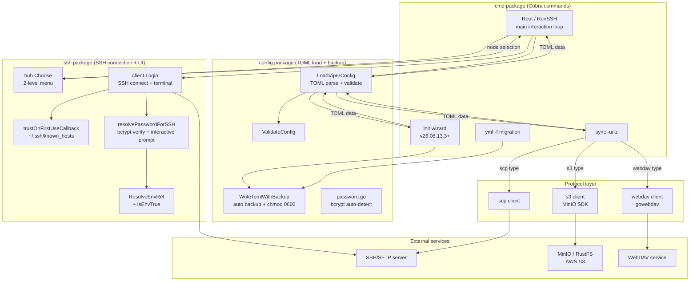

# mysshw

**A free and open source SSH command line client.** Written in Go 1.23+, runs on Linux, macOS, and Windows.

📖 [中文文档](readme.zh.md) · 📋 [Changelog](changelog.v26.07.08.0.md) · 📦 [Releases](https://github.com/cnphpbb/mysshw/releases)

> 🐳 **Windows users** — the official Docker image (`mysshw:latest`) is the recommended way to run mysshw on Windows. Native Windows has several terminal-semantic limitations; see [Windows (Native)](#windows-native-not-recommended) for details.

---

## Features

- 🚀 **SSH 2.0 full protocol** — terminal session with raw mode, adaptive window resize, KeepAlive
- 🔑 **Flexible authentication** — password, public key, key with passphrase, keyboard-interactive, bcrypt-pepper
- 🛡 **TOFU host key verification** — Trust On First Use with `~/.ssh/known_hosts` (shared with OpenSSH)
- 🛠 **TOML configuration** — node group organization, `${ENV_VAR}` password references (no plain-text storage)
- 🖥 **huh-based interactive menu** — Lipgloss colors, virtual "返回上级" node
- 🔌 **Config sync (remote backup)** — SCP, WebDAV, S3 (MinIO / RustFS / cloud S3)
- 🔁 **Loop-back main menu** — exit SSH session returns to the picker (no process restart)
- 🐳 **Docker image** — multi-stage build, ~21 MB, non-root user
- 📦 **Static binary** — `CGO_ENABLED=0`, runs anywhere
- 🔐 **File-level encryption** — AES-256-GCM + Argon2id, `mysshw encrypt` subcommand
- 🧩 **Config CRUD** — `mysshw config list/get/add/remove/update/diff` manage nodes without editing TOML
- 🛡 **Password hashing** — `mysshw hash gen/verify/pepper` supports bcrypt / bcrypt-pepper / argon2id
- 🌐 **TCP ping** — `mysshw ping` connectivity check (no root required)
- 📊 **System info** — `mysshw info` remote node information collection
- 🤖 **MCP server** — `mysshw mcp` exposes SSH operations as AI tools via stdio transport
- 🗂 **known_hosts management** — `mysshw hostkey list/show/remove/update/audit`
- 🔍 **Non-interactive commands** — `mysshw exec` / `list` / `copy` / `tunnel` with JSON output

---

## Installation

### From Source

```bash
git clone https://github.com/cnphpbb/mysshw.git
cd mysshw
go mod tidy
go install github.com/magefile/mage@latest
mage build
```

### Binary Release

Download a pre-built binary for your platform from the [Releases](https://github.com/cnphpbb/mysshw/releases) page.

### Docker

```bash
# Build
docker build -t mysshw:latest .
docker build -t mysshw:v26.07.08.0 \
  --build-arg VERSION=v26.07.08.0 \
  --build-arg BUILD=$(git rev-parse --short HEAD) \
  --build-arg BUILD_TIME=$(date -u +%Y-%m-%dT%H:%M:%SZ) .

# Run
docker run --rm -it mysshw:latest
docker run --rm -v $PWD/mysshw.toml:/home/mysshw/.mysshw.toml:ro mysshw
```

The image is based on `alpine:3.19`, runs as non-root `mysshw` user, and includes `ca-certificates` + `tzdata`. See `Dockerfile` for build details.

### Windows (Native, Not Recommended)

> ⚠️ mysshw uses Unix terminal semantics (raw mode, KeepAlive goroutines, `scp` binary invocation). On native Windows several features are limited. Use [Docker](#docker) instead whenever possible.

Limitations on native Windows:

- `Ctrl+D` does not exit (use `Ctrl+C` or `q | Q`)
- `scp.exe` must be in `PATH` for the `sync` subcommand
- Terminal raw mode behavior differs from Unix

If you must run on Windows natively:

1. Use PowerShell, Windows Terminal, WSL, or Git Bash
2. Install OpenSSH client, Git, and mingw64
3. Add to system `PATH`:
   - `C:\Windows\System32\OpenSSH`
   - `C:\Program Files\Git\usr\bin`
   - `C:\Program Files\Git\mingw64\bin`
   - `C:\Program Files\Git\usr\sbin`
   - `C:\Program Files\Git\usr\libexec\git-core`
   - `C:\Program Files\Git\mingw64\libexec\git-core`
4. Restart terminal

Example: `.\mysshw.exe -c D:\mydata\mysshw\mysshw.toml`

#### PowerShell Alias

`Set-Alias` does not support parameters, so create a function in your profile:

```powershell
notepad $profile   # open profile (create $PROFILE first if missing)

# Add to the profile:
function mysshw {
    D:\sbin\mysshw.exe -c D:\mydata\mysshw\mysshw.toml $args
}
```

Restart PowerShell to activate.

---

## Configuration

### File Location

The configuration file is searched in this order:

- `~/.mysshw.toml` (recommended)
- `~/.mysshw`
- `./.mysshw.toml`
- `./.mysshw`

Default: `$HOME/.mysshw.toml`. Override with `--cfg /path/to/your.toml`.

### Example

```toml
cfg_dir = "~/.mysshw.toml"   # default: $HOME/.mysshw.toml

[sync]
type = "scp"                  # scp | webdav | s3
remote_uri = "127.0.0.1:22"
remote_path = "/data/backup/mysshw/mysshw.toml"

[sync.scp]
username = "root"
password = "${MYSSHW_PWD_sync}"  # supports ${VAR} and ${VAR:-default}
keypath = ""
passphrase = ""

[sync.webdav]
auth = "Basic"                # Basic | Digest
username = "root"
password = "${MYSSHW_PWD_webdav}"

[sync.s3]
access_key = ""               # access key
secret_key = ""               # secret key
bucket_name = ""              # bucket name
region = ""                   # region
endpoint = ""                 # terminal node (empty → use remote_uri)

[[nodes]]
groups = "Groups01"

[[nodes.ssh]]
alias = "Test"
name = "vm-test-1"
host = "127.0.0.1"
user = "root"
password = "${MYSSHW_PWD_vm_test_1}"
#keypath = "~/.ssh/id_rsa"
#passphrase = "${MYSSHW_KEY_PASSPHRASE}"
#strict_host_key_checking = false  # skip host key check (test only)

[[nodes]]
groups = "Groups02"
ssh = [
    { name = "web01", host = "192.168.1.101", user = "admin", port = 22 },
    { name = "db01",  host = "192.168.1.102", user = "admin", keypath = "~/.ssh/id_rsa" },
]
```

> ⚠️ The configuration may contain password/key references. mysshw automatically tightens the loaded config file to mode `0600` (Windows uses NTFS ACL).

### Environment Variables

mysshw supports environment variables for non-interactive scenarios (CI / scripts / containers).

#### Host Key Verification

| Variable | Values | Description |
|----------|--------|-------------|
| `MYSSHW_SKIP_HOST_KEY_CHECK` | `true` / `1` / `yes` | Skip all host key checks (uses `InsecureIgnoreHostKey`). **MITM risk**, recommended only for test or isolated networks. |
| `MYSSHW_KNOWN_HOSTS` | absolute path | Custom `known_hosts` path. Highest priority, overrides `config.KnownHostsPath` and default `~/.ssh/known_hosts`. Supports `~` and `$HOME` expansion. |

#### Password & Key Passphrase (`${VAR}` References)

`password` and `passphrase` fields support shell-style `${VAR}` references, **avoiding plain-text storage**:

```toml
[[nodes.ssh]]
name = "web01"
host = "192.168.1.101"
user = "admin"
password = "${MYSSHW_PWD_web01}"            # required
# passphrase = "${MYSSHW_KEY_PASSPHRASE}"  # key passphrase also supported
# password = "${MYSSHW_PWD_x:-fallback}"   # default value when unset
# password = "${MYSSHW_PWD_x:-}"           # empty default, fall back to interactive prompt
```

**Syntax:**

- `${VAR}` — substitute `$VAR`; empty if unset
- `${VAR:-default}` — use `default` when `$VAR` is unset/empty (default may contain spaces or punctuation)
- Other text preserved as-is

**Usage examples:**

```bash
# Method 1: export before launch
export MYSSHW_PWD_web01='S3cret!'
mysshw -c ~/.mysshw.toml

# Method 2: integrate with secret managers (Vault, 1Password CLI, pass, etc.)
export MYSSHW_PWD_web01=$(op read 'op://vault/web01/password')
mysshw -c ~/.mysshw.toml
```

### File Permissions

mysshw automatically tightens the loaded config file to mode `0600` (owner-only). Backup files are protected the same way. On Windows, `chmod` is a no-op; permissions are controlled by NTFS ACL.

---

## Usage Examples

```bash
# View help
mysshw --help | -h

# Enter interactive mode (default with no arguments)
mysshw

# Specify configuration file path
mysshw --cfg /path/to/custom/config.toml
mysshw -c /path/to/custom/config.toml   # short option

# View version information
mysshw version | --version | -v

# Sync configuration file to remote server
mysshw sync --upload | -u

# Download configuration file from remote server
mysshw sync --down | -z

# Sync with custom configuration file path
mysshw sync --cfg /path/to/custom/config.toml --upload
mysshw sync -c /path/to/custom/config.toml -u   # mix short options

# Migrate from old sshw YAML config to mysshw TOML config
mysshw yml -f ~/.sshw.yml
mysshw yml --file ~/.sshw.yml   # long option

# View subcommand help
mysshw sync --help | -h
mysshw yml --help | -h
```

---

## Architecture



**Key design decisions:**

- **Config is the single source of truth** — every flow starts from `LoadViperConfig` → `ValidateConfig` → `chmod 0600`.
- **Env is internal to ssh** — `ssh.ResolveEnvRef` lives in the ssh package, not config. It's called by `resolvePasswordForSSH` in the SSH login path.
- **TOFU is opt-out, not opt-in** — `SSHNode.StrictHostKeyChecking = false` disables per-node; `MYSSHW_SKIP_HOST_KEY_CHECK=true` disables globally.
- **Sync is the only path to remote** — `mysshw sync -u` / `-z` is the explicit user action.
- **Backup is unified** — both `init` (wizard) and `yml` (legacy migration) routes go through `config.WriteTomlWithBackup`, with `backup_keep` (default 5) controlling retention.

---

## Development

### Building

```bash
# In project root
mage clean   # clean dist/
mage build   # development build (no tar)
mage pack    # release build (8 platforms + tar/zip + sha1)

./mysshw -h                # view help
./mysshw -c ./mysshw.toml  # run with config

# Create a shell alias for convenience
echo "alias mysshw='./mysshw -c ./mysshw.toml'" >> ~/.bashrc
source ~/.bashrc
```

### Docker Build Environment

```bash
docker compose -p base -f ./docker-compose.yml up -d
docker exec -it build_go bash
git config --global --add safe.directory /app

# Inside container
go mod tidy
go install github.com/magefile/mage@latest
mage build
```

### Testing

```bash
go test -v ./...
mage test          # with coverage report
```

We use [testify](http://github.com/stretchr/testify) as our Go testing framework. Test coverage includes:

- **230+ test cases** across 20+ test files
- SCP protocol layer: 100% covered
- `ValidateConfig`: 30+ cases covering all branches
- MCP server: 30+ unit tests (tool schema + handler + alias/dry-run/error/state isolation)
- `ssh/hostkey.go` TOFU + env var + callback strategy
- Mock SSH server (using `golang.org/x/crypto/ssh`) for end-to-end transfer tests

---

## TODO

Quick status — see [TODO.md](TODO.md) for the full list.

- ✅ P0: Repository hygiene (`.gitattributes`, `analysis.md` ignored, filter-repo cleanup)
- ✅ P0/P1: Critical bug fixes (SCP panic, Login callback)
- ✅ P1: Security (TOFU, env vars, chmod 0600, `${VAR}` password refs, bcrypt-pepper, file-level encryption)
- ✅ P2: Code quality (auth removed, tag unified, context propagation, etc.)
- ✅ P2: `ping` / `info` / `hostkey` / `config` CRUD / `hash` / `encrypt` subcommands
- ✅ P3: MCP server (AI integration), completions schema
- 🟡 P2: UI theme (deferred), S3/WebDAV mock tests, end-to-end SSH tests
- ⏸️ P3: CI/CD, Homebrew, Scoop (not goals)

---

## Tech Stack

- [github.com/magefile/mage](https://github.com/magefile/mage) — build system
- [github.com/spf13/cobra](https://github.com/spf13/cobra) — CLI framework
- [github.com/spf13/viper](https://github.com/spf13/viper) — config loading
- [github.com/GuanceCloud/toml](https://github.com/GuanceCloud/toml) — TOML codec
- [github.com/charmbracelet/huh](https://github.com/charmbracelet/huh) — TUI menus
- [github.com/charmbracelet/lipgloss](https://github.com/charmbracelet/lipgloss) — terminal styling
- [github.com/minio/minio-go/v7](https://github.com/minio/minio-go) — S3 client
- [github.com/studio-b12/gowebdav](https://github.com/studio-b12/gowebdav) — WebDAV client
- [golang.org/x/crypto/ssh](https://pkg.go.dev/golang.org/x/crypto/ssh) — SSH protocol
- [golang.org/x/term](https://pkg.go.dev/golang.org/x/term) — raw terminal
- [gopkg.in/yaml.v3](https://gopkg.in/yaml.v3) — YAML migration
- [github.com/stretchr/testify](https://github.com/stretchr/testify) — testing framework

See [go.mod](go.mod) for the complete list with versions.

---

## Contributing

Issues and PRs welcome! Project is MIT licensed.

For AI agents: see [AGENTS.md](AGENTS.md) for the development guide and process rules (commit format, tag/changelog workflow, branch classification).

---

## License

[MIT](LICENSE)

---

## Changelog

See [changelog.v26.07.08.0.md](changelog.v26.07.08.0.md) for the latest release. Process rule: every version tag on `main` must have a corresponding `changelog.${tag}.md` (see [AGENTS.md](AGENTS.md)).
