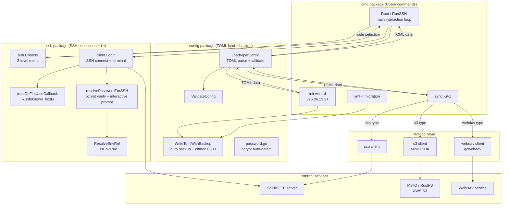

# mysshw

**A free and open source SSH command line client.** Written in Go 1.23+, runs on Linux, macOS, and Windows.

📖 [中文文档](readme.zh.md) · 📋 [Changelog](changelog.v26.07.12.0.md) · 📦 [Releases](https://github.com/cnphpbb/mysshw/releases)

> 🐳 **Windows users** — the official Docker image (`mysshw:latest`) is the recommended way to run mysshw on Windows. Native Windows has several terminal-semantic limitations; see [Windows (Native)](#windows-native-not-recommended) for details.

---

## Features

- 🚀 **SSH 2.0 full protocol** — terminal session with raw mode, adaptive window resize, KeepAlive
- 🔑 **Flexible authentication** — password, public key, key with passphrase, keyboard-interactive, bcrypt-pepper
- 🛡 **TOFU host key verification** — Trust On First Use with `~/.ssh/known_hosts` (shared with OpenSSH)
- 🛠 **TOML configuration** — node group organization, `${ENV_VAR}` password references (no plain-text storage)
- 🖥 **huh-based interactive menu** — Lipgloss colors, virtual "返回上级" node
- 🔌 **Config sync (remote backup)** — SCP, WebDAV, S3 (MinIO / RustFS / cloud S3)
- 🔁 **Loop-back main menu** — exit SSH session returns to the picker (no process restart)
- 🐳 **Docker image** — multi-stage build, ~21 MB, non-root user
- 📦 **Static binary** — `CGO_ENABLED=0`, runs anywhere
- 🔐 **File-level encryption** — AES-256-GCM + Argon2id, `mysshw encrypt` subcommand
- 🧩 **Config CRUD** — `mysshw config list/get/add/remove/update/diff` manage nodes without editing TOML
- 🛡 **Password hashing** — `mysshw hash gen/verify/pepper` supports bcrypt / bcrypt-pepper / argon2id
- 🌐 **TCP ping** — `mysshw ping` connectivity check (no root required)
- 📊 **System info** — `mysshw info` remote node information collection
- 🤖 **MCP server** — `mysshw mcp` exposes SSH operations as AI tools via stdio transport
- 🗂 **known_hosts management** — `mysshw hostkey list/show/remove/update/audit`
- 🔍 **Non-interactive commands** — `mysshw exec` / `list` / `copy` / `tunnel` with JSON output

---

## Installation

### From Source

```bash
git clone https://github.com/cnphpbb/mysshw.git
cd mysshw
go mod tidy
go install github.com/magefile/mage@latest
mage build
```

### Binary Release

Download a pre-built binary for your platform from the [Releases](https://github.com/cnphpbb/mysshw/releases) page.

### Docker

```bash
# Build
docker build -t mysshw:latest .
docker build -t mysshw:v26.07.12.0 \
  --build-arg VERSION=v26.07.12.0 \
  --build-arg BUILD=$(git rev-parse --short HEAD) \
  --build-arg BUILD_TIME=$(date -u +%Y-%m-%dT%H:%M:%SZ) .

# Run
docker run --rm -it mysshw:latest
docker run --rm -v $PWD/mysshw.toml:/home/mysshw/.mysshw.toml:ro mysshw
```

The image is based on `alpine:3.19`, runs as non-root `mysshw` user, and includes `ca-certificates` + `tzdata`. See `Dockerfile` for build details.

### Windows (Native, Not Recommended)

> ⚠️ mysshw uses Unix terminal semantics (raw mode, KeepAlive goroutines, `scp` binary invocation). On native Windows several features are limited. Use [Docker](#docker) instead whenever possible.

Limitations on native Windows:

- `Ctrl+D` does not exit (use `Ctrl+C` or `q | Q`)
- `scp.exe` must be in `PATH` for the `sync` subcommand
- Terminal raw mode behavior differs from Unix

If you must run on Windows natively:

1. Use PowerShell, Windows Terminal, WSL, or Git Bash
2. Install OpenSSH client, Git, and mingw64
3. Add to system `PATH`:
   - `C:\Windows\System32\OpenSSH`
   - `C:\Program Files\Git\usr\bin`
   - `C:\Program Files\Git\mingw64\bin`
   - `C:\Program Files\Git\usr\sbin`
   - `C:\Program Files\Git\usr\libexec\git-core`
   - `C:\Program Files\Git\mingw64\libexec\git-core`
4. Restart terminal

Example: `.\mysshw.exe -c D:\mydata\mysshw\mysshw.toml`

#### PowerShell Alias

`Set-Alias` does not support parameters, so create a function in your profile:

```powershell
notepad $profile   # open profile (create $PROFILE first if missing)

# Add to the profile:
function mysshw {
    D:\sbin\mysshw.exe -c D:\mydata\mysshw\mysshw.toml $args
}
```

Restart PowerShell to activate.

---

## Configuration

### File Location

The configuration file is searched in this order:

- `~/.mysshw.toml` (recommended)
- `~/.mysshw`
- `./.mysshw.toml`
- `./.mysshw`

Default: `$HOME/.mysshw.toml`. Override with `--cfg /path/to/your.toml`.

### Example

```toml
cfg_dir = "~/.mysshw.toml"   # default: $HOME/.mysshw.toml

[sync]
type = "scp"                  # scp | webdav | s3
remote_uri = "127.0.0.1:22"
remote_path = "/data/backup/mysshw/mysshw.toml"

[sync.scp]
username = "root"
password = "${MYSSHW_PWD_sync}"  # supports ${VAR} and ${VAR:-default}
keypath = ""
passphrase = ""

[sync.webdav]
auth = "Basic"                # Basic | Digest
username = "root"
password = "${MYSSHW_PWD_webdav}"

[sync.s3]
access_key = ""               # access key
secret_key = ""               # secret key
bucket_name = ""              # bucket name
region = ""                   # region
endpoint = ""                 # terminal node (empty → use remote_uri)

[[nodes]]
groups = "Groups01"

[[nodes.ssh]]
alias = "Test"
name = "vm-test-1"
host = "127.0.0.1"
user = "root"
password = "${MYSSHW_PWD_vm_test_1}"
#keypath = "~/.ssh/id_rsa"
#passphrase = "${MYSSHW_KEY_PASSPHRASE}"
#strict_host_key_checking = false  # skip host key check (test only)

[[nodes]]
groups = "Groups02"
ssh = [
    { name = "web01", host = "192.168.1.101", user = "admin", port = 22 },
    { name = "db01",  host = "192.168.1.102", user = "admin", keypath = "~/.ssh/id_rsa" },
]
```

> ⚠️ The configuration may contain password/key references. mysshw automatically tightens the loaded config file to mode `0600` (Windows uses NTFS ACL).

### Environment Variables

mysshw supports environment variables for non-interactive scenarios (CI / scripts / containers).

#### Host Key Verification

| Variable | Values | Description |
|----------|--------|-------------|
| `MYSSHW_SKIP_HOST_KEY_CHECK` | `true` / `1` / `yes` | Skip all host key checks (uses `InsecureIgnoreHostKey`). **MITM risk**, recommended only for test or isolated networks. |
| `MYSSHW_KNOWN_HOSTS` | absolute path | Custom `known_hosts` path. Highest priority, overrides `config.KnownHostsPath` and default `~/.ssh/known_hosts`. Supports `~` and `$HOME` expansion. |

#### Password & Key Passphrase (`${VAR}` References)

`password` and `passphrase` fields support shell-style `${VAR}` references, **avoiding plain-text storage**:

```toml
[[nodes.ssh]]
name = "web01"
host = "192.168.1.101"
user = "admin"
password = "${MYSSHW_PWD_web01}"            # required
# passphrase = "${MYSSHW_KEY_PASSPHRASE}"  # key passphrase also supported
# password = "${MYSSHW_PWD_x:-fallback}"   # default value when unset
# password = "${MYSSHW_PWD_x:-}"           # empty default, fall back to interactive prompt
```

**Syntax:**

- `${VAR}` — substitute `$VAR`; empty if unset
- `${VAR:-default}` — use `default` when `$VAR` is unset/empty (default may contain spaces or punctuation)
- Other text preserved as-is

**Usage examples:**

```bash
# Method 1: export before launch
export MYSSHW_PWD_web01='S3cret!'
mysshw -c ~/.mysshw.toml

# Method 2: integrate with secret managers (Vault, 1Password CLI, pass, etc.)
export MYSSHW_PWD_web01=$(op read 'op://vault/web01/password')
mysshw -c ~/.mysshw.toml
```

### Password Hashing (bcrypt)

In addition to `${VAR}` references, the `password` and `passphrase` fields also accept **bcrypt hashes** — store the hash in TOML, then verify against user-typed plaintext at runtime. This avoids plaintext-on-disk without requiring an external secret manager.

#### 4 Password Formats Compared

`mysshw list -o json` auto-detects the following formats via the `auth` field (a `keypath` adds a `+key` suffix, e.g. `bcrypt+key`):

| Format | TOML Syntax | `auth` Field | Runtime Behavior | Use Case |
|--------|-------------|--------------|------------------|----------|
| `${ENV}` reference | `password = "${MYSSHW_PWD_x}"` | `env` | `ssh.ResolveEnvRef` resolves | K8s Secret / Vault / CI |
| **bcrypt hash** | `password = "$2a$10$xxxxx..."` | `bcrypt` | prompt for plaintext → bcrypt verify | Static config + shared use |
| **bcrypt + pepper** | `password = "$2a$10$..."` + top-level `secret_key` | `bcrypt-pepper` | bcrypt verify + secret_key HMAC | Mitigate offline brute-force after config leak |
| Plaintext | `password = "my-secret"` | `password` | use directly | One-off tests (⚠️ not recommended) |
| Empty + keypath | `password = ""` + `keypath` | `key` | public-key auth | CI / automation / bastion |

**Auto-detection rules** (no extra marker needed):

- Starts with `$2a$` / `$2b$` / `$2y$` AND length 60 → bcrypt hash
- Starts with `$argon2id$` / `$pbkdf2-sha256$` → Argon2id / PBKDF2-SHA256 (recognized as placeholders, fallback to bcrypt verify at runtime)
- Starts with `${` → env reference
- Other non-empty string → plaintext

#### Configuration Examples

```toml
# Node A: bcrypt hash (avoids plaintext-on-disk, recommended for shared static configs)
[[nodes.ssh]]
name = "prod-db-1"
alias = "DB01"
host = "10.0.0.5"
user = "postgres"
port = 5432
# plaintext: prod-db-password-2024
password = "$2a$10$BBEDysNBBCnf/RwKMLiea.ufVrsybvoes.HYz8w.6wtff7TSLhjsC"

# Node B: bcrypt + secret_key pepper (mitigates offline brute-force after config leak)
# Pairs with top-level encryption_algorithm = "bcrypt-pepper" + secret_key = "..."
[[nodes.ssh]]
name = "prod-secure-1"
alias = "SecureDB"
host = "10.0.0.200"
user = "postgres"
password = "$2a$10$BBEDysNBBCnf/RwKMLiea.ufVrsybvoes.HYz8w.6wtff7TSLhjsC"

# Node C: pure public-key auth (recommended for CI / automation / bastion)
[[nodes.ssh]]
name = "prod-deploy-1"
host = "10.0.0.50"
user = "deploy"
# keypath = "~/.ssh/id_ed25519"   # enable key auth, leave password empty
```

#### `mysshw hash` Subcommand

The `hash` subcommand generates / verifies hashes and produces a server-side secret (pepper):

```bash
# Generate a bcrypt hash (default cost=10, ~60ms per hash)
mysshw hash gen 'my-password'
# Output: $2a$10$xxxxx...  (60 chars, paste into password field)

# Generate a bcrypt-pepper hash (concatenates secret into the hash)
mysshw hash gen --algo=bcrypt-pepper --pepper='my-server-secret' 'plaintext'

# Custom cost (4-31, default 10; higher = slower + more secure)
mysshw hash gen --cost=12 'my-password'

# Verify a hash against plaintext (plaintext read from stdin, not echoed)
echo -n 'my-password' | mysshw hash verify '$2a$10$xxx...'
echo -n 'my-password' | mysshw hash verify '$2a$10$xxx...' --pepper='my-secret'
# exit 0 = match, exit 1 = mismatch

# Generate a new random secret_key (32 bytes base64, 44 chars)
mysshw hash pepper
export MYSSHW_SECRET_KEY=$(mysshw hash pepper)

# Embed in scripts (output goes to stderr by default; --stdout for piping)
PWD_HASH=$(mysshw hash gen --stdout 'real-password')
```

Supported algorithms (`--algo`):

| Algorithm | Hash Format | Status |
|-----------|-------------|--------|
| `bcrypt` (default) | `$2a$10$...` | ✅ implemented |
| `bcrypt-pepper` | `$2a$10$...` (with pepper) | ✅ implemented |
| `argon2id` | `$argon2id$...` | 🟡 placeholder (fallback to bcrypt verify) |
| `pbkdf2-sha256` | `$pbkdf2-sha256$...` | 🟡 placeholder (fallback to bcrypt verify) |

#### bcrypt-pepper Mode (Recommended for Production)

`bcrypt-pepper` is a hardened variant of bcrypt: **even if the config file leaks, an attacker holding only the hash cannot brute-force offline** because they must additionally know the server-side `secret_key` (the "pepper").

```toml
# Top-level fields (set once per config)
encryption_algorithm = "bcrypt-pepper"            # enable bcrypt-pepper mode
secret_key = "${MYSSHW_SECRET_KEY}"                # reference env, not plaintext

# Node fields stay the same (still bcrypt hashes)
[[nodes.ssh]]
name = "prod-secure-1"
host = "10.0.0.200"
user = "postgres"
password = "$2a$10$BBEDysNBBCnf/RwKMLiea.ufVrsybvoes.HYz8w.6wtff7TSLhjsC"
```

Workflow:

```bash
# 1. Generate a random secret_key (32 bytes base64)
export MYSSHW_SECRET_KEY=$(mysshw hash pepper)

# 2. Generate node hash with the secret (one-time)
mysshw hash gen --algo=bcrypt-pepper --pepper="$MYSSHW_SECRET_KEY" 'real-password' \
    > /tmp/node.hash

# 3. Paste /tmp/node.hash contents into the TOML password field
# 4. Store secret_key in env var / K8s Secret (MUST keep secret!)

# 5. Smoke test
mysshw exec --node prod-secure-1 -- 'echo OK'
```

**Security notes:**

- Lost `secret_key` → all bcrypt-pepper nodes become unreachable (must regenerate + rehash every node)
- `secret_key` must stay secret; the `password` field hash can be shared freely (same idea as K8s Secret)
- Rotating `secret_key` requires verifying old + rehashing all nodes with the new secret
- **Non-interactive scenarios (AI / `mysshw exec`)**: bcrypt nodes are rejected outright (message: "bcrypt 哈希节点需要在终端中输入明文密码，或改用 ${ENV} 引用"), so CI / batch execution must use `${ENV}` references

#### End-to-End Workflow Examples

```bash
# === Scenario 1: add a node using bcrypt (interactive login) ===
HASH=$(mysshw hash gen --stdout 'node-password')
echo "password = \"$HASH\"" >> ~/.mysshw.toml

# === Scenario 2: add a node using bcrypt-pepper (production-recommended) ===
export MYSSHW_SECRET_KEY=$(mysshw hash pepper)
HASH=$(mysshw hash gen --stdout --algo=bcrypt-pepper --pepper="$MYSSHW_SECRET_KEY" 'node-password')
echo "password = \"$HASH\"" >> ~/.mysshw.toml

# === Scenario 3: audit existing node auth methods ===
mysshw list -o json | jq '.[] | select(.auth | startswith("bcrypt")) | .name'

# === Scenario 4: rotate secret_key ===
# 1. Backup: cp mysshw.toml mysshw.toml.bak
# 2. Generate new secret: mysshw hash pepper
# 3. Rehash each bcrypt-pepper node with the new secret:
#      mysshw hash gen --algo=bcrypt-pepper --pepper="<new secret>" <plaintext>
#    (verify old hashes still authenticate on a host that still has the old secret before switching)
# 4. Update secret_key field to the new value
# 5. Verify: mysshw list (all nodes parse) → mysshw exec (smoke test)
# 6. Remove backup: rm mysshw.toml.bak
```

### File-Level Encryption (`mysshw encrypt`)

bcrypt / bcrypt-pepper protects only the `password` and `passphrase` fields; other sensitive fields (`host`, `user`, `keypath`, `${MYSSHW_PWD_xxx}` references, etc.) still appear as plaintext in TOML. **File-level encryption** encrypts the entire `mysshw.toml` with a passphrase — only after decryption does the content enter viper, eliminating plaintext leaks at the source.

#### bcrypt / bcrypt-pepper vs File-Level Encryption

| Dimension | bcrypt / bcrypt-pepper | File-Level Encryption |
|-----------|------------------------|------------------------|
| Scope | `password` / `passphrase` fields only | entire TOML file |
| Can you edit the file post-protection? | ✅ yes (direct edit) | ❌ must decrypt first |
| Safe to git / S3 share the file? | ⚠️ host / keypath still plaintext | ✅ entire file unreadable |
| Consequence of losing passphrase | nodes unreachable (regenerable) | **entire file unrecoverable** |
| Performance cost | bcrypt verify ~60ms per node | Argon2id KDF ~300-500ms per load |
| Best for | passwords must not be plaintext on disk | whole config must not leak (shared / backup / git) |

**The two schemes stack**: bcrypt nodes inside an encrypted file = highest tier (encrypted file stolen → attacker has no hash; passphrase lost → attacker also cannot decrypt → double protection).

#### Encrypted File Format

The encrypted file is **binary** with a fixed 37-byte header followed by ciphertext:

```
+--------+--------+----------+----------+----------+---------------------+
| magic  | kdf_id | salt     | nonce    | ct_len   | ciphertext (w/ tag) |
| "MSEC" | 1B     | 16B      | 12B      | uint32   | N bytes             |
+--------+--------+----------+----------+----------+---------------------+
```

- **magic** = `MSEC` (ASCII, mysshw Encrypted Config) — key marker for auto-detection
- **kdf_id** = `0x01` (Argon2id) — reserved for future KDFs
- **salt** = Argon2id salt, 16 bytes, regenerated every encryption
- **nonce** = AES-256-GCM nonce, 12 bytes, regenerated every encryption
- **ct_len** = ciphertext length, 4 bytes big-endian
- **ciphertext** = AES-256-GCM output (includes 16-byte auth tag)

**Algorithms:**

- **KDF**: Argon2id (`time=3, memory=64MB, threads=4, keylen=32`) — OWASP 2023 recommended parameters, single derivation ~300-500ms
- **Cipher**: AES-256-GCM (authenticated encryption, tamper-detecting)
- **Auto-detection**: `LoadViperConfig` reads the first 4 bytes of the file; if they equal `MSEC`, it treats the file as encrypted and automatically prompts for a passphrase

#### `mysshw encrypt` Subcommand

```bash
# === Encryption ===
# Interactive passphrase + default in-place overwrite
mysshw encrypt

# Explicit input / output
mysshw encrypt -c /path/to/input.toml -o /path/to/output.toml

# Pipeline passphrase (script-friendly)
echo "$MYSSHW_PASSPHRASE" | mysshw encrypt -c ~/.mysshw.toml

# Output to stdout (for piping)
mysshw encrypt -c ~/.mysshw.toml --stdout > encrypted.bin

# === Decryption ===
# Default output is stdout (good for eyeballing / piping)
mysshw encrypt decrypt -c ~/.mysshw.toml
mysshw encrypt decrypt -c ~/.mysshw.toml -o plain.toml
mysshw encrypt decrypt -i encrypted.toml -o plain.toml
```

Available flags:

| flag | default | description |
|------|---------|-------------|
| `--in` / `-i` | `--cfg` / `~/.mysshw.toml` | input file |
| `--out` / `-o` | encrypt in-place / decrypt stdout | output file |
| `--in-place` | `true` (encrypt only) | overwrite the input file |
| `--stdout` | `false` | write to stdout (pipe-friendly) |

**Passphrase source**: always read from stdin (`readPassphraseInteractive`); supports interactive input or `echo "..." | mysshw encrypt`. Note: the current implementation uses `bufio.Scanner`, so the **passphrase is echoed on the terminal** (not a secure input). For production deployment, pass it via a pipeline or run inside a secure terminal.

#### Workflow Examples

```bash
# === Scenario 1: encrypt an existing plaintext config ===
# 1. Backup plaintext (in case passphrase is lost)
cp ~/.mysshw.toml ~/.mysshw.toml.bak

# 2. Encrypt
echo "$passphrase" | mysshw encrypt -c ~/.mysshw.toml

# 3. Verify the encrypted file works
echo "$passphrase" | mysshw list -c ~/.mysshw.toml -o json

# 4. Remove the plaintext backup (after confirming encrypted file is OK)
rm ~/.mysshw.toml.bak

# === Scenario 2: use encrypted config in CI / scripts ===
export MYSSHW_PASSPHRASE=$(vault read -field=passphrase secret/mysshw)
echo "$MYSSHW_PASSPHRASE" | mysshw exec -c /etc/mysshw/encrypted.toml --node web01 -- 'uptime'

# === Scenario 3: edit an encrypted config (must decrypt first) ===
echo "$passphrase" | mysshw encrypt decrypt -c ~/.mysshw.toml -o /tmp/plain.toml
vim /tmp/plain.toml
echo "$passphrase" | mysshw encrypt -i /tmp/plain.toml -o ~/.mysshw.toml
rm /tmp/plain.toml

# === Scenario 4: rotate passphrase ===
# 1. Decrypt with the old passphrase
echo "$old_passphrase" | mysshw encrypt decrypt -c ~/.mysshw.toml -o /tmp/plain.toml
# 2. Re-encrypt with the new passphrase
echo "$new_passphrase" | mysshw encrypt -i /tmp/plain.toml -o ~/.mysshw.toml
# 3. Verify
echo "$new_passphrase" | mysshw list -c ~/.mysshw.toml -o json | jq '.[0].name'
# 4. Remove the temporary plaintext
rm /tmp/plain.toml
# 5. (Optional) sync the encrypted file to remote
mysshw sync --upload
```

#### Security Notes

- ⚠️ **Lost passphrase = unrecoverable data** (mysshw stores no derived key / recovery key)
- ⚠️ **Encrypted file itself is shareable** (salt / nonce are public), but the passphrase must stay secret
- ✅ **Wrong passphrase / tampered ciphertext → AES-GCM auth tag fails**, immediate error (no partial plaintext leaked)
- ✅ **Atomic write**: encrypt uses `tmpfile + rename`, no half-written state
- ✅ **Output file mode 0600**: even the plaintext backup is owner-only readable
- ✅ **Rejects double encryption**: encrypting an already-encrypted file errors immediately (no double wrap)
- ✅ **Pairs with `sync`**: ship the encrypted file to remote / S3 / WebDAV — no link in the chain ever sees plaintext

### File Permissions

mysshw automatically tightens the loaded config file to mode `0600` (owner-only). Backup files are protected the same way. On Windows, `chmod` is a no-op; permissions are controlled by NTFS ACL.

---

## Usage Examples

```bash
# View help
mysshw --help | -h

# Enter interactive mode (default with no arguments)
mysshw

# Specify configuration file path
mysshw --cfg /path/to/custom/config.toml
mysshw -c /path/to/custom/config.toml   # short option

# View version information
mysshw version | --version | -v

# Sync configuration file to remote server
mysshw sync --upload | -u

# Download configuration file from remote server
mysshw sync --down | -z

# Sync with custom configuration file path
mysshw sync --cfg /path/to/custom/config.toml --upload
mysshw sync -c /path/to/custom/config.toml -u   # mix short options

# Migrate from old sshw YAML config to mysshw TOML config
mysshw yml -f ~/.sshw.yml
mysshw yml --file ~/.sshw.yml   # long option

# View subcommand help
mysshw sync --help | -h
mysshw yml --help | -h
```

---

## Architecture



**Key design decisions:**

- **Config is the single source of truth** — every flow starts from `LoadViperConfig` → `ValidateConfig` → `chmod 0600`.
- **Env is internal to ssh** — `ssh.ResolveEnvRef` lives in the ssh package, not config. It's called by `resolvePasswordForSSH` in the SSH login path.
- **TOFU is opt-out, not opt-in** — `SSHNode.StrictHostKeyChecking = false` disables per-node; `MYSSHW_SKIP_HOST_KEY_CHECK=true` disables globally.
- **Sync is the only path to remote** — `mysshw sync -u` / `-z` is the explicit user action.
- **Backup is unified** — both `init` (wizard) and `yml` (legacy migration) routes go through `config.WriteTomlWithBackup`, with `backup_keep` (default 5) controlling retention.

---

## Development

### Building

```bash
# In project root
mage clean   # clean dist/
mage build   # development build (no tar)
mage pack    # release build (8 platforms + tar/zip + sha1)

./mysshw -h                # view help
./mysshw -c ./mysshw.toml  # run with config

# Create a shell alias for convenience
echo "alias mysshw='./mysshw -c ./mysshw.toml'" >> ~/.bashrc
source ~/.bashrc
```

### Docker Build Environment

```bash
docker compose -p base -f ./docker-compose.yml up -d
docker exec -it build_go bash
git config --global --add safe.directory /app

# Inside container
go mod tidy
go install github.com/magefile/mage@latest
mage build
```

### Testing

```bash
go test -v ./...
mage test          # with coverage report
```

We use [testify](http://github.com/stretchr/testify) as our Go testing framework. Test coverage includes:

- **230+ test cases** across 20+ test files
- SCP protocol layer: 100% covered
- `ValidateConfig`: 30+ cases covering all branches
- MCP server: 30+ unit tests (tool schema + handler + alias/dry-run/error/state isolation)
- `ssh/hostkey.go` TOFU + env var + callback strategy
- Mock SSH server (using `golang.org/x/crypto/ssh`) for end-to-end transfer tests

---

## TODO

Quick status — see [TODO.md](TODO.md) for the full list.

- ✅ P0: Repository hygiene (`.gitattributes`, `analysis.md` ignored, filter-repo cleanup)
- ✅ P0/P1: Critical bug fixes (SCP panic, Login callback)
- ✅ P1: Security (TOFU, env vars, chmod 0600, `${VAR}` password refs, bcrypt-pepper, file-level encryption)
- ✅ P2: Code quality (auth removed, tag unified, context propagation, etc.)
- ✅ P2: `ping` / `info` / `hostkey` / `config` CRUD / `hash` / `encrypt` subcommands
- ✅ P3: MCP server (AI integration), completions schema
- 🟡 P2: UI theme (deferred), S3/WebDAV mock tests, end-to-end SSH tests
- ⏸️ P3: CI/CD, Homebrew, Scoop (not goals)

---

## Tech Stack

- [github.com/magefile/mage](https://github.com/magefile/mage) — build system
- [github.com/spf13/cobra](https://github.com/spf13/cobra) — CLI framework
- [github.com/spf13/viper](https://github.com/spf13/viper) — config loading
- [github.com/GuanceCloud/toml](https://github.com/GuanceCloud/toml) — TOML codec
- [github.com/charmbracelet/huh](https://github.com/charmbracelet/huh) — TUI menus
- [github.com/charmbracelet/lipgloss](https://github.com/charmbracelet/lipgloss) — terminal styling
- [github.com/minio/minio-go/v7](https://github.com/minio/minio-go) — S3 client
- [github.com/studio-b12/gowebdav](https://github.com/studio-b12/gowebdav) — WebDAV client
- [golang.org/x/crypto/ssh](https://pkg.go.dev/golang.org/x/crypto/ssh) — SSH protocol
- [golang.org/x/term](https://pkg.go.dev/golang.org/x/term) — raw terminal
- [gopkg.in/yaml.v3](https://gopkg.in/yaml.v3) — YAML migration
- [github.com/stretchr/testify](https://github.com/stretchr/testify) — testing framework

See [go.mod](go.mod) for the complete list with versions.

---

## Contributing

Issues and PRs welcome! Project is MIT licensed.

For AI agents: see [AGENTS.md](AGENTS.md) for the development guide and process rules (commit format, tag/changelog workflow, branch classification).

---

## License

[MIT](LICENSE)

---

## Changelog

See [changelog.v26.07.08.0.md](changelog.v26.07.08.0.md) for the latest release. Process rule: every version tag on `main` must have a corresponding `changelog.${tag}.md` (see [AGENTS.md](AGENTS.md)).
