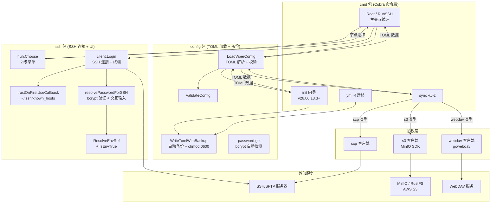

# mysshw

**开源免费的SSH命令行客户端工具**  
**Go 1.23.0 及以上版本**  
**支持 Linux、macOS、Windows 平台（Windows 强烈推荐使用 Docker）**

[English Documentation](readme.md) · [更新日志](changelog.v26.06.13.2.md)

> 🐳 **Docker 用户**：官方镜像（`mysshw:latest`）是 Windows 以及任何终端行为与 Unix 不一致的运行环境下的**推荐运行方式**。详见 [Docker](#docker)。

## 功能特性

- 🚀 **SSH 2.0 协议全功能** — 终端会话（Raw 模式）、窗口自适应、KeepAlive 保活
- 🔑 **灵活认证方式** — 密码、密钥、带密码短语密钥、键盘交互
- 🛡 **主机指纹校验 (TOFU)** — Trust On First Use，共享 `~/.ssh/known_hosts`
- 🛠 **TOML 配置管理** — 节点分组、`${ENV_VAR}` 密码引用（避免明文落盘）
- 🖥 **huh 交互式菜单** — Lipgloss 颜色高亮、虚拟"返回上级"节点
- 🔌 **配置远程同步** — SCP、WebDAV、S3（MinIO / RustFS / 云 S3）
- 🔁 **会话可循环** — 退出 SSH 自动返回主菜单，无需重启进程
- 🐳 **Docker 镜像** — 多阶段构建，~21 MB，非 root 用户
- 📦 **静态二进制** — `CGO_ENABLED=0`，跨平台直接运行

## 安装指南

### 从源码安装

```bash
git clone https://github.com/cnphpbb/mysshw.git mysshw
cd mysshw
go mod tidy
go install github.com/magefile/mage@latest
mage build
```

### 下载二进制

访问 [Release 页面](https://github.com/cnphpbb/mysshw/releases) 下载对应平台版本。

### Docker

```bash
# 构建
docker build -t mysshw:latest .
docker build -t mysshw:v26.06.13.2 \
  --build-arg VERSION=v26.06.13.2 \
  --build-arg BUILD=$(git rev-parse --short HEAD) \
  --build-arg BUILD_TIME=$(date -u +%Y-%m-%dT%H:%M:%SZ) .

# 运行
docker run --rm -it mysshw:latest
docker run --rm -v $PWD/mysshw.toml:/home/mysshw/.mysshw.toml:ro mysshw
```

镜像基于 `alpine:3.19`，以非 root 用户 `mysshw` 运行，包含 ca-certificates + tzdata。详见 `Dockerfile`。

> **为什么 Windows 推荐 Docker**：mysshw 深度使用 Unix 终端语义（Raw 模式、KeepAlive goroutines、scp 二进制调用）。Windows 原生环境有多项限制（`Ctrl+D` 无效、需将 `scp.exe` 加入 PATH 等）。Docker 提供一致的 Linux 用户态，是 Windows 下的推荐运行方式。

## 配置文件

配置文件可放在以下任一位置：
- `~/.mysshw.toml`（推荐）
- `~/.mysshw`
- `./.mysshw.toml`
- `./.mysshw`

默认路径：`$HOME/.mysshw.toml`。可用 `--cfg /path/to/your.toml` 自定义。

### 配置示例

```toml
cfg_dir = "~/.mysshw.toml"   # default: $HOME/.mysshw.toml

[sync]
type = "scp"                  # scp | webdav | s3
remote_uri = "127.0.0.1:22"
remote_path = "/data/backup/mysshw/mysshw.toml"

[sync.scp]
username = "root"
password = "${MYSSHW_PWD_sync}"  # 支持 ${VAR} 和 ${VAR:-default}
keypath = ""
passphrase = ""

[sync.webdav]
auth = "Basic"                # Basic | Digest
username = "root"
password = "${MYSSHW_PWD_webdav}"

[sync.s3]
access_key = ""               # 访问密钥
secret_key = ""               # 密钥
bucket_name = ""              # 桶名
region = ""                   # 区域
endpoint = ""                 # 终端节点 (空 → 用 remote_uri)

[[nodes]]
groups = "Groups01"

[[nodes.ssh]]
alias = "Test"
name = "vm-test-1"
host = "127.0.0.1"
user = "root"
password = "${MYSSHW_PWD_vm_test_1}"
#keypath = "~/.ssh/id_rsa"
#passphrase = "${MYSSHW_KEY_PASSPHRASE}"
#strict_host_key_checking = false  # 跳过主机指纹校验 (仅测试)

[[nodes]]
groups = "Groups02"
ssh = [
    { name = "web01", host = "192.168.1.101", user = "admin", port = 22 },
    { name = "db01",  host = "192.168.1.102", user = "admin", keypath = "~/.ssh/id_rsa" },
]
```

> ⚠️ 配置文件可能含密码/密钥引用，mysshw 加载后会自动收紧到 `0600`（Windows 由 NTFS ACL 控制）。

## 架构



**关键设计决策**：

- **config 是唯一真相源**：所有流程都从 `LoadViperConfig` → `ValidateConfig` → `chmod 0600` 开始
- **Env 属于 ssh 包内部**：`ssh.ResolveEnvRef` 位于 ssh 包而非 config，由 `resolvePasswordForSSH` 在 SSH 登录路径调用
- **TOFU 默认开启，opt-out 关闭**：`SSHNode.StrictHostKeyChecking = false` 关闭单节点；`MYSSHW_SKIP_HOST_KEY_CHECK=true` 全局关闭
- **远程写入只能通过 sync**：没有隐式远程写，`mysshw sync -u` / `-z` 是用户显式动作
- **备份机制统一**：`init`（向导）和 `yml`（迁移）路径都走 `config.WriteTomlWithBackup`，`backup_keep`（默认 5）控制保留数量

## 环境变量 (Environment Variables)

mysshw 支持以下环境变量，用于非交互式场景（CI/脚本/容器）。

### 主机指纹校验

| 变量名 | 取值 | 说明 |
|--------|------|------|
| `MYSSHW_SKIP_HOST_KEY_CHECK` | `true` / `1` / `yes` | 跳过所有主机指纹校验（用 `InsecureIgnoreHostKey`）。**有 MITM 风险**，仅推荐测试或隔离网络环境。 |
| `MYSSHW_KNOWN_HOSTS` | 绝对路径 | 自定义 `known_hosts` 文件路径。优先级最高，覆盖 `config.KnownHostsPath` 和默认 `~/.ssh/known_hosts`。支持 `~` 和 `$HOME` 展开。 |

### 密码与私钥口令（`${VAR}` 引用）

`password` 和 `passphrase` 字段支持 Shell 风格的 `${VAR}` 引用，**避免明文落盘**：

```toml
[[nodes.ssh]]
name = "web01"
host = "192.168.1.101"
user = "admin"
password = "${MYSSHW_PWD_web01}"            # 必填
# passphrase = "${MYSSHW_KEY_PASSPHRASE}"  # 私钥口令同样支持
# password = "${MYSSHW_PWD_x:-fallback}"   # 未设置时使用默认值
# password = "${MYSSHW_PWD_x:-}"           # 未设置时为空, 走交互输入
```

**语法**：
- `${VAR}` — 取环境变量 `$VAR`；未设置或为空时替换为空字符串
- `${VAR:-default}` — `$VAR` 未设置或为空时使用 `default`（default 可含空格、标点）
- 其他文本原样保留

**使用示例**：

```bash
# 方式 1: 启动前 export
export MYSSHW_PWD_web01='S3cret!'
mysshw -c ~/.mysshw.toml

# 方式 2: 配合 secret 管理工具 (Vault, 1Password CLI, pass 等)
export MYSSHW_PWD_web01=$(op read 'op://vault/web01/password')
mysshw -c ~/.mysshw.toml
```

### 配置文件权限

mysshw 加载配置后会自动将权限收紧到 `0600`（仅所有者可读写），备份文件同样处理。
Windows 上 `Chmod` 是 no-op，权限由 NTFS ACL 控制。

## 使用示例

```bash
# 查看帮助信息
mysshw --help | -h

# 启动程序（无参数时默认进入交互模式）
mysshw

# 指定配置文件路径
mysshw --cfg /path/to/custom/config.toml
mysshw -c /path/to/custom/config.toml   # 短选项

# 查看版本信息
mysshw version | --version | -v

# 同步配置文件到远程服务器
mysshw sync --upload | -u

# 从远程服务器下载配置文件
mysshw sync --down | -z

# 使用自定义配置文件路径进行同步
mysshw sync --cfg /path/to/custom/config.toml --upload
mysshw sync -c /path/to/custom/config.toml -u   # 混合短选项

# 从 sshw 的 YAML 配置迁移到 mysshw TOML 配置
mysshw yml -f ~/.sshw.yml
mysshw yml --file ~/.sshw.yml   # 长选项

# 查看子命令帮助
mysshw sync --help | -h
mysshw yml --help | -h
```

## AI / 脚本友好模式

新增的 `list` 与 `exec` 子命令专为 AI Agent 与脚本设计，不需要 TUI 菜单，可以机器可读方式输出：

- 默认输出人类可读（plain），加 `-o json` 输出机器可读 JSON
- 退出码按 BSD sysexits（0/1/2/64/65/66/70/73/74/78/124/126/127/255），AI 可直接读退出码分类错误
- 不依赖 TTY/终端，没有 huh 或交互菜单

### `list` — 列出节点

```bash
# 默认表格
mysshw list

# JSON (供 jq / AI 解析)
mysshw list -o json
mysshw list -o json --search prod        # 模糊匹配 name/alias/host/user
mysshw list -o json --group Production   # 筛选 group
```

JSON 输出示例：

```json
[
  {
    "group": "Production",
    "name": "prod-1",
    "alias": "Web01",
    "user": "app",
    "host": "10.0.0.1",
    "port": 22,
    "auth": "env"
  }
]
```

**安全**：list 永不输出 `password` / `passphrase` 字段。`auth` 字段仅标识认证方式类别（`key` / `password` / `env` / `bcrypt` / `empty`），AI 可据此决定怎么认证。

### `exec` — 在节点上执行命令

```bash
# 单节点（按 name 定位）
mysshw exec --node prod-1 -- uptime

# 按 host + user (不需要 name)
mysshw exec --host 10.0.0.5 -u app -- "systemctl status nginx"

# 按 alias
mysshw exec --alias Web01 -- "df -h"

# 批量扇出：多条 --node 并发执行
mysshw exec --node prod-1 --node prod-2 --node prod-3 -- "uptime"

# JSON 输出（适合 AI 解析）
mysshw exec -o json --node prod-1 -- "ls -la /var/log"

# 禁用 PTY (管道模式，适合二进制)
mysshw exec --no-pty --node prod-1 -- "tar czf - /var/log" > out.tgz

# 超时控制
mysshw exec --node prod-1 --timeout 5s -- "ping 8.8.8.8"
```

**默认 PTY 开启**：支持 `sudo` / 进度条 / 交互式密码检测（sudo 需要 NOPASSWD 或配 `${ENV}`）。
需要纯管道模式用 `--no-pty`。

**退出码**：

- 单节点：`os.Exit(命令退出码)`，透传命令自身的 exit code
- 批量：任一失败时 `os.Exit(1)`，细节看 JSON 输出 `exit_code` 字段
- 参数错误：`64` (EX_USAGE)
- 节点未找到：`78` (EX_CONFIG)
- 超时：`124`
- SSH 协议错误：`255`

**典型 AI 工作流**：

```bash
# 1) 让 AI 先看节点列表再决定连哪一台
mysshw list -o json | jq '.[] | select(.group=="Production")'

# 2) 在选定节点上执行命令并解析 JSON
RESULT=$(mysshw exec -o json --node prod-1 -- "free -m")
echo "$RESULT" | jq '.stdout'

# 3) 批量检查
mysshw exec -o json --node prod-1 --node prod-2 -- "uptime" \
  | jq '[.[] | {name: .node, ok: (.exit_code == 0)}]'

# 4) AI 生成危险命令前, 先 dry-run 检查节点/认证是否正确
mysshw exec --dry-run --node prod-1 -o json -- "rm -rf /var/log/*.tmp"
```

### `exec --dry-run` 安全预演

```bash
# JSON 模式: AI 可结构化检查
mysshw exec --dry-run -o json --node prod-1 -- "systemctl restart nginx" | jq '
  .nodes[].name, .command, .use_pty
'

# plain 模式: fallback 为单行 JSON
mysshw exec --dry-run --node prod-1 -- "uptime"
```

输出 example:

```json
{
  "dry_run": true,
  "selector": { "names": ["prod-1"] },
  "nodes": [{
    "name": "prod-1", "user": "app", "host": "10.0.0.1", "port": 22,
    "auth": "env"
  }],
  "command": "systemctl restart nginx",
  "use_pty": true,
  "timeout": "30s"
}
```

`--dry-run` 不会建立任何 SSH 连接，仅打印「将要做什么」。

### 跳板 (`-J` 等价)

通过 `[[nodes.ssh]]` 中的 `proxy` 字段指定下一个节点名即可走跳板链:

```toml
[[nodes.ssh]]
name = "bastion"
host = "bastion.example.com"
user = "sshw"
password = "${SSHW_PWD_BASTION}"

[[nodes.ssh]]
name = "internal-1"
host = "10.0.0.5"
user = "app"
password = "${SSHW_PWD_INTERNAL}"
proxy = "bastion"   # ← 走 bastion 跳板访问

[[nodes.ssh]]
name = "deep-1"
host = "10.0.1.10"
user = "ops"
proxy = "internal-1"  # ← 多跳 (最多 6 层节点, 含 target)
```

访问 `internal-1` 与直连节点无差别:

```bash
mysshw exec --node internal-1 -- "hostname"
mysshw copy -U --node deep-1 --local ./deploy.sh --remote /tmp/deploy.sh
mysshw list -o json | jq '.[] | select(.proxy != null)'
```

机制:
1. `ssh.Dial` 直连跳板 (bastion)
2. 在跳板上 `Client.Dial("tcp", next)` 建立 direct-tcpip channel
3. channel 上二次 SSH 握手连到下一跳
4. 链上任意 hop 失败 → 全部已建立的 transport Close (无资源泄露)
5. 循环引用检测 + 6 层深度上限

未走 proxy 时直连, 性能与之前一致。

### `copy` — 非交互文件传输

```bash
# 上传 (同一文件 → 多个节点并发)
mysshw copy --node prod-1 --node prod-2 --node prod-3 \
            -U --local ./deploy.sh --remote /tmp/deploy.sh

# 下载 (仅单节点)
mysshw copy --node prod-1 -d --local ./backup.sql --remote /var/db/backup.sql

# 自定义远端文件权限 (仅 upload)
mysshw copy --node prod-1 -U --mode 0755 --local ./run.sh --remote /opt/run.sh

# JSON 输出 (错误也能解析)
mysshw copy -o json --node prod-1 --node prod-2 -U --local ./f.txt --remote /tmp/f.txt
```

JSON schema：

```json
[
  {
    "node": "prod-1",
    "action": "upload",
    "local": "./deploy.sh",
    "remote": "/tmp/deploy.sh",
    "bytes": 1234,
    "duration": "234ms"
  }
]
```

> ⚠️ `--upload` 用 `-U` (大写)，避免与 `-u/--user` 冲突。

### `tunnel` — SSH 端口转发 (local / reverse / dynamic)

子命令式接口，三个子命令对应 OpenSSH 三个转发模式:

#### `tunnel local` — 本地转发 (`-L` 等价)

```bash
# 转发 本地 :8080 → prod-1 上的 127.0.0.1:80 (看 web 服务)
mysshw tunnel local --node prod-1 --local 127.0.0.1:8080 --remote 127.0.0.1:80

# 转发到 bastion 后接的内部主机
mysshw tunnel local --node bastion --local :2222 --remote internal-host:22

# 连接空闲超时 5min
mysshw tunnel local --node prod-1 --local 127.0.0.1:8080 --remote internal:80 \
                   --idle-timeout 5m
```

#### `tunnel reverse` — 反向转发 (`-R` 等价)

```bash
# 让 SSH server 在 8080 上监听, 把连接转回 client 侧
mysshw tunnel reverse --node bastion --bind 0.0.0.0:8080 --remote 10.0.0.5:80

# 反向跳到另一个跳板 / 跳点
mysshw tunnel reverse --node bastion --bind :8080 --remote db.internal:5432 \
                     --config /path/to/config.toml
```

典型用例: 通过 bastion 把内网服务暴露给外网。

#### `tunnel dynamic` — Dynamic 转发 (SOCKS5 / `-D` 等价)

```bash
# 在 client 侧 :1080 起 SOCKS5 代理, 透过 SSH 拨号任何目标
mysshw tunnel dynamic --node bastion --local 127.0.0.1:1080

# 使用: 浏览器/系统代理指向上面 1080
#   curl --socks5 127.0.0.1:1080 http://internal.example/
```

Ctrl+C / SIGTERM 优雅退出 (三个子命令都一样)。`tunnel` 是长连接，不输出 JSON。

适用 Proxy 跳板 (`SSHNode.Proxy`):
  `tunnel` 系列都自动走 ssh/client.go 的 connect() → resolveProxyChain + dialViaProxyChain
  对用户透明, 无需额外配置。

### 主机指纹 mismatch 处理 (`--rotate-known-hosts`)

mysshw 默认对主机指纹严格校验（防 MITM）。服务器密钥轮换是合法的运维操作，
但客户端**无法区分** "密钥轮换" 与 "MITM 攻击"。

提供 opt-in flag `--rotate-known-hosts` 单独覆盖本次连接:

```bash
# 服务器密钥轮换后第一次连接:
mysshw exec --node prod-1 --rotate-known-hosts -- "uptime"
# 输出应含警告:
#   ⚠️ mysshw:: ROTATING known_hosts (--rotate-known-hosts): \
#        host=prod-1 old=SHA256:... new=SHA256:... at=2026-07-04T09:59:55Z

# 批量上传到多节点时也可以:
mysshw copy --node prod-1 --node prod-2 -U \
            --rotate-known-hosts \
            --local ./f.txt --remote /tmp/f.txt
```

安全注意事项:
- **与 OpenSSH `-o StrictHostKeyChecking=no` 行为不同** —— 仅对本次连接生效,
  下次不带 flag 仍走默认严格校验
- 实际生产中, 推荐做法:**管理员先通过 SSH `ssh-keyscan`** 在 trusted machine 上拿到新指纹,
  通过 `mysshw hostkey update`（后续工作）显式更新; `--rotate-known-hosts` 只作为应急通道
与现有的 `MYSSHW_SKIP_HOST_KEY_CHECK=true` 的区别:
  - **SKIP**: 整个 process 内禁用校验（适合 CI/测试环境）
  - **rotate**: 仅本次连接遭遇 mismatch 时, 自动替换为新 key（适合 admins 知道自己做了什么）

### `hostkey` 子命令 — 主动管理 known_hosts

比 `--rotate-known-hosts` flag 更可控、显式、可 audit。默认为 dry-run。

```bash
# 列出全部条目 (JSON, AI 友好)
mysshw hostkey list -o json

# 查询某 host
mysshw hostkey show prod-1.example.com -o json

# 删除某 host (类似 ssh-keygen -R)
mysshw hostkey remove prod-1.example.com -o json

# 主动 update (推荐用于 admin 告知新指纹后):
mysshw hostkey update prod-1.example.com --node prod-1 --confirm \
                   --expect-fingerprint SHA256:abc... -o json

# 全面审计 (文件状态 + algorithm 分布 + 与 config 对齐):
mysshw hostkey audit --check-config -o json
```

子命令退出码 (BSD sysexits):
  0    成功
  64   缺 flag
  66   known_hosts 路径不可读
  78   节点未找到
  124  超时 / `--expect-fingerprint` 不匹配
  255  SSH 错误

### 主机指纹 rotate 与 update 的使用区别

| 场景 | 推荐方式 | 安全 |
|------|---------|------|
| CI 测试，节点 key 已固定但不关心指纹 | `MYSSHW_SKIP_HOST_KEY_CHECK=true` |  低 (易被 MITM, 仅测试用) |
| 紧急一次性连接 (admin 告知 key 已换) | `mysshw exec --rotate-known-hosts` | 中 (opt-in, 但下个连接又变成 严格) |
| 主动管理 (admin 通过安全渠道告知新指纹) | `mysshw hostkey update --expect-fingerprint --confirm` | 高 (显式 + fingerprint 验证) |
| 全面安全审查 / 运维对账 | `mysshw hostkey audit --check-config` | (只读, 不会改任何东西) |

### `hostkey audit` — 安全审查输出

`audit` 子命令可读但不改 known_hosts，给运维/AI agent 安全对账:

```json
{
  "file": {
    "path": "/home/user/.ssh/known_hosts",
    "size_bytes": 1234,
    "modified_at": "2026-07-04T11:00:00Z",
    "exists": true
  },
  "total_entries": 92,
  "plain_entries": 92,
  "hashed_entries": 0,
  "algorithm_distribution": {
    "ssh-ed25519": 23,
    "ecdsa-sha2-nistp256": 11,
    "ssh-rsa": 58
  },
  "repeated_hosts": ["github.com"],            // 同一 host 多 entry (可能 rotate 遗留)
  "warnings": [
    "ssh-rsa present (58 entries); RFC 8332 recommends Ed25519 or ECDSA",
    "1 hosts have multiple entries (possible stale rotations): [github.com]"
  ],
  "configured_hosts": ["prod-1", "prod-2"],
  "missing_in_known_hosts": ["prod-3"]      // --check-config 时才有
}
```

AI 工作流:
- 建议定期 `hostkey audit` 审查; ssh-rsa / ssh-dss / hashed-only 给出 warning
- `--check-config` 帮 agent 检查 config 里的节点是否都有 fingerprint
- plain 模式表格友好 (debug); -o json AI 友好

e2e 测试: 6 个用例覆盖 list/dry-run/confirm/show/mismatch/remove 路径。

## TODO

简要状态 — 完整列表见 [TODO.md](TODO.md)。

- ✅ P0：仓库健康（`.gitattributes`、`analysis.md` 忽略、filter-repo 清理）
- ✅ P0/P1：关键 Bug 修复（SCP panic、Login 回调）
- ✅ P1：安全（TOFU、env vars、chmod 0600、`${VAR}` 密码引用）
- ✅ P2：代码质量（auth 删除、tag 统一、context 传播等）
- 🟡 P2：UI 主题（搁置）、S3/WebDAV mock 测试、端到端 SSH 测试
- ✅ P3：Dockerfile、架构图、changelog 规则
- ⏸️ P3：CI/CD、Homebrew、Scoop（非目标）
- ❌ P3：`go install` 文档化、readme 中的 changelog 链接

## Go Packages 依赖

- [github.com/magefile/mage](https://github.com/magefile/mage) — 构建系统
- [github.com/spf13/cobra](https://github.com/spf13/cobra) — CLI 框架
- [github.com/spf13/viper](https://github.com/spf13/viper) — 配置加载
- [github.com/GuanceCloud/toml](https://github.com/GuanceCloud/toml) — TOML 编解码
- [github.com/charmbracelet/huh](https://github.com/charmbracelet/huh) — TUI 菜单
- [github.com/charmbracelet/lipgloss](https://github.com/charmbracelet/lipgloss) — 终端样式
- [github.com/minio/minio-go/v7](https://github.com/minio/minio-go) — S3 客户端
- [github.com/studio-b12/gowebdav](https://github.com/studio-b12/gowebdav) — WebDAV 客户端
- [golang.org/x/crypto/ssh](https://pkg.go.dev/golang.org/x/crypto/ssh) — SSH 协议
- [golang.org/x/term](https://pkg.go.dev/golang.org/x/term) — 终端 Raw 模式
- [gopkg.in/yaml.v3](https://gopkg.in/yaml.v3) — YAML 迁移
- [github.com/stretchr/testify](https://github.com/stretchr/testify) — 测试框架

完整列表及版本见 [go.mod](go.mod)。

## 测试

```bash
go test -v ./...
mage test          # 含覆盖率报告
```

使用 [testify](http://github.com/stretchr/testify) 作为 Go 测试框架。测试覆盖包括：

- **110+ 个测试用例**，分布于 13 个测试文件
- SCP 协议层：100% 覆盖
- `ValidateConfig`：27 个用例覆盖全部分支
- `ssh/hostkey.go` TOFU + env var + callback 策略
- Mock SSH server（用 `golang.org/x/crypto/ssh`）端到端传输测试

## 贡献指南

欢迎提交 Issue 和 PR！项目遵循 MIT 开源协议。详见 [AGENTS.md](AGENTS.md) 中的 AI 代理开发指南和流程规范（commit 格式、tag/changelog 流程、分支分类）。

## 许可证

[MIT](../LICENSE)

## 项目编译

```bash
# 可选：使用 Docker 编译
docker compose -p base -f ./docker-compose.yml up -d
docker exec -it build_go bash
# 可选：添加安全目录
git config --global --add safe.directory /app

# 以下必须在项目根目录执行
go mod tidy
go install github.com/magefile/mage@latest
mage clean   # 清理 dist/
mage build   # 开发编译 (不打 tar)
mage pack    # 发布打包 (8 平台 + tar/zip + sha1)

./mysshw -h                # 查看帮助
./mysshw -c ./mysshw.toml  # 指定配置运行

# 设置别名方便使用
echo "alias mysshw='./mysshw -c ./mysshw.toml'" >> ~/.bashrc
source ~/.bashrc
```

### Windows 平台（原生）

> ⚠️ **不推荐** — 请改用 [Docker](#docker)。Windows 原生有多项限制：

- `Ctrl+D` 不支持（请使用 `Ctrl+C` 或输入 `q | Q`）
- `sync` 子命令需要 `scp.exe` 在 `PATH` 中
- 终端 Raw 模式行为与 Unix 不同

如必须在 Windows 原生运行：

1. 使用 PowerShell、Windows Terminal、WSL 或 Git Bash
2. 确保已安装 OpenSSH 客户端、Git、mingw64
3. 添加以下路径到系统 `PATH`：
   - `C:\Windows\System32\OpenSSH`
   - `C:\Program Files\Git\usr\bin`
   - `C:\Program Files\Git\mingw64\bin`
   - `C:\Program Files\Git\usr\sbin`
   - `C:\Program Files\Git\usr\libexec\git-core`
   - `C:\Program Files\Git\mingw64\libexec\git-core`
4. 重启终端，使环境变量生效

**支持**： `.\mysshw.exe -c D:\mydata\mysshw\mysshw.toml`

#### PowerShell 中设置别名

PowerShell 的 `Set-Alias` 不支持带参数命令，需在 profile 中定义函数：

```powershell
notepad $profile   # 打开 profile (如不存在需先创建)

# 在 profile 中添加：
function mysshw {
    D:\sbin\mysshw.exe -c D:\mydata\mysshw\mysshw.toml $args
}
```

重启 PowerShell 激活。

## 更新日志

最新发布见 [changelog.v26.06.13.2.md](changelog.v26.06.13.2.md)。流程规则：每次在 `main` 分支打版本 tag 前必须生成 `changelog.${tag}.md`（详见 [AGENTS.md](AGENTS.md)）。
