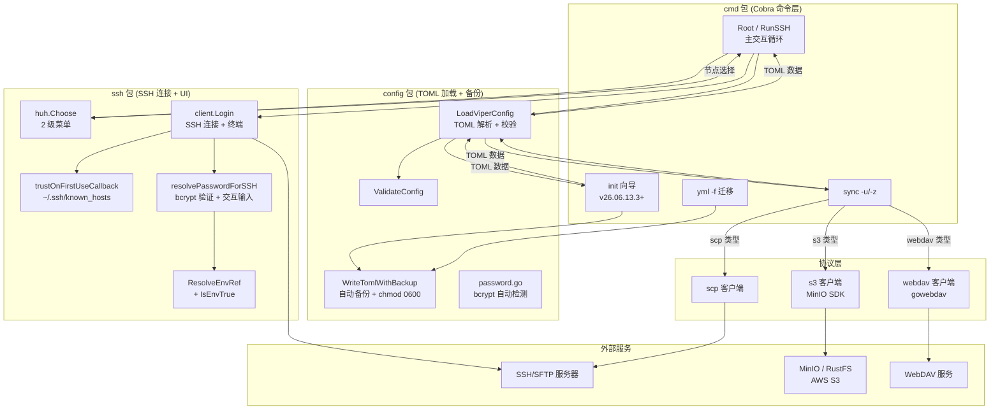

# mysshw

**开源免费的 SSH 命令行客户端工具**。Go 1.23+ 编写，支持 Linux、macOS、Windows。

📖 [English Documentation](readme.md) · 📋 [更新日志](changelog.v26.07.12.0.md) · 📦 [Releases](https://github.com/cnphpbb/mysshw/releases)

> 🐳 **Windows 用户** — 官方 Docker 镜像（`mysshw:latest`）是 Windows 下运行 mysshw 的**推荐方式**。原生 Windows 有多项终端语义限制，详见 [Windows 原生](#windows-原生不推荐)。

---

## 功能特性

- 🚀 **SSH 2.0 协议全功能** — 终端会话（Raw 模式）、窗口自适应、KeepAlive 保活
- 🔑 **灵活认证方式** — 密码、密钥、带密码短语密钥、键盘交互、bcrypt-pepper
- 🛡 **主机指纹校验 (TOFU)** — Trust On First Use，共享 `~/.ssh/known_hosts`
- 🛠 **TOML 配置管理** — 节点分组、`${ENV_VAR}` 密码引用（避免明文落盘）
- 🖥 **huh 交互式菜单** — Lipgloss 颜色高亮、虚拟"返回上级"节点
- 🔌 **配置远程同步** — SCP、WebDAV、S3（MinIO / RustFS / 云 S3）
- 🔁 **会话可循环** — 退出 SSH 自动返回主菜单，无需重启进程
- 🐳 **Docker 镜像** — 多阶段构建，~21 MB，非 root 用户
- 📦 **静态二进制** — `CGO_ENABLED=0`，跨平台直接运行
- 🔐 **文件级加密** — AES-256-GCM + Argon2id，`mysshw encrypt` 子命令
- 🧩 **配置 CRUD** — `mysshw config list/get/add/remove/update/diff`，无需手写 TOML
- 🛡 **密码哈希工具** — `mysshw hash gen/verify/pepper` 支持 bcrypt / bcrypt-pepper / argon2id
- 🌐 **TCP ping** — `mysshw ping` 连通性检测（无需 root）
- 📊 **系统信息** — `mysshw info` 远程节点信息采集
- 🤖 **MCP 服务器** — `mysshw mcp` 通过 stdio transport 将 SSH 操作暴露为 AI 工具
- 🗂 **known_hosts 管理** — `mysshw hostkey list/show/remove/update/audit`
- 🔍 **非交互命令** — `mysshw exec` / `list` / `copy` / `tunnel` 支持 JSON 输出

---

## 安装指南

### 从源码安装

```bash
git clone https://github.com/cnphpbb/mysshw.git mysshw
cd mysshw
go mod tidy
go install github.com/magefile/mage@latest
mage build
```

### 下载二进制

访问 [Release 页面](https://github.com/cnphpbb/mysshw/releases) 下载对应平台版本。

### Docker

```bash
# 构建
docker build -t mysshw:latest .
docker build -t mysshw:v26.07.12.0 \
  --build-arg VERSION=v26.07.12.0 \
  --build-arg BUILD=$(git rev-parse --short HEAD) \
  --build-arg BUILD_TIME=$(date -u +%Y-%m-%dT%H:%M:%SZ) .

# 运行
docker run --rm -it mysshw:latest
docker run --rm -v $PWD/mysshw.toml:/home/mysshw/.mysshw.toml:ro mysshw
```

镜像基于 `alpine:3.19`，以非 root 用户 `mysshw` 运行，包含 ca-certificates + tzdata。详见 `Dockerfile`。

### Windows 原生（不推荐）

> ⚠️ mysshw 深度使用 Unix 终端语义（Raw 模式、KeepAlive goroutines、scp 二进制调用）。Windows 原生有多项限制：
>
> - `Ctrl+D` 不支持（请使用 `Ctrl+C` 或输入 `q | Q`）
> - `sync` 子命令需要 `scp.exe` 在 `PATH` 中
> - 终端 Raw 模式行为与 Unix 不同
>
> 推荐改用 [Docker](#docker)，可获得一致的 Linux 用户态。

如必须在 Windows 原生运行：

1. 使用 PowerShell、Windows Terminal、WSL 或 Git Bash
2. 确保已安装 OpenSSH 客户端、Git、mingw64
3. 添加以下路径到系统 `PATH`：
   - `C:\Windows\System32\OpenSSH`
   - `C:\Program Files\Git\usr\bin`
   - `C:\Program Files\Git\mingw64\bin`
   - `C:\Program Files\Git\usr\sbin`
   - `C:\Program Files\Git\usr\libexec\git-core`
   - `C:\Program Files\Git\mingw64\libexec\git-core`
4. 重启终端，使环境变量生效

**支持**：`.\mysshw.exe -c D:\mydata\mysshw\mysshw.toml`

#### PowerShell 中设置别名

PowerShell 的 `Set-Alias` 不支持带参数命令，需在 profile 中定义函数：

```powershell
notepad $profile   # 打开 profile（如不存在需先创建）

# 在 profile 中添加：
function mysshw {
    D:\sbin\mysshw.exe -c D:\mydata\mysshw\mysshw.toml $args
}
```

重启 PowerShell 激活。

---

## 配置文件

配置文件可放在以下任一位置：

- `~/.mysshw.toml`（推荐）
- `~/.mysshw`
- `./.mysshw.toml`
- `./.mysshw`

默认路径：`$HOME/.mysshw.toml`。可用 `--cfg /path/to/your.toml` 自定义。

### 配置示例

```toml
cfg_dir = "~/.mysshw.toml"   # default: $HOME/.mysshw.toml

[sync]
type = "scp"                  # scp | webdav | s3
remote_uri = "127.0.0.1:22"
remote_path = "/data/backup/mysshw/mysshw.toml"

[sync.scp]
username = "root"
password = "${MYSSHW_PWD_sync}"  # 支持 ${VAR} 和 ${VAR:-default}
keypath = ""
passphrase = ""

[sync.webdav]
auth = "Basic"                # Basic | Digest
username = "root"
password = "${MYSSHW_PWD_webdav}"

[sync.s3]
access_key = ""               # 访问密钥
secret_key = ""               # 密钥
bucket_name = ""              # 桶名
region = ""                   # 区域
endpoint = ""                 # 终端节点（空 → 用 remote_uri）

[[nodes]]
groups = "Groups01"

[[nodes.ssh]]
alias = "Test"
name = "vm-test-1"
host = "127.0.0.1"
user = "root"
password = "${MYSSHW_PWD_vm_test_1}"
#keypath = "~/.ssh/id_rsa"
#passphrase = "${MYSSHW_KEY_PASSPHRASE}"
#strict_host_key_checking = false  # 跳过主机指纹校验（仅测试）

[[nodes]]
groups = "Groups02"
ssh = [
    { name = "web01", host = "192.168.1.101", user = "admin", port = 22 },
    { name = "db01",  host = "192.168.1.102", user = "admin", keypath = "~/.ssh/id_rsa" },
]
```

> ⚠️ 配置文件可能含密码/密钥引用，mysshw 加载后会自动收紧到 `0600`（Windows 由 NTFS ACL 控制）。

### 环境变量

mysshw 支持以下环境变量，用于非交互式场景（CI / 脚本 / 容器）。

#### 主机指纹校验

| 变量名 | 取值 | 说明 |
|--------|------|------|
| `MYSSHW_SKIP_HOST_KEY_CHECK` | `true` / `1` / `yes` | 跳过所有主机指纹校验（用 `InsecureIgnoreHostKey`）。**有 MITM 风险**，仅推荐测试或隔离网络环境。 |
| `MYSSHW_KNOWN_HOSTS` | 绝对路径 | 自定义 `known_hosts` 文件路径。优先级最高，覆盖 `config.KnownHostsPath` 和默认 `~/.ssh/known_hosts`。支持 `~` 和 `$HOME` 展开。 |

#### 密码与私钥口令（`${VAR}` 引用）

`password` 和 `passphrase` 字段支持 Shell 风格的 `${VAR}` 引用，**避免明文落盘**：

```toml
[[nodes.ssh]]
name = "web01"
host = "192.168.1.101"
user = "admin"
password = "${MYSSHW_PWD_web01}"            # 必填
# passphrase = "${MYSSHW_KEY_PASSPHRASE}"  # 私钥口令同样支持
# password = "${MYSSHW_PWD_x:-fallback}"   # 未设置时使用默认值
# password = "${MYSSHW_PWD_x:-}"           # 未设置时为空，走交互输入
```

**语法**：

- `${VAR}` — 取环境变量 `$VAR`；未设置或为空时替换为空字符串
- `${VAR:-default}` — `$VAR` 未设置或为空时使用 `default`（default 可含空格、标点）
- 其他文本原样保留

**使用示例**：

```bash
# 方式 1：启动前 export
export MYSSHW_PWD_web01='S3cret!'
mysshw -c ~/.mysshw.toml

# 方式 2：配合 secret 管理工具（Vault, 1Password CLI, pass 等）
export MYSSHW_PWD_web01=$(op read 'op://vault/web01/password')
mysshw -c ~/.mysshw.toml
```

### 密码哈希 (bcrypt)

除了 `${VAR}` 引用外，`password` 和 `passphrase` 字段还支持 **bcrypt 哈希**——把密码哈希写入 TOML，运行时由用户交互输入明文并验证，既避免明文落盘，也不需要外部 secret 管理器。

#### 4 种密码格式对比

`mysshw list -o json` 的 `auth` 字段会自动识别以下格式（带 `keypath` 时附加 `+key` 后缀，如 `bcrypt+key`）：

| 格式 | TOML 写法 | `auth` 字段 | 运行时行为 | 适用场景 |
|------|-----------|-------------|------------|----------|
| `${ENV}` 引用 | `password = "${MYSSHW_PWD_x}"` | `env` | `ssh.ResolveEnvRef` 解析 | K8s Secret / Vault / CI |
| **bcrypt 哈希** | `password = "$2a$10$xxxxx..."` | `bcrypt` | 交互输入明文 → bcrypt 验证 | 静态配置文件 + 多人共享 |
| **bcrypt + pepper** | `password = "$2a$10$..."` + 顶层 `secret_key` | `bcrypt-pepper` | bcrypt 验证 + secret_key HMAC | 防 config 泄露后离线爆破 |
| 明文 | `password = "my-secret"` | `password` | 直接使用 | 一次性测试（⚠️ 不推荐） |
| 空 + keypath | `password = ""` + `keypath` | `key` | 走密钥认证 | CI / 自动化 / 跳板机 |

**自动检测规则**（无需额外标记）：

- 以 `$2a$` / `$2b$` / `$2y$` 开头且长度 60 → bcrypt 哈希
- 以 `$argon2id$` / `$pbkdf2-sha256$` 开头 → Argon2id / PBKDF2-SHA256（当前版本识别为占位，运行时 fallback 到 bcrypt 验证）
- 以 `${` 开头 → env 引用
- 其他非空字符串 → 明文

#### 配置示例

```toml
# 节点 A：bcrypt 哈希（防明文落盘，推荐静态配置文件场景）
[[nodes.ssh]]
name = "prod-db-1"
alias = "DB01"
host = "10.0.0.5"
user = "postgres"
port = 5432
# 明文：prod-db-password-2024
password = "$2a$10$BBEDysNBBCnf/RwKMLiea.ufVrsybvoes.HYz8w.6wtff7TSLhjsC"

# 节点 B：bcrypt + secret_key pepper（防 config 泄露后离线爆破）
# 配合顶层 encryption_algorithm = "bcrypt-pepper" + secret_key = "..."
[[nodes.ssh]]
name = "prod-secure-1"
alias = "SecureDB"
host = "10.0.0.200"
user = "postgres"
password = "$2a$10$BBEDysNBBCnf/RwKMLiea.ufVrsybvoes.HYz8w.6wtff7TSLhjsC"

# 节点 C：纯密钥认证（推荐 CI / 自动化 / 跳板机）
[[nodes.ssh]]
name = "prod-deploy-1"
host = "10.0.0.50"
user = "deploy"
# keypath = "~/.ssh/id_ed25519"   # 启用密钥认证，password 留空
```

#### `mysshw hash` 子命令

`hash` 子命令用于生成 / 验证哈希，以及生成 server 侧 secret（pepper）：

```bash
# 生成 bcrypt 哈希（默认 cost=10，约 60ms/次）
mysshw hash gen 'my-password'
# 输出：$2a$10$xxxxx...  （60 字符，复制到 password 字段）

# 生成 bcrypt-pepper 哈希（把 secret 拼到 hash 里）
mysshw hash gen --algo=bcrypt-pepper --pepper='my-server-secret' 'plaintext'

# 自定义 cost（4-31，默认 10；越高越慢越安全）
mysshw hash gen --cost=12 'my-password'

# 验证 hash 是否匹配明文（明文从 stdin 读取，不 echo）
echo -n 'my-password' | mysshw hash verify '$2a$10$xxx...'
echo -n 'my-password' | mysshw hash verify '$2a$10$xxx...' --pepper='my-secret'
# exit 0 = 匹配，exit 1 = 不匹配

# 生成新的随机 secret_key（32 字节 base64，44 字符）
mysshw hash pepper
export MYSSHW_SECRET_KEY=$(mysshw hash pepper)

# 脚本中嵌入（默认输出到 stderr，加 --stdout 切到 stdout 便于管道）
PWD_HASH=$(mysshw hash gen --stdout 'real-password')
```

支持的算法（`--algo`）：

| 算法 | hash 格式 | 状态 |
|------|-----------|------|
| `bcrypt`（默认） | `$2a$10$...` | ✅ 已实现 |
| `bcrypt-pepper` | `$2a$10$...`（含 pepper） | ✅ 已实现 |
| `argon2id` | `$argon2id$...` | 🟡 识别占位（fallback 到 bcrypt 验证） |
| `pbkdf2-sha256` | `$pbkdf2-sha256$...` | 🟡 识别占位（fallback 到 bcrypt 验证） |

#### bcrypt-pepper 模式（推荐生产）

`bcrypt-pepper` 是 bcrypt 的加强版：**配置文件泄露后，攻击者拿到纯 hash 也无法离线爆破**，因为他还必须额外知道 server 侧的 `secret_key`（"pepper"）。

```toml
# 顶层字段（全配置仅需设置一次）
encryption_algorithm = "bcrypt-pepper"            # 启用 bcrypt-pepper 模式
secret_key = "${MYSSHW_SECRET_KEY}"                # 推荐引用 env，不要明文

# 节点字段保持不变（仍是 bcrypt 哈希）
[[nodes.ssh]]
name = "prod-secure-1"
host = "10.0.0.200"
user = "postgres"
password = "$2a$10$BBEDysNBBCnf/RwKMLiea.ufVrsybvoes.HYz8w.6wtff7TSLhjsC"
```

工作流：

```bash
# 1. 生成随机 secret_key（32 字节 base64）
export MYSSHW_SECRET_KEY=$(mysshw hash pepper)

# 2. 用 secret_key 生成节点 hash（一次性）
mysshw hash gen --algo=bcrypt-pepper --pepper="$MYSSHW_SECRET_KEY" 'real-password' \
    > /tmp/node.hash

# 3. 把 /tmp/node.hash 的内容粘贴到 TOML 的 password 字段
# 4. 把 secret_key 写入环境变量 / K8s Secret（必须保密！）

# 5. 验证
mysshw exec --node prod-secure-1 -- 'echo OK'
```

**安全提示**：

- `secret_key` 丢失 → 全部 bcrypt-pepper 节点无法登录（必须重新生成 + 重新哈希所有节点）
- `secret_key` 必须保密，但 `password` 字段的 hash 可以共享（类似 K8s Secret 思路）
- 更换 `secret_key` 需要用旧 secret 验证 + 新 secret 重新哈希全部节点
- **非交互场景（AI / `mysshw exec`）**：bcrypt 节点会直接拒绝认证（提示 "bcrypt 哈希节点需要在终端中输入明文密码，或改用 ${ENV} 引用"），因此 CI / 批量执行请用 `${ENV}` 引用

#### 完整 workflow 示例

```bash
# === 场景 1：新增节点，使用 bcrypt（人工登录） ===
HASH=$(mysshw hash gen --stdout 'node-password')
echo "password = \"$HASH\"" >> ~/.mysshw.toml

# === 场景 2：新增节点，使用 bcrypt-pepper（生产推荐） ===
export MYSSHW_SECRET_KEY=$(mysshw hash pepper)
HASH=$(mysshw hash gen --stdout --algo=bcrypt-pepper --pepper="$MYSSHW_SECRET_KEY" 'node-password')
echo "password = \"$HASH\"" >> ~/.mysshw.toml

# === 场景 3：审计现有节点认证方式 ===
mysshw list -o json | jq '.[] | select(.auth | startswith("bcrypt")) | .name'

# === 场景 4：轮换 secret_key ===
# 1. 备份：cp mysshw.toml mysshw.toml.bak
# 2. 生成新 secret：mysshw hash pepper
# 3. 逐节点重哈希：对每个 bcrypt-pepper 节点执行
#      mysshw hash gen --algo=bcrypt-pepper --pepper="<新 secret>" <明文>
#    （需在另一台保留旧 secret 的机器上验证旧 hash 仍可登录后再切）
# 4. 更新 secret_key 字段为新值
# 5. 验证：mysshw list（确保所有节点仍可解析）→ mysshw exec（冒烟测试）
# 6. 删除备份：rm mysshw.toml.bak
```

### 文件级加密 (mysshw encrypt)

bcrypt / bcrypt-pepper 只保护 `password` 和 `passphrase` 两个字段;对于其他敏感字段(`host`、`user`、`keypath`、整段 `${MYSSHW_PWD_xxx}` 引用等)仍以明文出现在 TOML 中。**文件级加密**把整个 `mysshw.toml` 用 passphrase 加密,只有解密后才进入 viper 解析,从源头杜绝明文泄露。

#### bcrypt / bcrypt-pepper vs 文件级加密

| 维度 | bcrypt / bcrypt-pepper | 文件级加密 |
|------|------------------------|------------|
| 加密对象 | `password` / `passphrase` 字段 | 整个 TOML 文件 |
| 加密后还能编辑 TOML 吗? | ✅ 可以（直接改） | ❌ 必须先解密再编辑 |
| 文件是否能直接 git / S3 共享? | ⚠️ host / keypath 等仍明文 | ✅ 整文件不可读 |
| passphrase 丢失后果 | 节点不可登录（可重新生成 hash） | **整文件不可恢复** |
| 性能开销 | bcrypt 验证 ~60ms / 节点 | Argon2id 派生 ~300-500ms / 次（load 时） |
| 适用场景 | 密码不能明文落盘 | 整个配置文件不能泄露（多人共享 / 备份 / Git） |

**两种方案可叠加**:bcrypt 节点 + 整体加密文件 = 最高安全等级（加密文件本身被窃 → 攻击者拿不到 hash;passphrase 丢失 → 攻击者也无法解密 → 双重保护）。

#### 加密文件格式

加密文件是**二进制**,前 37 字节是固定 header,后面是密文:

```
+--------+--------+----------+----------+----------+---------------------+
| magic  | kdf_id | salt     | nonce    | ct_len   | ciphertext (含 tag) |
| "MSEC" | 1B     | 16B      | 12B      | uint32   | N bytes             |
+--------+--------+----------+----------+----------+---------------------+
```

- **magic** = `MSEC`（ASCII,mysshw Encrypted Config）— 自动检测的关键标记
- **kdf_id** = `0x01`（Argon2id）— 未来扩展其他 KDF 时使用
- **salt** = Argon2id salt,16 字节,每次加密重新生成
- **nonce** = AES-256-GCM nonce,12 字节,每次加密重新生成
- **ct_len** = 密文长度,4 字节 big-endian
- **ciphertext** = AES-256-GCM 输出（包含 16 字节 auth tag）

**算法**:

- **KDF**: Argon2id（`time=3, memory=64MB, threads=4, keylen=32`）— OWASP 2023 推荐参数,单次派生约 300-500ms
- **Cipher**: AES-256-GCM（认证加密,自动检测篡改）
- **自动检测**:`LoadViperConfig` 读文件前 4 字节,如 = `MSEC` 则视为加密文件,自动 prompt passphrase 解密

#### `mysshw encrypt` 子命令

```bash
# === 加密 ===
# 交互输入 passphrase + 默认 in-place 覆盖原文件
mysshw encrypt

# 显式指定输入 / 输出文件
mysshw encrypt -c /path/to/input.toml -o /path/to/output.toml

# 管道输入 passphrase（脚本友好）
echo "$MYSSHW_PASSPHRASE" | mysshw encrypt -c ~/.mysshw.toml

# 输出到 stdout（便于管道）
mysshw encrypt -c ~/.mysshw.toml --stdout > encrypted.bin

# === 解密 ===
# 默认输出到 stdout（便于人眼 / 管道）
mysshw encrypt decrypt -c ~/.mysshw.toml
mysshw encrypt decrypt -c ~/.mysshw.toml -o plain.toml
mysshw encrypt decrypt -i encrypted.toml -o plain.toml
```

可用 flags:

| flag | 默认值 | 说明 |
|------|--------|------|
| `--in` / `-i` | `--cfg` / `~/.mysshw.toml` | 输入文件 |
| `--out` / `-o` | encrypt in-place / decrypt stdout | 输出文件 |
| `--in-place` | `true`（仅 encrypt） | 直接覆盖输入文件 |
| `--stdout` | `false` | 输出到 stdout（管道） |

**passphrase 来源**:固定从 stdin 读取（`readPassphraseInteractive`）,支持交互输入或 `echo "..." | mysshw encrypt`。注意:当前实现是 `bufio.Scanner`,**passphrase 会在终端回显**（不是 secure input）;生产部署请用管道方式传入或运行在安全终端中。

#### Workflow 示例

```bash
# === 场景 1:首次加密现有明文配置 ===
# 1. 备份明文（防止 passphrase 丢失）
cp ~/.mysshw.toml ~/.mysshw.toml.bak

# 2. 加密
echo "$passphrase" | mysshw encrypt -c ~/.mysshw.toml

# 3. 验证加密文件可用
echo "$passphrase" | mysshw list -c ~/.mysshw.toml -o json

# 4. 删除明文备份（已确认加密文件 OK）
rm ~/.mysshw.toml.bak

# === 场景 2:在 CI / 脚本中使用加密配置 ===
export MYSSHW_PASSPHRASE=$(vault read -field=passphrase secret/mysshw)
echo "$MYSSHW_PASSPHRASE" | mysshw exec -c /etc/mysshw/encrypted.toml --node web01 -- 'uptime'

# === 场景 3:修改加密配置（必须先解密） ===
echo "$passphrase" | mysshw encrypt decrypt -c ~/.mysshw.toml -o /tmp/plain.toml
vim /tmp/plain.toml
echo "$passphrase" | mysshw encrypt -i /tmp/plain.toml -o ~/.mysshw.toml
rm /tmp/plain.toml

# === 场景 4:轮换 passphrase ===
# 1. 用旧 passphrase 解密
echo "$old_passphrase" | mysshw encrypt decrypt -c ~/.mysshw.toml -o /tmp/plain.toml
# 2. 用新 passphrase 重新加密
echo "$new_passphrase" | mysshw encrypt -i /tmp/plain.toml -o ~/.mysshw.toml
# 3. 验证
echo "$new_passphrase" | mysshw list -c ~/.mysshw.toml -o json | jq '.[0].name'
# 4. 删除临时明文
rm /tmp/plain.toml
# 5.（可选） 同步加密文件到远端
mysshw sync --upload
```

#### 安全提示

- ⚠️ **passphrase 丢失 = 数据不可恢复**（mysshw 不存储任何派生密钥 / recovery key）
- ⚠️ **加密文件本身可共享**（salt / nonce 公开）,但 passphrase 必须严格保密
- ✅ **错 passphrase / 篡改密文 → AES-GCM auth tag 验证失败**,自动报错（不会输出半明文）
- ✅ **原子写**:encrypt 用 `tmpfile + rename`,防止半写状态
- ✅ **输出文件权限 0600**:即使明文备份也仅所有者可读
- ✅ **拒绝重复加密**:已加密文件再 encrypt 会立即报错（防止双重加密）
- ✅ **配合 `sync`**:把加密文件传输到远端 / S3 / WebDAV,中间任何环节都拿不到明文

### 配置文件权限

mysshw 加载配置后会自动将权限收紧到 `0600`（仅所有者可读写），备份文件同样处理。Windows 上 `Chmod` 是 no-op，权限由 NTFS ACL 控制。

---

## 使用示例

```bash
# 查看帮助信息
mysshw --help | -h

# 启动程序（无参数时默认进入交互模式）
mysshw

# 指定配置文件路径
mysshw --cfg /path/to/custom/config.toml
mysshw -c /path/to/custom/config.toml   # 短选项

# 查看版本信息
mysshw version | --version | -v

# 同步配置文件到远程服务器
mysshw sync --upload | -u

# 从远程服务器下载配置文件
mysshw sync --down | -z

# 使用自定义配置文件路径进行同步
mysshw sync --cfg /path/to/custom/config.toml --upload
mysshw sync -c /path/to/custom/config.toml -u   # 混合短选项

# 从 sshw 的 YAML 配置迁移到 mysshw TOML 配置
mysshw yml -f ~/.sshw.yml
mysshw yml --file ~/.sshw.yml   # 长选项

# 查看子命令帮助
mysshw sync --help | -h
mysshw yml --help | -h
```

---

## 架构



**关键设计决策**：

- **config 是唯一真相源**：所有流程都从 `LoadViperConfig` → `ValidateConfig` → `chmod 0600` 开始
- **Env 属于 ssh 包内部**：`ssh.ResolveEnvRef` 位于 ssh 包而非 config，由 `resolvePasswordForSSH` 在 SSH 登录路径调用
- **TOFU 默认开启，opt-out 关闭**：`SSHNode.StrictHostKeyChecking = false` 关闭单节点；`MYSSHW_SKIP_HOST_KEY_CHECK=true` 全局关闭
- **远程写入只能通过 sync**：没有隐式远程写，`mysshw sync -u` / `-z` 是用户显式动作
- **备份机制统一**：`init`（向导）和 `yml`（迁移）路径都走 `config.WriteTomlWithBackup`，`backup_keep`（默认 5）控制保留数量

---

## AI / 脚本友好模式

新增的 `list` 与 `exec` 等子命令专为 AI Agent 与脚本设计，不需要 TUI 菜单，可以机器可读方式输出：

- 默认输出人类可读（plain），加 `-o json` 输出机器可读 JSON
- 退出码按 BSD sysexits（0/1/2/64/65/66/70/73/74/78/124/126/127/255），AI 可直接读退出码分类错误
- 不依赖 TTY/终端，没有 huh 或交互菜单

### `list` — 列出节点

```bash
# 默认表格
mysshw list

# JSON（供 jq / AI 解析）
mysshw list -o json
mysshw list -o json --search prod        # 模糊匹配 name/alias/host/user
mysshw list -o json --group Production   # 筛选 group
```

JSON 输出示例：

```json
[
  {
    "group": "Production",
    "name": "prod-1",
    "alias": "Web01",
    "user": "app",
    "host": "10.0.0.1",
    "port": 22,
    "auth": "env"
  }
]
```

**安全**：list 永不输出 `password` / `passphrase` 字段。`auth` 字段仅标识认证方式类别（`key` / `password` / `env` / `bcrypt` / `empty`），AI 可据此决定怎么认证。

### `exec` — 在节点上执行命令

```bash
# 单节点（按 name 定位）
mysshw exec --node prod-1 -- uptime

# 按 host + user（不需要 name）
mysshw exec --host 10.0.0.5 -u app -- "systemctl status nginx"

# 按 alias
mysshw exec --alias Web01 -- "df -h"

# 批量扇出：多条 --node 并发执行
mysshw exec --node prod-1 --node prod-2 --node prod-3 -- "uptime"

# JSON 输出（适合 AI 解析）
mysshw exec -o json --node prod-1 -- "ls -la /var/log"

# 禁用 PTY（管道模式，适合二进制）
mysshw exec --no-pty --node prod-1 -- "tar czf - /var/log" > out.tgz

# 超时控制
mysshw exec --node prod-1 --timeout 5s -- "ping 8.8.8.8"
```

**默认 PTY 开启**：支持 `sudo` / 进度条 / 交互式密码检测（sudo 需要 NOPASSWD 或配 `${ENV}`）。需要纯管道模式用 `--no-pty`。

**退出码**：

- 单节点：`os.Exit(命令退出码)`，透传命令自身的 exit code
- 批量：任一失败时 `os.Exit(1)`，细节看 JSON 输出 `exit_code` 字段
- 参数错误：`64` (EX_USAGE)
- 节点未找到：`78` (EX_CONFIG)
- 超时：`124`
- SSH 协议错误：`255`

**典型 AI 工作流**：

```bash
# 1) 让 AI 先看节点列表再决定连哪一台
mysshw list -o json | jq '.[] | select(.group=="Production")'

# 2) 在选定节点上执行命令并解析 JSON
RESULT=$(mysshw exec -o json --node prod-1 -- "free -m")
echo "$RESULT" | jq '.stdout'

# 3) 批量检查
mysshw exec -o json --node prod-1 --node prod-2 -- "uptime" \
  | jq '[.[] | {name: .node, ok: (.exit_code == 0)}]'

# 4) AI 生成危险命令前，先 dry-run 检查节点/认证是否正确
mysshw exec --dry-run --node prod-1 -o json -- "rm -rf /var/log/*.tmp"
```

### `exec --dry-run` 安全预演

```bash
# JSON 模式：AI 可结构化检查
mysshw exec --dry-run -o json --node prod-1 -- "systemctl restart nginx" | jq '
  .nodes[].name, .command, .use_pty
'

# plain 模式：fallback 为单行 JSON
mysshw exec --dry-run --node prod-1 -- "uptime"
```

输出示例：

```json
{
  "dry_run": true,
  "selector": { "names": ["prod-1"] },
  "nodes": [{
    "name": "prod-1", "user": "app", "host": "10.0.0.1", "port": 22,
    "auth": "env"
  }],
  "command": "systemctl restart nginx",
  "use_pty": true,
  "timeout": "30s"
}
```

`--dry-run` 不会建立任何 SSH 连接，仅打印"将要做什么"。

### 跳板 (`-J` 等价)

通过 `[[nodes.ssh]]` 中的 `proxy` 字段指定下一个节点名即可走跳板链：

```toml
[[nodes.ssh]]
name = "bastion"
host = "bastion.example.com"
user = "sshw"
password = "${SSHW_PWD_BASTION}"

[[nodes.ssh]]
name = "internal-1"
host = "10.0.0.5"
user = "app"
password = "${SSHW_PWD_INTERNAL}"
proxy = "bastion"   # ← 走 bastion 跳板访问

[[nodes.ssh]]
name = "deep-1"
host = "10.0.1.10"
user = "ops"
proxy = "internal-1"  # ← 多跳（最多 6 层节点，含 target）
```

访问 `internal-1` 与直连节点无差别：

```bash
mysshw exec --node internal-1 -- "hostname"
mysshw copy -U --node deep-1 --local ./deploy.sh --remote /tmp/deploy.sh
mysshw list -o json | jq '.[] | select(.proxy != null)'
```

> [!IMPORTANT]
> **跳板机上 sshd 配置必须打开 AllowTcpForwarding**
>
> 凡是被其它节点的 `proxy = "..."` 引用作为跳板的节点，它的 `sshd` 都必须允许客户端侧的 TCP 转发。编辑该节点的 `/etc/ssh/sshd_config`：
>
> ```sshd_config
> AllowTcpForwarding yes
> ```
>
> - OpenSSH 默认就是 `yes`，但部分**加固镜像 / 云平台镜像**会把它改成 `no`，那时 mysshw 会报 `ssh: rejected: unknown channel type (unsupported channel type)` 或 `forward dial via "..." to "...": ... refused`。
> - 这一项对**多跳链上的每一个 hop** 都适用（每一级都是它内层下一跳的「forwarder」），不只是最外层的 bastion。
> - `GatewayPorts` **不需要**为 `yes`，它只影响 `tunnel reverse` 让 server 端开监听端口的场景，跟 proxy 透传无关。
> - 改完 `sshd_config` 后记得重载：`sudo systemctl reload sshd`（先 `sudo sshd -t` 试配置再 reload 最稳）。

机制：

1. `ssh.Dial` 直连跳板（bastion）
2. 在跳板上 `Client.Dial("tcp", next)` 建立 direct-tcpip channel
3. channel 上二次 SSH 握手连到下一跳
4. 链上任意 hop 失败 → 全部已建立的 transport Close（无资源泄露）
5. 循环引用检测 + 6 层深度上限

未走 proxy 时直连，性能与之前一致。

### `copy` — 非交互文件传输

```bash
# 上传（同一文件 → 多个节点并发）
mysshw copy --node prod-1 --node prod-2 --node prod-3 \
            -U --local ./deploy.sh --remote /tmp/deploy.sh

# 下载（仅单节点）
mysshw copy --node prod-1 -d --local ./backup.sql --remote /var/db/backup.sql

# 自定义远端文件权限（仅 upload）
mysshw copy --node prod-1 -U --mode 0755 --local ./run.sh --remote /opt/run.sh

# JSON 输出（错误也能解析）
mysshw copy -o json --node prod-1 --node prod-2 -U --local ./f.txt --remote /tmp/f.txt
```

JSON schema：

```json
[
  {
    "node": "prod-1",
    "action": "upload",
    "local": "./deploy.sh",
    "remote": "/tmp/deploy.sh",
    "bytes": 1234,
    "duration": "234ms"
  }
]
```

> ⚠️ `--upload` 用 `-U`（大写），避免与 `-u/--user` 冲突。

### `tunnel` — SSH 端口转发 (local / reverse / dynamic)

子命令式接口，三个子命令对应 OpenSSH 三个转发模式：

#### `tunnel local` — 本地转发 (`-L` 等价)

```bash
# 转发 本地 :8080 → prod-1 上的 127.0.0.1:80（看 web 服务）
mysshw tunnel local --node prod-1 --local 127.0.0.1:8080 --remote 127.0.0.1:80

# 转发到 bastion 后接的内部主机
mysshw tunnel local --node bastion --local :2222 --remote internal-host:22

# 连接空闲超时 5min
mysshw tunnel local --node prod-1 --local 127.0.0.1:8080 --remote internal:80 \
                   --idle-timeout 5m
```

#### `tunnel reverse` — 反向转发 (`-R` 等价)

```bash
# 让 SSH server 在 8080 上监听，把连接转回 client 侧
mysshw tunnel reverse --node bastion --bind 0.0.0.0:8080 --remote 10.0.0.5:80

# 反向跳到另一个跳板 / 跳点
mysshw tunnel reverse --node bastion --bind :8080 --remote db.internal:5432 \
                     --config /path/to/config.toml
```

典型用例：通过 bastion 把内网服务暴露给外网。

#### `tunnel dynamic` — Dynamic 转发 (SOCKS5 / `-D` 等价)

```bash
# 在 client 侧 :1080 起 SOCKS5 代理，透过 SSH 拨号任何目标
mysshw tunnel dynamic --node bastion --local 127.0.0.1:1080

# 使用：浏览器/系统代理指向上面 1080
#   curl --socks5 127.0.0.1:1080 http://internal.example/
```

`Ctrl+C` / `SIGTERM` 优雅退出（三个子命令都一样）。`tunnel` 是长连接，不输出 JSON。

适用 Proxy 跳板（`SSHNode.Proxy`）：`tunnel` 系列都自动走 `ssh/client.go` 的 `connect()` → `resolveProxyChain` + `dialViaProxyChain`，对用户透明，无需额外配置。

### 主机指纹 mismatch 处理 (`--rotate-known-hosts`)

mysshw 默认对主机指纹严格校验（防 MITM）。服务器密钥轮换是合法的运维操作，但客户端**无法区分**"密钥轮换"与"MITM 攻击"。

提供 opt-in flag `--rotate-known-hosts` 单独覆盖本次连接：

```bash
# 服务器密钥轮换后第一次连接：
mysshw exec --node prod-1 --rotate-known-hosts -- "uptime"
# 输出应含警告：
#   ⚠️ mysshw:: ROTATING known_hosts (--rotate-known-hosts): \
#        host=prod-1 old=SHA256:... new=SHA256:... at=2026-07-04T09:59:55Z

# 批量上传到多节点时也可以：
mysshw copy --node prod-1 --node prod-2 -U \
            --rotate-known-hosts \
            --local ./f.txt --remote /tmp/f.txt
```

安全注意事项：

- **与 OpenSSH `-o StrictHostKeyChecking=no` 行为不同** —— 仅对本次连接生效，下次不带 flag 仍走默认严格校验
- 实际生产中，推荐做法：**管理员先通过 SSH `ssh-keyscan`** 在 trusted machine 上拿到新指纹，通过 `mysshw hostkey update`（后续工作）显式更新；`--rotate-known-hosts` 只作为应急通道

与现有的 `MYSSHW_SKIP_HOST_KEY_CHECK=true` 的区别：

- **SKIP**：整个 process 内禁用校验（适合 CI / 测试环境）
- **rotate**：仅本次连接遭遇 mismatch 时，自动替换为新 key（适合 admins 知道自己做了什么）

### `hostkey` 子命令 — 主动管理 known_hosts

比 `--rotate-known-hosts` flag 更可控、显式、可 audit。默认为 dry-run。

```bash
# 列出全部条目（JSON，AI 友好）
mysshw hostkey list -o json

# 查询某 host
mysshw hostkey show prod-1.example.com -o json

# 删除某 host（类似 ssh-keygen -R）
mysshw hostkey remove prod-1.example.com -o json

# 主动 update（推荐用于 admin 告知新指纹后）：
mysshw hostkey update prod-1.example.com --node prod-1 --confirm \
                   --expect-fingerprint SHA256:abc... -o json

# 全面审计（文件状态 + algorithm 分布 + 与 config 对齐）：
mysshw hostkey audit --check-config -o json
```

子命令退出码 (BSD sysexits)：

- `0` 成功
- `64` 缺 flag
- `66` known_hosts 路径不可读
- `78` 节点未找到
- `124` 超时 / `--expect-fingerprint` 不匹配
- `255` SSH 错误

### 主机指纹 rotate 与 update 的使用区别

| 场景 | 推荐方式 | 安全 |
|------|---------|------|
| CI 测试，节点 key 已固定但不关心指纹 | `MYSSHW_SKIP_HOST_KEY_CHECK=true` | 低（易被 MITM，仅测试用） |
| 紧急一次性连接（admin 告知 key 已换） | `mysshw exec --rotate-known-hosts` | 中（opt-in，但下个连接又变成严格） |
| 主动管理（admin 通过安全渠道告知新指纹） | `mysshw hostkey update --expect-fingerprint --confirm` | 高（显式 + fingerprint 验证） |
| 全面安全审查 / 运维对账 | `mysshw hostkey audit --check-config` | 只读，不会改任何东西 |

### `hostkey audit` — 安全审查输出

`audit` 子命令可读但不改 known_hosts，给运维/AI agent 安全对账：

```json
{
  "file": {
    "path": "/home/user/.ssh/known_hosts",
    "size_bytes": 1234,
    "modified_at": "2026-07-04T11:00:00Z",
    "exists": true
  },
  "total_entries": 92,
  "plain_entries": 92,
  "hashed_entries": 0,
  "algorithm_distribution": {
    "ssh-ed25519": 23,
    "ecdsa-sha2-nistp256": 11,
    "ssh-rsa": 58
  },
  "repeated_hosts": ["github.com"],            // 同一 host 多 entry（可能 rotate 遗留）
  "warnings": [
    "ssh-rsa present (58 entries); RFC 8332 recommends Ed25519 or ECDSA",
    "1 hosts have multiple entries (possible stale rotations): [github.com]"
  ],
  "configured_hosts": ["prod-1", "prod-2"],
  "missing_in_known_hosts": ["prod-3"]      // --check-config 时才有
}
```

AI 工作流：

- 建议定期 `hostkey audit` 审查；ssh-rsa / ssh-dss / hashed-only 给出 warning
- `--check-config` 帮 agent 检查 config 里的节点是否都有 fingerprint
- plain 模式表格友好（debug）；`-o json` AI 友好

e2e 测试：6 个用例覆盖 list/dry-run/confirm/show/mismatch/remove 路径。

### `ping` — TCP 连通性检测

```bash
# 按 name 单节点
mysshw ping --node prod-1

# 按 alias 批量
mysshw ping --alias WebAlias

# 直连 host:port（不需要配置文件）
mysshw ping --host 10.0.0.5 -p 22

# 自定义超时 + 3 次尝试
mysshw ping --node prod-1 --timeout 3s --count 3

# AI agent 用 JSON 输出
mysshw ping --node prod-1 -o json | jq '.[] | select(.reachable==false)'
```

与系统 `ping(1)` 不同，这里走 TCP 拨号（不需 root）。每个节点的 JSON schema：

```json
{
  "node": "prod-1",
  "host": "10.0.0.1",
  "port": 22,
  "reachable": true,
  "latency_ms": 12.4,
  "attempts": 1,
  "error": ""
}
```

退出码：`0` 全部可达，`1` 部分不可达，`64` 参数错误，`78` 节点未找到。

### `info` — 远程系统信息采集

通过 SSH 收集一个或多个节点的结构化系统信息（hostname、OS、内核、CPU、内存、磁盘、运行时间）。

```bash
# 按 name 单节点
mysshw info --node prod-1

# 批量（最多 10 并发）
mysshw info --node web-1 --node web-2 --node web-3

# 按 group 筛选
mysshw list --group production -o json | jq -r '.[].name' | \
  xargs mysshw info -o json

# AI 辅助决策：
mysshw info --node target -o json | jq '.[0].memory.total_bytes > 8589934592'
```

每节点 JSON schema：

```json
{
  "node": "prod-1",
  "hostname": "prod-1.internal",
  "os": "linux",
  "kernel": "6.8.0-31-generic",
  "arch": "x86_64",
  "cpu": {"cores": 4, "model": "Intel(R) Xeon(R) ..."},
  "memory": {"total_bytes": 17179869184},
  "disk": [{"mount": "/", "size_bytes": ..., "used_bytes": ..., "percent": 42}],
  "uptime_seconds": 2592000,
  "uptime_human": "30d 0h 0m",
  "collected_at": "2026-07-06T...",
  "error": ""
}
```

**跨平台**：Linux（`/proc`）、macOS（`sysctl`）、其他 Unix（尽力而为）。

### `config` — SSH 节点 CRUD

直接在 `mysshw.toml` 中管理 SSH 节点，无需手动编辑。6 个子命令：

```bash
# 列出所有节点（含全部可编辑字段）
mysshw config list
mysshw config list --group Production --format json

# 查看单个节点详情（密码脱敏）
mysshw config get prod-1
mysshw config get prod-1 --format json

# 新增节点（默认 dry-run，--confirm 才写入）
mysshw config add --group Production --name web-2 --host 10.0.0.2 \
                  --user app --password '${MYSSHW_PWD_web2}'
mysshw config add --group Staging --name db-1 --host 10.0.1.5 \
                  --password 'my-password' --confirm

# 删除节点（默认 dry-run）
mysshw config remove prod-3 --confirm

# 增量修改（默认 dry-run）
mysshw config update prod-1 --port 2222 --confirm
mysshw config update prod-1 --group Production --confirm

# 对比两个节点（JSON 输出）
mysshw config diff prod-1 prod-2
```

**安全设计**：
- 写操作（`add` / `remove` / `update`）默认 `--dry-run`，加 `--confirm` 才真正写入
- 每次写入使用原子重写 + 自动备份（见配置中的 `backup_keep`）
- 密码推荐使用 bcrypt hash 或 `${ENV}` 引用；明文会触发警告
- JSON 输出永远不会包含 password 字段

### `export` / `import` — 配置可移植性

将节点导出为可移植的 JSON/TOML 文件，或从文件导入。密码字段自动替换为 `${IMPORTED}` 占位符。

```bash
# 导出全部节点为 JSON（stdout）
mysshw export

# 导出某 group 为 TOML 到文件
mysshw export --group Production --format toml --output nodes.toml

# 导出指定节点
mysshw export --name prod-1 --name prod-2

# dry-run 预览导入
mysshw import nodes.json

# 实际导入（支持覆盖 + group 重写）
mysshw import nodes.toml --confirm --overwrite --group Staging

# 管道导出给 AI 解析
mysshw export --group Production --format json | jq '. | length'
```

**格式自动检测**：`.json` → JSON；`.toml` → TOML；其他扩展名先试 JSON 再试 TOML。

**重复处理**：同名节点默认跳过；`--overwrite` 更新已有节点。

### `sync` — 配置远程备份

通过 SCP、WebDAV 或 S3 上传/下载配置文件。

```bash
# 上传配置到远程
mysshw sync --upload
mysshw sync -u

# 从远程下载配置
mysshw sync --down
mysshw sync -z

# 使用自定义配置路径同步
mysshw sync -c /path/to/custom/config.toml -u
```

**支持的协议**（在 `mysshw.toml` 的 `[sync]` 下配置）：
- `scp` — 通过 SSH（用户名 + 密码 / 密钥）
- `webdav` — HTTP WebDAV（Basic / Digest 认证）
- `s3` — S3 兼容（MinIO / RustFS / AWS S3）

### `yml` — 从旧版 sshw YAML 迁移

解析旧版 `sshw` 项目的 `.sshw.yml` 文件，将转换后的节点追加到 `mysshw.toml`。

```bash
# 转换并追加到当前配置
mysshw yml -f ~/.sshw.yml
```

### `init` — 交互式向导

通过交互式向导初始化 `~/.mysshw.toml`。首次运行会显示"更新内容"页面，然后进入向导。

```bash
# 交互式向导
mysshw init

# 覆盖已有配置（不询问）
mysshw init --force
```

### `completions` — AI Agent 用的 CLI Schema

输出完整的 CLI 结构（命令、flag、参数策略、退出码）为 JSON 文档。专为 AI 动态工具封装设计。

```bash
# 完整 CLI schema (JSON)
mysshw completions json

# 只输出某个子命令
mysshw completions json exec

# 展平模式（单层数组，AI 遍历友好）
mysshw completions json --flat

# 通过 jq 提取特定 flag
mysshw completions json copy | jq '.commands[] | .flags[] | .name'
```

输出包含所有子命令、flag（类型/默认值/是否必填）、参数策略（noargs / exact / arbitrary / range）以及 BSD sysexit 退出码说明。

### `mcp` — MCP Server（AI 集成）

启动 Model Context Protocol (MCP) server，通过 stdio transport 将 SSH 操作暴露为 AI 工具。

```bash
# 启动 MCP server
mysshw mcp

# 指定配置文件
mysshw mcp -c /path/to/config.toml
```

暴露的工具（共 9 个）：

| 工具 | 说明 |
|------|------|
| `ssh_list_nodes` | 列出所有 SSH 节点（支持按 group/name 筛选） |
| `ssh_exec` | 在一个或多个节点上执行命令 |
| `ssh_copy` | SCP 文件上传/下载 |
| `ssh_hostkey_list` | 列出 known_hosts 条目 |
| `ssh_hostkey_show` | 查看指定主机的详情 |
| `ssh_hostkey_remove` | 从 known_hosts 中删除主机条目 |
| `ssh_hostkey_update` | 更新主机条目（带指纹验证） |
| `ssh_hostkey_audit` | known_hosts 安全审查 |
| `ssh_completions` | 动态查询 CLI schema |

详细集成指南（Python SDK、JSON-RPC 示例）见 [examples/mcp-integration.md](examples/mcp-integration.md)。

---

## 开发

### 构建

```bash
# 项目根目录执行
mage clean   # 清理 dist/
mage build   # 开发编译（不打 tar）
mage pack    # 发布打包（8 平台 + tar/zip + sha1）

./mysshw -h                # 查看帮助
./mysshw -c ./mysshw.toml  # 指定配置运行

# 设置别名方便使用
echo "alias mysshw='./mysshw -c ./mysshw.toml'" >> ~/.bashrc
source ~/.bashrc
```

### Docker 编译环境

```bash
docker compose -p base -f ./docker-compose.yml up -d
docker exec -it build_go bash
# 可选：添加安全目录
git config --global --add safe.directory /app

# 以下必须在项目根目录执行
go mod tidy
go install github.com/magefile/mage@latest
mage build
```

### 测试

```bash
go test -v ./...
mage test          # 含覆盖率报告
```

使用 [testify](http://github.com/stretchr/testify) 作为 Go 测试框架。测试覆盖包括：

- **230+ 个测试用例**，分布于 20+ 个测试文件
- SCP 协议层：100% 覆盖
- `ValidateConfig`：30+ 个用例覆盖全部分支
- MCP server：30+ 单元测试（tool schema + handler + alias/dry-run/error/state 隔离）
- `ssh/hostkey.go` TOFU + env var + callback 策略
- Mock SSH server（用 `golang.org/x/crypto/ssh`）端到端传输测试

---

## TODO

简要状态 — 完整列表见 [TODO.md](TODO.md)。

- ✅ P0：仓库健康（`.gitattributes`、`analysis.md` 忽略、filter-repo 清理）
- ✅ P0/P1：关键 Bug 修复（SCP panic、Login 回调）
- ✅ P1：安全（TOFU、env vars、chmod 0600、`${VAR}` 密码引用、bcrypt-pepper、文件级加密）
- ✅ P2：代码质量（auth 删除、tag 统一、context 传播等）
- ✅ P2：`ping` / `info` / `hostkey` / `config` CRUD / `hash` / `encrypt` 子命令
- ✅ P3：MCP server（AI 集成）、completions schema
- 🟡 P2：UI 主题（搁置）、S3/WebDAV mock 测试、端到端 SSH 测试
- ⏸️ P3：CI/CD、Homebrew、Scoop（非目标）

## Go Packages 依赖

- [github.com/magefile/mage](https://github.com/magefile/mage) — 构建系统
- [github.com/spf13/cobra](https://github.com/spf13/cobra) — CLI 框架
- [github.com/spf13/viper](https://github.com/spf13/viper) — 配置加载
- [github.com/GuanceCloud/toml](https://github.com/GuanceCloud/toml) — TOML 编解码
- [github.com/charmbracelet/huh](https://github.com/charmbracelet/huh) — TUI 菜单
- [github.com/charmbracelet/lipgloss](https://github.com/charmbracelet/lipgloss) — 终端样式
- [github.com/minio/minio-go/v7](https://github.com/minio/minio-go) — S3 客户端
- [github.com/studio-b12/gowebdav](https://github.com/studio-b12/gowebdav) — WebDAV 客户端
- [golang.org/x/crypto/ssh](https://pkg.go.dev/golang.org/x/crypto/ssh) — SSH 协议
- [golang.org/x/term](https://pkg.go.dev/golang.org/x/term) — 终端 Raw 模式
- [gopkg.in/yaml.v3](https://gopkg.in/yaml.v3) — YAML 迁移
- [github.com/stretchr/testify](https://github.com/stretchr/testify) — 测试框架

完整列表及版本见 [go.mod](go.mod)。

## 贡献指南

欢迎提交 Issue 和 PR！项目遵循 MIT 开源协议。详见 [AGENTS.md](AGENTS.md) 中的 AI 代理开发指南和流程规范（commit 格式、tag/changelog 流程、分支分类）。

## 许可证

[MIT](LICENSE)

## 更新日志

最新发布见 [changelog.v26.07.08.0.md](changelog.v26.07.08.0.md)。流程规则：每次在 `main` 分支打版本 tag 前必须生成 `changelog.${tag}.md`（详见 [AGENTS.md](AGENTS.md)）。
